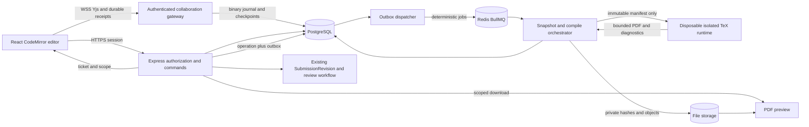

# ADR 0001: native collaborative LaTeX with durable snapshots and isolated compilation

Date: **2026-10-14**. Status: **accepted; Option A is implemented** with CodeMirror 6 + Yjs in `apps/web` and a custom authenticated `ws` WebSocket gateway in `apps/backend/src/modules/workspaces/manuscript-collaboration.ts` (Hocuspocus, the first candidate named below, is not used; it is not a dependency). The comparison and release-gate sections below are the original decision record and have not been re-verified against the implementation; where they describe the repository as lacking a CRDT gateway or compiler, that was true on the decision date only. See `docs/manuscript-compilation.md` for the compiler.

Related (original proposal documents, since removed from the repository): the workspace architecture audit, API contracts and implementation plan dated 2026-10-14.

## Context and decision

LumiGap eventually needs simultaneous manuscript editing **inside its own interface** for authorized project owners/members. Mentors provide scoped feedback; formal reviewers assess immutable output versions. Neither relationship grants source editing. Public registration makes every imported file and compile input untrusted.

The repository currently has React 18/Vite, Express/Node 22, PostgreSQL/Prisma, Redis/BullMQ, private PDF storage, section revisions and a substantial formal-review workflow. It has no manuscript CRDT gateway or safe TeX execution service. Its structured DraftWorkspace is useful for legacy drafting/import; section-level optimistic saves do not provide simultaneous editing.

**Select Option A:** CodeMirror 6 + Yjs, a maintained authenticated collaboration gateway (Hocuspocus is the first candidate), PostgreSQL binary persistence, and a separate disposable compiler execution boundary. Keep identity, project policy, storage and output/review authority in LumiGap. Add process boundaries for sockets and untrusted compilation, not a microservice for each domain.

The selection is conditional: the prototype must prove durable receipts, coherent snapshots, revocation and crash recovery without relying on an unsupported assumption about provider hooks. If it cannot, keep writing private/disabled and revisit the adapter or procurement decision. **Option C** is a useful interim export. **Option B** remains an alternative requiring a separately approved integration and operating budget.

## Options compared

The table distinguishes vendor capabilities from integration LumiGap would still have to build. No cost or feature tier is inferred from consumer Overleaf subscriptions.

| Dimension | A — native CodeMirror + Yjs | B — licensed/self-hosted Overleaf Server Pro | C — external Overleaf Cloud handoff |
| --- | --- | --- | --- |
| User experience | Native React source editor, file tree, shared cursors and PDF panel; LumiGap owns the integration | Complete editor product; supported embedding/rebranding/session integration must be confirmed with vendor | Opens an external project; fails eventual inside-LumiGap editing requirement |
| Licensing | CodeMirror, Yjs, CM binding and Hocuspocus core have MIT licenses; audit pinned dependency/transitive licenses | Commercial Server Pro agreement, distinct from Cloud subscription; verify license scope and procurement | Provider account/plan/terms apply; no implied license to embed/fork service |
| Authentication | Reuse current session authority; short room ticket; live project membership/epoch checks | Supported SAML/LDAP options and separate Overleaf accounts; SSO authenticates identity, not LumiGap membership | External identity and project sharing managed by users; LumiGap revocation cannot revoke downloaded/exported copies |
| Project permissions | One project policy; mentors/reviewers get immutable packets, not editor rooms | Overleaf role model needs explicit mapping, provisioning and removal/owner-transfer tests; no automatic equivalence to academic review | User responsible for external collaborator invitations; no claim of synchronized ACLs |
| Realtime | Yjs convergence, CM binding/presence; gateway authorization, durability and operational limits are our work | Product provides collaboration; private project revocation, scale and native integration still require acceptance | Provider collaboration after handoff; changes do not flow back automatically |
| Persistence | PostgreSQL binary journal/checkpoints; source snapshots for compile; durable acknowledgement must be built/proven | Additional product databases/files/history; separate backup and integration responsibilities | Provider owns live state; LumiGap keeps exported snapshot and manually imported immutable return |
| Safe compilation | Dedicated hardened runtime, allowlisted toolchain and resource quotas; no shell escape/network | Server Pro provides sandboxed-compilation mechanism; operator must configure/isolate it correctly | Provider compiles externally; export explicitly discloses selected source/assets |
| Complexity | Moderate editor/gateway engineering; substantial compiler security and reliability work; fits existing data stack | Less editor engineering, more product operations, separate stack, identity and permission integration | Lowest platform operations; manual workflow and reconciliation |
| Hosting/cost | Socket memory + journal I/O + compiler CPU/RAM + object/PITR storage + on-call engineering | Quote/license + product services + compile hosts + backup + integration/on-call costs | External plan costs/limits vary; export storage/egress and manual support remain |
| Templates | Allowlisted TeX Live engines/packages/fonts pinned by image; arbitrary network/package installs unsupported | Broad TeX ecosystem; test required engine/packages/fonts and sandbox constraints | Depends on provider toolchain/plan; returned PDF must pin actual source/toolchain information where available |
| PDF preview | Scoped private PDF.js display of a successful immutable CompileRun | Product preview; LumiGap still needs an exact version/PDF bridge for formal review | External preview; uploaded return becomes a new LumiGap output version |
| Version history | CRDT recovery state, source checkpoints and existing SubmissionRevision each have distinct purpose | Product history is useful but not a substitute for LumiGap's pinned reviewable output | No linked history guarantee; export/import events and hashes provide provenance |
| Mentor/review integration | Direct existing FeedbackRequest/SubmissionRevision/ReviewerAssignment model | Keep LumiGap feedback/reviews canonical; verify version export and editor access separation | Manual PDF/source return; reviewers stay in LumiGap |
| Backup/recovery | PG WAL/PITR + source/output objects + journal restore/compaction tests | Consistent backup of its own database, Redis and files, and restoration of product plus LumiGap links | Provider backup terms plus LumiGap export retention; no platform promise for external edits |

### Official evidence and licensing boundaries

- CodeMirror's documented native collaboration example uses operational transformation. Choosing its Yjs binding is an explicit CRDT integration choice, not evidence that CM6 defaults to Yjs. [CodeMirror collaboration](https://codemirror.net/examples/collab/).
- CodeMirror is MIT-licensed; Yjs and its CM6 binding publish MIT licenses. Preserve notices and verify the pinned versions and TeX/font/template licenses at implementation time. [CodeMirror](https://codemirror.net/), [Yjs license](https://github.com/yjs/yjs/blob/main/LICENSE), [CM6 binding](https://github.com/yjs/y-codemirror.next).
- Hocuspocus core is MIT. Its authentication hooks support application-provided authorization/read-only connections, and message hooks can reject expired/invalid access. These are integration points, not LumiGap policy or a durability guarantee. Current v4 documentation requires Node 22+. [License](https://github.com/ueberdosis/hocuspocus/blob/main/LICENSE.md), [authentication](https://tiptap.dev/docs/hocuspocus/guides/authentication), [hooks](https://tiptap.dev/docs/hocuspocus/server/hooks).
- Overleaf documents Community Edition for trusted users without Server Pro's sandboxed compiles. CE is AGPL-3.0; do not treat a commercial Server Pro deployment or external Cloud subscription as interchangeable with CE licensing. Unchanged CE is rejected for public multi-tenant compilation. [Edition comparison](https://docs.overleaf.com/on-premises/welcome/server-pro-vs.-community-edition), [CE source/license](https://github.com/overleaf/overleaf).
- Server Pro compilation can use sandbox containers orchestrated through a Docker socket. This creates a privileged administration boundary to isolate; it does not justify mounting the host socket into LumiGap API/worker containers. [Sandboxed compiles](https://docs.overleaf.com/on-premises/configuration/overleaf-toolkit/server-pro-only-configuration/sandboxed-compiles).
- Overleaf has its own owner/editor/reviewer/viewer/site-admin permissions. Its Reviewer role can make suggestions and access source; it is not LumiGap's formal reviewer scope. Supported SSO alone does not mirror project ACLs. [Product roles](https://docs.overleaf.com/on-premises/user-and-project-management/roles-and-permissions).
- A Server Pro installation introduces its own database, Redis and file operations and product-specific backups. It requires a repo architecture exception for the separate vendor stack; Node's PostgreSQL project authority must remain intact. [Infrastructure](https://docs.overleaf.com/on-premises/getting-started/server-pro-infrastructure), [backup guide](https://docs.overleaf.com/on-premises/maintenance/data-and-backups).

No evidence reviewed establishes a supported white-label embedded editor contract or general bidirectional Cloud document API. Treat both as unconfirmed rather than promising them.

## Proposed Option A structure

The gateway and orchestrator are separate processes using existing domain services/contracts; the compile runtime has no direct access to PostgreSQL, Redis, platform storage credentials or user AI keys. A dedicated Linux execution host or appropriately isolated infrastructure is required; a Windows dev shell is not that production boundary.

### 1. One manuscript document first

Use one Y.Doc for the manuscript's bounded textual file tree: stable file IDs, normalized paths, Y.Text per text file, entrypoint and references to immutable binary assets. Single-document sequencing makes a multi-file checkpoint coherent. Avoid one uncoordinated room per file in the first release. Text is edited collaboratively; binary assets never travel as large presence/CRDT blobs.

File create/rename/delete and asset attach use validated domain commands that produce journaled server-origin Yjs changes. Clients must not bypass reserved manifest fields through crafted binary updates; validate mutations or reconcile against a server-owned file registry before accepting a snapshot. All paths/refs are validated again for import, compile and export. A safe failure may block an invalid draft from compiling; it may never grant file access.

Introduce no separate text column that competes with the binary editing authority. Materialized text exists only in an immutable snapshot or disposable read projection. Load the existing binary document, then replay the journal; never reconstruct an existing Y.Doc from plain JSON/text on every connection. Hocuspocus explicitly warns that this breaks merging. [Persistence guide](https://tiptap.dev/docs/hocuspocus/guides/persistence).

### 2. Authentication, authorization and presence

1. Express checks current user/session, project owner/member, account/onboarding, archive state and manuscript generation before issuing a ticket. Ticket TTL proposal: 60 seconds; bounded single-use room/session scope; stored nonce/hash, never an API access JWT in URL/history/logs.
2. Gateway accepts WSS only from allowlisted origins. Bound unauthenticated socket count, handshake time and frame sizes. Consume/validate ticket through a shared authority operation; authenticate before loading any room state or broadcasting presence.
3. Each connection carries user/session/project/manuscript/generation/accessEpoch and short authority lease. User display identity is server-derived; client awareness cannot impersonate another user or inject rendered HTML. Presence discloses only current room collaborators.
4. Membership removal, archive and session revocation emit eviction signals. Enforce expiry and authority on message admission, before sensitive delivery and at persistence commit. Maximum proposed lease is 15 seconds with proactive eviction; if authority is unavailable, freeze/close instead of extending it. Logout/refresh-family revocation must disconnect rooms, not merely expire a future ticket.
5. On normal token expiry, obtain a fresh session/ticket and reconnect without losing the in-memory unacknowledged edit buffer. Revoked users may retain their own local bytes but cannot merge them back or read new state. Do not clear another member's saved history.
6. Only current owner/member EDIT tickets join the live room initially. Mentors/reviewers use packet/PDF feedback, no shared editor account or write-capable link. A purpose-bound read grant for an admin should use a scoped snapshot viewer first, avoiding a hidden editor-room bypass.

The design follows OWASP's transport, origin, message validation, session revalidation and resource-limiting guidance; no connection is authorized solely because a room ID is hard to guess. [WebSocket security](https://cheatsheetseries.owasp.org/cheatsheets/WebSocket_Security_Cheat_Sheet.html).

### 3. Durable editing is a separate protocol requirement

Yjs updates are binary and designed for commutative/idempotent merging; that does not mean a received update is committed to PostgreSQL. [Update semantics](https://docs.yjs.dev/api/document-updates). Hocuspocus's usual `onStoreDocument` is debounced; provider sync can precede a database save. **Never label the default provider sync event “Saved.”** [Persistence lifecycle](https://tiptap.dev/docs/hocuspocus/guides/persistence).

Proposed durable adapter:

1. Admit and bound the authenticated update envelope; identify client session/sequence, generation and bytes/hash. Account for protocol sync messages and server-origin updates, not only editor change callbacks.
2. Serialize a manuscript's writes under a fenced writer/generation. In a short transaction, recheck current authority, assign a server sequence, insert ManuscriptUpdate and unique client-command receipt, then commit. No external calls under locks.
3. Apply/broadcast accepted bytes and issue a receipt **only after** the covered bytes are durably committed. If the selected stack applies/broadcasts earlier, peers must mark those bytes provisional and the adapter must reconcile after failure; persist-before-broadcast is the preferred release gate.
4. Receipt includes generation, clientSessionId, contiguous throughClientSequence and throughServerSequence. Receipt is independent from awareness or provider state-vector synchronization. A client is Saved only when all its submitted edits and required causal state are covered. Missing dependencies remain Syncing, even if some update bytes are journaled.
5. On DB failure/backpressure, stop acceptance and do not issue success. On crash after commit but before receipt, reconnect resends the same command; unique receipt/hash makes it safe. A reused sequence with different bytes is rejected. No phantom successful save.
6. Rebuild from binary checkpoint plus ordered committed updates. CRDT merge may tolerate duplicate/out-of-order delivery; application receipt sequences and coherent snapshot eligibility still require explicit handling of gaps/dependencies.
7. Compact to a binary checkpoint at sequence N, verify reconstruction/hash and transactionally move its pointer; retain journal until the checkpoint and backup policy make deletion safe. Source snapshots/review outputs remain independent retained records.

**Prototype requirement:** verify pinned Hocuspocus/provider extension semantics for framing, actor attribution, validation, persistence gating and custom receipts. Hooks are available, but their mere presence is not proof of correct ordering. If a supported adapter cannot enforce these rules, choose a smaller maintained Yjs gateway integration that can; do not fork a large server unnoticed or weaken durability to fit a hook.

Initially run one authoritative collaboration gateway instance, or one fenced writer per room with explicit routing. Redis pub/sub may carry presence/revocation hints, not canonical edit durability. Do not scale several in-memory room owners by merely putting them behind a load balancer. Replica failover, fencing and routing require separate load/crash acceptance before horizontal rollout.

### 4. Coherent source snapshots

`ManuscriptSnapshot` freezes a full manifest at one **committed, reconstructible** server sequence, with generation, state vector/binary hash, normalized file paths, text bytes/hashes, entrypoint and validated immutable asset hashes. Do not read files at different live moments.

The client requests a snapshot after its own durable receipt and supplies a minimum sequence. A snapshot worker reconstructs state at an exact committed sequence ≥ that minimum, validates dependencies/manifest and stores immutable source objects plus manifest. The returned sequence makes concurrent edits explicit. If peers continue writing, their later edits remain in the live document and do not alter the snapshot. Snapshot labels are labels, not a competing human version counter.

Object upload and PostgreSQL are not a distributed transaction. Use FileObject upload intents, content-addressed private objects, final hash/size verification, and a database manifest commit only when all inputs exist. Retry/orphan reconciliation handles crashes. A run cannot point to an incomplete/quarantined object. Restore creates a new generation/draft with provenance and reconnects editors deliberately; it never resets a currently active room silently.

### 5. Safe compilation boundary

TeX is executable, adversarial input. `-no-shell-escape` alone does not contain filesystem reads, engine vulnerabilities or resource exhaustion. The following are proposed mandatory controls, not claims about an existing compiler.

| Boundary | Required control |
| --- | --- |
| Input | Compile only immutable snapshot IDs resolved by a trusted worker. No user-provided host paths, command strings, arbitrary URLs, executable templates, `.latexmkrc`, custom build scripts or hooks. Fixed argv and selected engine; no shell interpolation. |
| Toolchain | Pinned engine/image/package/font digest; preinstalled approved dependencies. No runtime package download; restricted TeX read/write settings; no shell escape/restricted shell escape. LuaTeX requires the same containment and may be disabled initially. |
| Filesystem | Read-only trusted toolchain/root, disposable writable work/tmp, unprivileged UID, no host/user directories, secrets, service credentials or Docker socket. Validate path/link rules and output paths again. |
| Network | No inbound or outbound sandbox network, including metadata service/DNS. Worker stages only approved input; sandbox cannot fetch storage objects or call an LLM. |
| Isolation | Dedicated Linux compiler boundary with strong workload isolation such as gVisor or microVMs, dropped capabilities, no-new-privileges, seccomp and read-only mounts. A stock container alone is not the full multi-tenant isolation claim. |
| Resources | Hard wall/CPU/memory/PID/scratch/input/output/page/log/file-count limits, concurrency quotas, cancellable process tree. Prevent fork/recursive-macro/file-output bombs from affecting neighbors. |
| Output | Copy out only allowlisted regular PDF and capped sanitized diagnostics through a trusted boundary; verify magic/hash/size and reject links. No shell files, arbitrary working files or embedded local paths in API responses. |
| Lifecycle | Destroy runtime/scratch on completion/timeout/cancel. Recheck authorization before publishing; keep intent/cleanup recovery. Never retry a failure with greater privilege. |

Initial **measurement defaults**, centrally validated configuration rather than product promises: 20 MiB compressed ZIP, 100 MiB expanded input, 200 files, 10 MiB total text; one active compile/manuscript, at most two/user; 60-second wall timeout, 1 vCPU, 512 MiB memory, 64 PIDs, 256 MiB scratch, 25 MiB PDF and 1 MiB captured log. Adjust only after template and abuse tests; quota enforcement includes expanded and generated data. Bounds at reverse proxy, API, gateway, worker and sandbox must agree.

Allowed first templates should include one article, one proposal and one FPT-oriented thesis template **only if licensing/compatibility is verified**. Package/font/template licenses are separate from MIT editor licensing. Document unsupported packages or biber/special tools; add an allowlisted fixed bibliography step only when needed. Never let a template select an arbitrary executable. [OWASP upload controls](https://cheatsheetseries.owasp.org/cheatsheets/File_Upload_Cheat_Sheet.html), [gVisor architecture](https://gvisor.dev/docs/).

### 6. Preview, feedback and review versions

Use a patched PDF.js viewer with accessible loading/error states, zoom/page navigation and synchronized diagnostics where source locations are reliable. Preview downloads reauthorize the exact project/run/file; avoid permanent storage URLs or an iframe to arbitrary user HTML. Render sanitized compiler messages as text. Privacy headers and viewer behavior must not expose bearer tokens in Referer or third-party requests.

CompileRun links one source snapshot and toolchain to one successful PDF/hash. A human seals that package into the existing **SubmissionRevision**, including research metadata/author snapshot and references to manuscript/snapshot/compile. SubmissionRevision is the sole human output version authority; no OutputVersion clone. The live editor may continue changing.

Mentor FeedbackRequest shares selected immutable output/context, with exact page/quote/source anchors if allowed. Formal ReviewRequest pins the chosen SubmissionRevision and published template version. Existing ReviewerAssignment may move to a new revision/round on resubmit; submitted HumanReview remains pinned to the old revision. Reviewers never review “whatever the editor currently contains.”

### 7. Backup, recovery and cost controls

- PostgreSQL retains journal/checkpoint/receipt manifests and output/review references with WAL/PITR. Private object storage retains referenced source/assets/PDFs; test restores with checksums and encryption-key recovery. Redis loss must not lose acknowledged edits or sealed outputs.
- Define primary-boundary edit RPO: **zero for acknowledged edits**, assuming the promised PostgreSQL durability boundary. A single-node disk loss without synchronous replica/backup is a different failure domain; do not advertise universal RPO zero. Proposed disaster-backup target: RPO ≤15 minutes, RTO ≤4 hours, subject to actual platform configuration/restore drills.
- Restore includes document reconstruction, no duplicate content, exact output/PDF hashes, private grant integrity and job reconciliation. Prevent old generation replay and revoke tickets after restore. Test compaction concurrent with editing, gateway crash, stale fence, storage outage and lost queue.
- Keep compile scratch ephemeral; cap retained failed artifacts/logs and export TTL. Preserve all files referenced by retained versions/reviews. Storage GC traces references, holds and upload intents, not file age alone.
- Measure socket/document heap, journal write rate/size, checkpoint/restore latency, compile CPU/RAM/time/failure rate, storage growth/egress and queue delay. Quotas and fair scheduling precede public rollout. Avoid auto-compilation on each keystroke and do not describe open-source licenses as zero operating cost.

## Option B conditions before reconsideration

Request a vendor-supported plan covering native embedding/branding, SAML/LDAP/session logout, project provisioning and owner transfer, revocation latency, source-versus-PDF permissions, immutable version/PDF export, incident/admin access policy, license scope, upgrade support, regional hosting, accessibility and total cost. Do not assume a hidden product API is a supported integration.

Rehearse permission mapping with users who are members of multiple LumiGap projects and with removed/expired lecturers. Disable anonymous read/write sharing. Keep product site-admin access and privileged compile orchestration in a restricted administrative environment with audit. The application's ADMIN role must not silently acquire that product privilege.

Plan consistent backup of product stores plus LumiGap's version references, restore drills, separate upgrades/security response and an exit/export strategy. SSO, embedding approval and complete ACL synchronization are **unresolved procurement gates**. This option cannot be introduced as a shortcut around current PostgreSQL-only application conventions.

## Option C interim handoff contract

Overleaf's documented developer entrypoint can import text, a file URL or a ZIP URL into a project. This is an import/handoff. Its GitHub synchronization is a separate plan-dependent push/pull feature; neither establishes a generic real-time bidirectional LumiGap API. [Developer import](https://www.overleaf.com/devs), [GitHub synchronization](https://docs.overleaf.com/integrations-and-add-ons/git-integration-and-github-synchronization/github-synchronization).

Safest first workflow: user requests an authorized immutable source ZIP, downloads it, then uploads it to their Overleaf account. Show export snapshot/hash and external disclosure destination. No new public file bucket or long-lived bearer URL. URL-based handoff requires an explicitly approved expiring fetch token and awareness that Overleaf must access the bytes; private API auth URLs will not work automatically.

Returning work is an explicit new source import or uploaded PDF SubmissionRevision with provenance; no automatic merge, overwrite, ACL synchronization or claimed external history. Conflicts are reviewed by the user. Deleting or archiving the LumiGap project does not revoke an external copy; explain this when choosing export.

## Release gates and consequences

| Gate | Evidence required before enabling public native writing |
| --- | --- |
| Dependency fit | Pinned maintained package versions/license notices and working React18 binding; no unsupported API assumption or dependency upgrade disguised as the audit. |
| Durability | Two clients converge; kill gateway before/after DB commit; replay receipts; all acknowledged edits reconstruct byte-identically after reconnect/restart/compaction. No false Saved state during DB outage. |
| Access | Outsider/mentor/reviewer/admin-room denial; nested-ID attacks; member removal, archive and session revocation during sync/save/snapshot/download; bounded expiry/eviction. |
| Coherence | Multi-file rename/import/asset edits racing snapshot/compile; exact manifest and causal completeness; no missing object or stale generation accepted. |
| Sandbox | Adversarial path/ZIP/link, TeX file read, network, Lua/shell, process/memory/time/log/output bombs; cross-tenant isolation and cleanup; host compromise boundaries assessed. |
| Versions/review | Compile→sealed SubmissionRevision hash agreement; concurrent revision conflict; immutable submitted review pins; mentor feedback cannot mutate source. |
| Operations | Queue/Redis/storage failure, duplicate jobs, worker termination, orphan GC, backup/restore and measured quota/load limits; supported rollback to read/export. |
| UX | Keyboard/file navigation, accessible PDF/editor labels, reduced motion, responsive pane layout, correct focus, safe unsaved navigation, `data-no-i18n` protection around source/editor/quotes. |

Accepted tradeoff: Option A avoids a second academic identity/project authority and matches the native UI requirement, while making LumiGap responsible for collaboration durability and compiler security. It is the smallest **domain integration**, not a claim of trivial implementation. Keep external handoff available and native compilation disabled until the isolation and restore gates pass.
