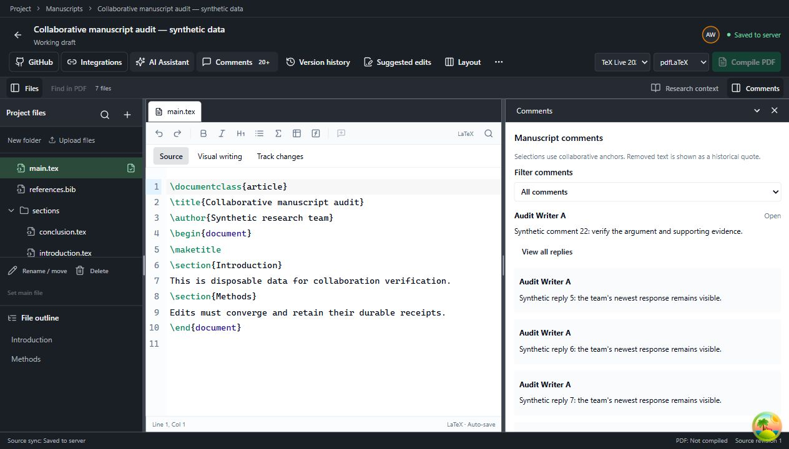
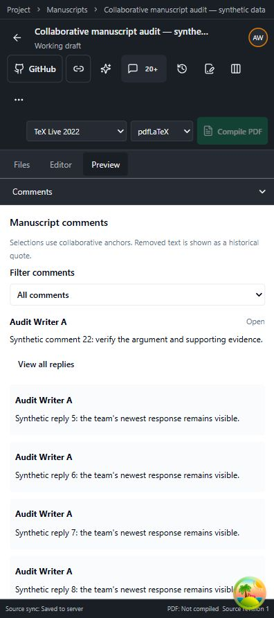

# Kiểm tra không gian cùng viết bản thảo — 23/10/2026

> Đã có [kết quả kiểm tra bổ sung](2026-10-23-manuscript-collaboration-recheck.md) với các lỗi mới, bản sửa và số test cập nhật. Các số liệu bên dưới là của lần kiểm tra đầu.

## Phạm vi và điều kiện kiểm tra

URL được yêu cầu: `http://localhost:8080/projects/6ab33f1537802fe30d38753b/manuscripts/a575ed8e-db29-4715-9669-821f43d65bba`.

Đã rà mã frontend, API, WebSocket, quyền truy cập, lưu và khôi phục nguồn Yjs, bình luận, đề xuất chỉnh sửa, snapshot, xuất/khôi phục và biên dịch PDF. Không chỉnh sửa nội dung bản thảo thật hoặc thay đổi thành viên/quyền của dự án.

Phiên trình duyệt kiểm tra nhận HTTP 404 khi mở cả dự án và bản thảo thật. Kiểm tra chỉ đọc trong PostgreSQL xác nhận dự án và bản thảo vẫn tồn tại, bản thảo thuộc đúng dự án, ở chế độ LATEX và chưa bị xóa. Vì vậy, không thể xác nhận thao tác trên nội dung thật bằng phiên đăng nhập này. Các tương tác ghi và kiểm thử tích hợp dùng tài khoản, dự án và cơ sở dữ liệu dùng riêng cho kiểm thử.

## Những lỗi đã sửa

| Mức | Vấn đề | Sửa đổi |
| --- | --- | --- |
| P1 | Recovery tự xóa thay đổi chưa được máy chủ xác nhận khi quá 1.000 update hoặc quá 7 ngày. | Giữ bản nháp cho đến khi nhận đủ receipt hoặc người dùng đăng xuất; không dùng chính sách hết hạn cache cho dữ liệu chưa lưu. |
| P1 | Có thể bỏ lỡ thay đổi được commit trong lúc một người đang tham gia phòng WebSocket. | Đăng ký vào phòng sau bước xác thực đầu tiên, rồi đọc lại checkpoint; thay đổi trước khi tham gia nằm trong checkpoint, thay đổi sau đó đến qua broadcast. |
| P1 | Người phản biện chính thức có thể đọc trao đổi nội bộ gắn với snapshot đã được chia sẻ cho phản biện. | Endpoint bình luận không trả thảo luận nội bộ cho quyền formal reviewer. Quyền đọc nguồn đã niêm phong và quy trình phản biện chính thức được giữ theo grant hiện có. |
| P2 | Kết nối mở nhưng không có checkpoint/receipt khiến trạng thái lưu có thể treo. | Sau 10 giây không nhận phản hồi đồng bộ, kết nối lại và gửi lại cùng định danh receipt, giữ nguyên hàng đợi. |
| P2 | Frame đến không theo thứ tự có thể làm số phiên bản file lùi; receipt có thể làm giao diện mất trạng thái chỉ đọc. | Sequence và fileVersion chỉ tăng; receipt tôn trọng quyền canWrite hiện tại. |
| P2 | Chuyển từ bản nháp sang snapshot có thể tái sử dụng trạng thái editor/outline của nguồn đang viết. | Tách vòng đời workspace theo tài khoản, dự án, bản thảo và snapshot; outline và main file lấy từ manifest snapshot. |
| P2 | Lỗi refresh metadata nền có thể tháo editor đang chứa phần chưa lưu. | Giữ editor khi còn dữ liệu cũ, hiển thị lỗi và nút thử lại. |
| P2 | Chỉ 200 thread và 1.000 trả lời đầu tiên được đọc, làm bình luận/trả lời mới biến mất. | Thêm API phân trang cursor 20 thread, hiển thị mới nhất trước; tải thêm bình luận cũ và xem toàn bộ trả lời theo trang. |
| P2 | Reply chưa gửi biến mất khi chuyển bảng hoặc đổi bộ lọc. | Giữ component bình luận trong workspace khi ẩn; bổ sung cảnh báo rời trang cho reply và kết luận chưa gửi. |
| P2 | Hai thao tác mutation có thể bắt đầu trước khi React cập nhật trạng thái busy. | Dùng ref chặn thao tác đồng thời, giữ định danh retry và khóa ô nhập khi gửi. |

## Cải thiện xử lý dữ liệu

- Recovery bỏ các checkpoint còn nằm trong hàng đợi khi đã có checkpoint mới hơn bao gồm toàn bộ pending receipt. Test với 1.001 thay đổi liên tiếp xác nhận tối đa hai lần ghi recovery trong tình huống này.
- Đọc trả lời bằng `CROSS JOIN LATERAL ... ORDER BY created_at DESC, id DESC LIMIT 21` cho từng thread, tận dụng chỉ mục `(thread_id, created_at, id)` hiện có. Trả 20 dòng mới nhất và dùng dòng dư để xác định còn lịch sử.
- Gom trả lời theo thread bằng `Map`, tránh quét lại toàn bộ mảng trả lời cho từng thread.
- Cursor được kiểm tra thuộc đúng dự án, bản thảo/snapshot và phạm vi mentor trước khi dùng. SQL dùng tham số Prisma; không ghép dữ liệu người dùng vào chuỗi SQL.

## Bằng chứng kiểm thử

| Nhóm | Kết quả |
| --- | --- |
| Frontend manuscripts, 26 file | 135 test đạt |
| PostgreSQL manuscript persistence | 22 test đạt |
| HTTP routes, gồm validation/scope cursor mới | 15 test đạt |
| Race khi tham gia WebSocket, server và socket thật | 1 test đạt |
| Sáu người viết đồng thời, reconnect/replay, thu hồi quyền/session | 1 test đạt |
| Tài khoản/project có ID cũ sau chuyển PostgreSQL | 3 test đạt |
| HTTP + BullMQ + Redis + TeX Live 2022 thật | 20 test đạt; 3 test dành cho TeX Live 2025 được bỏ qua do không cấu hình compiler 2025 cho fixture |
| PostgreSQL runtime boundary | 4 test đạt |
| Typecheck web/backend; lint các file thay đổi; diff whitespace | Đạt |
| Build shared types, backend, web | Đạt |

Các test quan trọng bao gồm:

- Giữ hơn 1.000 thay đổi chưa xác nhận và bản recovery cũ hơn 7 ngày.
- Gửi lại cùng receipt sau mất phản hồi; không hạ phiên bản file bởi frame cũ.
- Đọc đủ 201 thread, giữ trả lời thứ 1.001 và từ chối cursor từ dự án khác.
- Cô lập trao đổi nhóm với formal reviewer; giới hạn mentor theo snapshot đã được chia sẻ.
- Snapshot bất biến, restore sang bản nháp mới, giữ nguồn và asset đúng phiên bản.
- Đề xuất chỉnh sửa không thay nguồn trước khi chấp nhận; cạnh tranh autosave/accept và quyền tác giả.
- Biên dịch các template, tiếng Việt, bibliography, hình ảnh; SyncTeX hai chiều; timeout/lỗi nguồn vẫn giữ PDF thành công trước đó.

Trình duyệt trên dữ liệu thử đã xác nhận: tải thêm đủ 22 bình luận; xem toàn bộ 24 trả lời và trang cuối; chuyển bảng/đổi bộ lọc vẫn giữ reply đang gõ. Đã quan sát giao diện desktop và màn hình 412 × 892.

## Những phần còn cần cải thiện

1. **Xác nhận quyền trên URL thật:** cần mở lại bằng tài khoản có quyền trong dự án để kiểm tra nội dung và trạng thái cộng tác của bản thảo này. Không tự thêm quyền để vượt qua lỗi 404.
2. **Lịch sử dài:** danh sách bản thảo và danh sách snapshot vẫn giới hạn 100 mục. Nên thêm phân trang trước khi dùng với dự án nhiều năm hoặc tạo snapshot thường xuyên.
3. **Chạy nhiều API instance:** phòng WebSocket và presence hiện ở bộ nhớ của một tiến trình. Cần cơ chế phân phối sự kiện giữa các instance trước khi mở rộng gateway; lưu nguồn PostgreSQL không tự giải quyết việc chuyển broadcast giữa các tiến trình.
4. **Ma trận compiler:** chưa chạy ba kịch bản TeX Live 2025 trong fixture của đợt này. Cần chạy chúng trong môi trường có endpoint 2025 riêng.
5. **Giao diện lỗi lúc mở lần đầu:** trang unavailable vẫn dùng thông báo chung. Có thể bổ sung phân biệt lỗi mạng và quyền truy cập, cùng nút thử lại tại màn hình này.
6. **AI và tích hợp ngoài:** chưa đánh giá chất lượng lập luận khoa học của AI hoặc ghi lên GitHub/Overleaf thật. Không có yêu cầu AI trả phí hoặc ghi lên kho bên ngoài trong đợt kiểm tra này.

## Bản chạy local

Đã build và cập nhật image local cho backend/web, khởi động lại API và hai worker liên quan bằng cả hai file Compose. Health API và web trả HTTP 200; gọi `auth/me` khi không đăng nhập trả 401 đúng dự kiến. Không thay schema, không thêm migration, không commit hoặc push.

Các server, database và container dành riêng cho fixture được dọn sau kiểm tra. Bản thảo thật được giữ nguyên.
