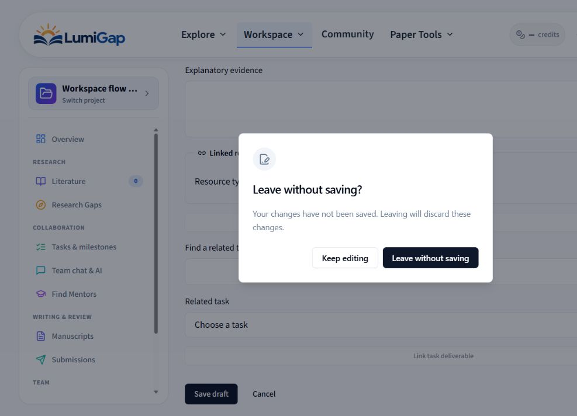
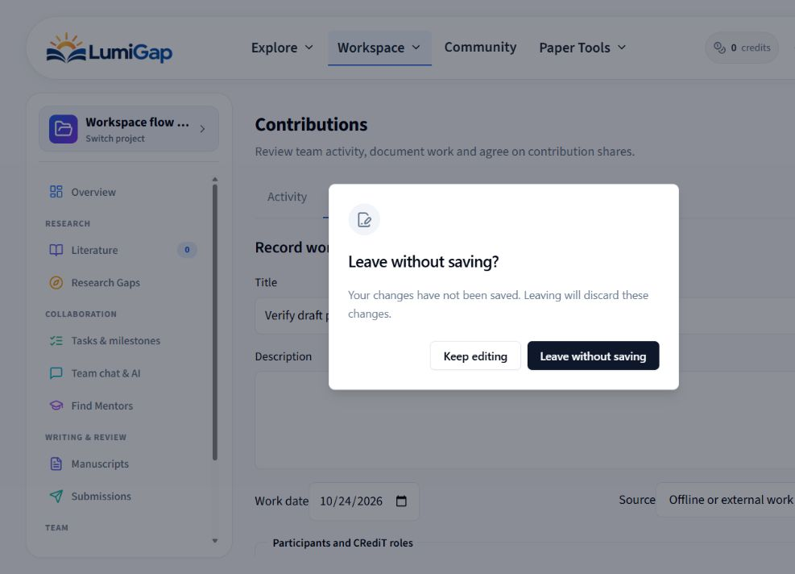

# Kiểm tra luồng làm việc trong dự án — 24/10/2026

## Phạm vi và điều kiện kiểm tra

Đợt kiểm tra này rà soát hữu hạn 11 mục trên sidebar cùng luồng chuyển dự án: điều hướng, quyền truy cập, dữ liệu cache, bản nháp, thử lại yêu cầu, phân trang và các thao tác đồng thời. Việc xác minh gồm đọc mã, test frontend, test backend trên môi trường dùng riêng cho kiểm thử, TypeScript, lint và build.

URL bản thảo thật được ghi trong [báo cáo kiểm tra bản thảo lần đầu](2026-10-23-manuscript-collaboration-audit.md) tiếp tục trả HTTP 404 trong phiên đăng nhập hiện tại. Không thay thành viên, cấp thêm quyền hoặc bỏ qua kiểm tra truy cập để mở URL đó. Không chỉnh sửa nội dung thật của người dùng.

Các ca ghi dùng fixture kiểm thử. Provider AI được mock; không gọi AI trả phí, không tiêu credit và không gửi email. Không commit hoặc push. Kết quả dưới đây mô tả phạm vi đã kiểm tra ở mã và test; phần trình duyệt dùng API thật và bản triển khai cuối được ghi riêng ở cuối báo cáo.

Phần cùng viết bản thảo có bằng chứng chi tiết tại [báo cáo lần đầu](2026-10-23-manuscript-collaboration-audit.md) và [báo cáo kiểm tra lại](2026-10-23-manuscript-collaboration-recheck.md). Số test trong hai tài liệu đó thuộc các lần chạy trước, không cộng vào tổng của đợt này.

## Bảng phạm vi 12 luồng

| Luồng | Nội dung đã kiểm tra | Kết quả trong phạm vi đợt này |
| --- | --- | --- |
| Chọn/chuyển dự án | Desktop, mobile, tìm kiếm, project ID cũ, tham số bản ghi thuộc dự án trước, bản nháp đang mở | Dữ liệu detail mới cập nhật sidebar; chuyển dự án loại bỏ ID bản ghi cũ; mobile hỏi trước khi bỏ bản nháp. |
| Overview | Quyền hiện tại, số lượng thành viên/tài liệu, giai đoạn, liên kết tài nguyên gần đây | Cache được làm mới sau mutation; chỉ đưa bản thảo LATEX còn tồn tại vào danh sách gần đây và bộ chọn tài nguyên. |
| Literature | Đọc đúng nguồn, thêm/lọc nguồn, trạng thái screening, liên kết từ kết quả discovery | Tham số `source` mở đúng reader, nhận cả ID chuẩn và alias cũ; đóng reader xóa tham số nguồn. |
| Research Gaps | Screening, evidence, tổng hợp, đánh giá gap và provenance trong luồng nghiên cứu kết hợp | Tìm kiếm, đổi bộ lọc, phân trang và đổi nguồn extraction giữ cảnh báo bản nháp; các test hiện có kiểm tra phiên bản, provenance và quyền. |
| Tasks & milestones | Tạo/sửa/xóa, thử lại, cập nhật đồng thời, quyền tại thời điểm ghi | Giữ receipt cho cùng nội dung retry; tạo milestone không trùng; retry xóa giữ provenance gốc; kiểm tra lại quyền trong transaction. |
| Team chat & AI | Gửi tin, retry, lịch sử Team/AI, thứ tự, cursor, bản nháp theo kênh | Lịch sử tải thêm giữ tin mới; thứ tự ổn định khi trùng thời gian; chặn cursor khác dự án; phản hồi AI đến muộn giữ nội dung mới gõ. |
| Find Mentors | Trạng thái discovery, chỉnh preference, tải lại nền, phiên bản và bản nháp | Lỗi refetch không tháo form đang sửa; bản nháp và phiên bản gốc được giữ để người dùng xử lý rõ ràng. |
| Manuscripts | Đổi tên/xóa file, file bị xóa từ xa, buffer visual/tracked, bình luận và lỗi tải đầu | Thao tác giữ đúng file đích; buffer chưa lưu của file đã xóa còn đọc/copy được; có Retry; quyền và comment giữ các kiểm tra đã nêu trong báo cáo bản thảo. |
| Submissions | Tạo trong đúng dự án, quyền theo thao tác, race ghi/thu hồi quyền, revision của blind reviewer và nguồn LATEX | Tách quyền revision/review/AI; chỉ trả AI pre-review cho revision được phân công; gửi nguồn LATEX đã niêm phong và giữ snapshot khi khôi phục revision. |
| Team & settings | Owner/member, archived, form general/privacy, lời mời và phân trang Team | Form giữ bản nháp khi dữ liệu mới đến; quyền ghi bị giới hạn đúng vai trò; trang thành viên/lời mời tự lùi khi tổng số trang giảm. |
| Contributions | Ghi nhận công việc, kỳ phân bổ, đề xuất tỷ lệ, retry và đổi quyền trong lúc mở form | Cùng nội dung dùng cùng receipt; sửa nội dung tạo receipt mới; khóa gửi đồng thời; giữ bản nháp khi mất quyền hoặc dự án chuyển chỉ đọc. |
| About project | README, autosave, version/conflict, bản nháp chưa đồng bộ, chia sẻ revision cho mentor | Kiểm tra lưu/merge và phạm vi share; bản nháp tham gia cảnh báo rời workspace; rà soát backend không tìm thêm lỗi cụ thể trong phạm vi này. |

## Các lỗi chính đã sửa

### 1. Điều hướng, cache và quyền trên sidebar

- Sidebar dùng detail mới của dự án cho tiêu đề, số lượng và quyền truy cập khi danh sách thư viện còn đang refresh. Một dòng thư viện cũ không tiếp tục mở các mục nội bộ sau khi detail trả về public summary.
- Nếu API detail trả 403/404, tiêu đề và điều hướng nội bộ từ cache cũ cũng bị ẩn. Lỗi mạng tạm thời không bị đánh đồng với việc mất quyền.
- Mutation làm mới các query dự án liên quan. Trang bắt đầu chờ dữ liệu đang invalidate trước khi tự chọn dự án tiếp theo, tránh chọn lại dự án vừa rời hoặc xóa.
- Chuyển dự án giữ tìm kiếm và mục đang xem, loại bỏ các ID submission/revision/source thuộc dự án trước. Mobile selector gọi cùng cơ chế xác nhận rời workspace; chọn lại dự án hiện tại không hỏi thừa.

### 2. Nghiên cứu và tài nguyên đã xóa

- Search, filter và Previous/Next trong screening/evidence từng thay hàng dữ liệu và tháo form rationale chưa lưu. Các thao tác này hiện xác nhận trước khi thay query; đổi nguồn extraction cũng bảo vệ nội dung đang soạn.
- Kết quả discovery tạo liên kết `tab=papers&source=...`; Literature hiện đọc tham số này và tìm đúng paper qua ID chuẩn hoặc alias cũ. Nguồn được yêu cầu không bị xóa khỏi lựa chọn trong lúc danh sách chưa tải xong.
- Overview lấy ba bản thảo LATEX còn tồn tại theo thứ tự cập nhật ổn định. Bộ chọn manuscript và snapshot loại các bản thảo đã xóa hoặc chế độ legacy, khớp điều kiện truy cập của dịch vụ manuscript.

### 3. Bản nháp, receipt UUID và thao tác đồng thời

- Comment, ghi nhận công việc, kỳ phân bổ và đề xuất phân bổ giữ UUID cho lần retry cùng nội dung. Khi nội dung thay đổi sau lỗi, yêu cầu có UUID mới để tránh xung đột với receipt cũ.
- Khóa thao tác đồng bộ và khóa ô nhập khi đang gửi ngăn hai lần submit trước khi React cập nhật trạng thái pending. Cancel và điều hướng bảo vệ bản nháp còn mở.
- Nếu quyền owner/member bị thu hồi hoặc dự án chuyển archived trong lúc form đang mở, nội dung vẫn được giữ để đọc/copy và thao tác lưu bị chặn.
- Backend milestone xử lý retry tạo theo receipt ban đầu, kể cả khi bản ghi đã được sửa sau đó. Retry xóa giữ thông tin xóa gốc; quyền được kiểm tra lại trong transaction sau bước preflight.

### 4. Team chat, lịch sử AI và phản hồi đến muộn

- Lịch sử Team và AI hỗ trợ tải thêm thay vì giới hạn người dùng ở phần gần nhất. Team chat dùng thời gian cùng ID; AI dùng thứ tự `(createdAt, role desc, id)` để câu hỏi đứng trước câu trả lời khi trùng thời gian. Truy vấn cursor giữ độ chính xác timestamp PostgreSQL và được kiểm tra trong đúng dự án/conversation/người dùng. Ngữ cảnh gửi cho AI dùng cùng thứ tự ổn định này.
- Gửi Team chat đồng thời cùng receipt tạo một tin và một activity/notification tương ứng. Payload đã sửa không được tái sử dụng receipt của tin trước.
- Lỗi gửi giữ nguyên bản nháp; nội dung soạn riêng cho Team chat, private AI và Team AI được giữ theo kênh. Phản hồi AI đến sau khi người dùng đã gõ tiếp không xóa phần mới.

### 5. Mentor, submissions và quản lý Team

- Mentor discovery giữ form và phiên bản gốc khi background refetch lỗi, tránh mất preference chưa lưu.
- Submissions kiểm tra riêng quyền upload revision, mời review và AI; cập nhật tiến độ request cùng trạng thái submission. Các nhánh ghi kiểm tra lại quyền trước commit; AI đang chờ hoặc đang chạy bị hủy khi tác giả mất quyền hay dự án bị archive. Blind reviewer chỉ nhận AI pre-review thuộc revision được phân công. AI pre-review của submission LATEX dùng nguồn đã niêm phong; khôi phục revision giữ liên kết manuscript snapshot. Giao diện nhận diện rõ kết quả AI của revision cũ.
- Team từng có thể mắc ở trang 2 trống sau khi xóa thành viên hoặc hủy lời mời cuối cùng làm tổng trang giảm còn 1. Cả hai bộ phân trang hiện điều chỉnh về trang còn hợp lệ. Hai regression test tái hiện lỗi trước bản sửa và đạt sau bản sửa.

## Bằng chứng kiểm thử

| Kiểm tra cuối | Kết quả |
| --- | --- |
| Web: projects, manuscripts, submissions, reviews, academic support và locales | **436/436 test đạt, 57 file** |
| Backend: các tập test có phạm vi không trùng nhau | **179 test đạt**: `59 + 40 + 41 + 5 + 26 + 4 + 4`; gồm **4 test PostgreSQL runtime boundary** |
| TypeScript web/backend | Đạt |
| ESLint các file thay đổi | Đạt |
| Build web/backend | Đạt |
| Kiểm tra whitespace/diff | Đạt |

Một số bằng chứng tập trung trong tổng trên:

- [Research workflow](../../apps/web/src/features/projects/__tests__/research-workflow.test.tsx), [Literature](../../apps/web/src/features/projects/__tests__/project-literature-flow.test.tsx) và các suite gap/synthesis: 73 test frontend đạt; collaborative research cùng overview artifacts: 14 test PostgreSQL đạt trên database dùng riêng.
- [Project switcher](../../apps/web/src/features/projects/__tests__/project-switcher.test.tsx), [Team settings](../../apps/web/src/features/projects/__tests__/project-team-settings.test.tsx), settings forms và members: 23 test đạt, gồm xác nhận chuyển dự án trên mobile và hai ca tổng số trang giảm.
- [Draft/retry](../../apps/web/src/features/projects/__tests__/workspace-draft-retries.test.tsx) kiểm tra receipt, giữ bản nháp, khóa gửi và thay đổi quyền; [sidebar collaboration persistence](../../apps/backend/src/modules/projects/__tests__/project-sidebar-collaboration.persistence.test.ts) kiểm tra gửi đồng thời, cursor trùng timestamp, milestone retry và race thu hồi quyền.

Các nhóm tập trung là tập con của tổng kiểm thử cuối, không cộng thêm vào 436 hoặc 179. Các fixture snapshot có lịch sử append-only được giữ để dọn cùng database kiểm thử; không tắt trigger bảo vệ lịch sử.

## Ảnh kiểm tra giao diện

Ảnh dưới đây là **preview chỉ đọc dùng dữ liệu mock**, thể hiện cảnh báo rời form có bản nháp chưa lưu. Đây là bằng chứng giao diện preview; xác minh fixture với API thật được ghi riêng ở mục tiếp theo.

Ảnh desktop: [`2026-10-24-workspace-draft-guard-desktop.png`](2026-10-24-workspace-draft-guard-desktop.png).

## Trình duyệt với API thật

Chạy Express thật và Vite với PostgreSQL/Redis tách biệt trên `http://127.0.0.1:18888`. Dự án fixture `1158c2c4-0ccb-4362-b062-a21dc84fc105` tên **Workspace flow audit**, dùng tài khoản và dữ liệu tổng hợp. Đây không phải dự án thật của người dùng.

- Mở các mục trên sidebar, bộ chọn dự án, bảng Tasks và Milestones; xác nhận trạng thái trống của Literature, Manuscripts và Submissions, thông tin owner trong Team, cùng nội dung Overview và About.
- Find Mentors tải được danh sách từ database thử; không gửi lời mời.
- Team chat hiển thị kết nối và ô nhập; My AI khóa gửi khi không có paper, không phát sinh yêu cầu provider.
- Tại Contributions → Work contributions, nhập tiêu đề thử rồi chuyển sang Overview: cảnh báo xuất hiện. Chọn **Keep editing** giữ nguyên tiêu đề và mục đang xem. Không lưu đóng góp vào database.
- Không ghi nhận lỗi console trong phiên tab kiểm tra.
- Kiểm tra mobile bằng preview trước đó ghi nhận chiều rộng nội dung 397px trong viewport 412px, không có tràn ngang. Các ca retry, thu hồi quyền, conflict và lịch sử nhiều trang được xác minh bằng regression test; phiên browser này tập trung vào điều hướng và trạng thái hiển thị.

## Bản local sau cập nhật

- Build web/backend và biên dịch TypeScript backend sau thay đổi cuối đều đạt. Tạo lại image local từ output mới, sau đó recreate `backend`, `web`, `worker-ai-jobs` và `worker-manuscript-compile` bằng cấu hình Compose hiện có; reload nginx.
- `http://localhost:4000/health`: **200**.
- `http://localhost:8080/`: **200**.
- `http://localhost:8080/api/v1/auth/me` khi chưa đăng nhập: **401**, đúng kỳ vọng.
- Backend báo **healthy**; web và hai worker liên quan đang chạy.
- Giới hạn truy cập URL thật: lần mở bằng phiên có sẵn trả 404 như đã ghi ở trên; không mở lại bằng cách thay quyền hoặc thay thành viên. Kiểm thử browser của bản sửa dùng fixture riêng.
- Đã đóng tab thử, dừng server cổng 18888, xóa hai container PostgreSQL/Redis dùng riêng và ba helper tạm của lượt kiểm tra. Giữ thư mục build local bị gitignore để tái sử dụng. Không commit hoặc push.

