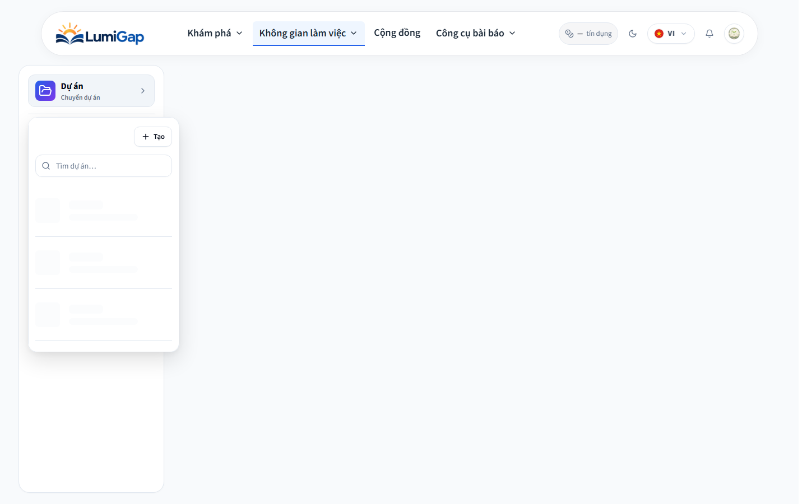
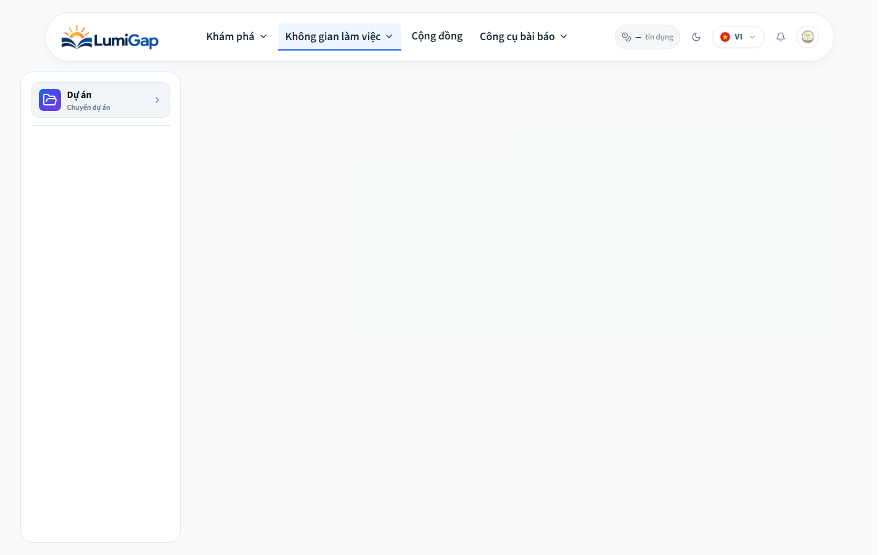
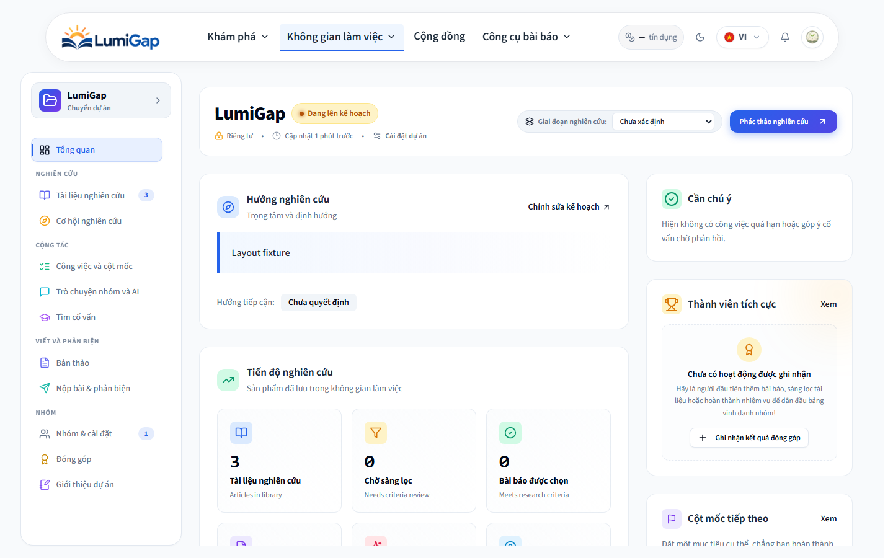

# Bộ chọn dự án tự xổ khi tải lần đầu, 26/10/2026

## Tái hiện

Người dùng báo sidebar xổ xuống vài giây ở lần vào đầu tiên, sau khi vào lại thì hết.

Kiểm thử bằng Chromium với context mới, tiếng Việt, dữ liệu tổng hợp và API GET bị giữ chậm. Các API ghi bị chặn; không dùng tài khoản thật hoặc thay dữ liệu dự án.

- Mở trực tiếp `/projects/6ab33f1537802fe30d38753b`: sidebar giữ nguyên tọa độ và kích thước khi dữ liệu chuyển từ loading sang ready; chưa tái hiện được nhảy bố cục ở nhánh này.
- Mở `/projects` rồi tự chọn dự án: bộ chọn có `open` ngay khi danh sách còn loading. Nó hiện dropdown, sau đó đóng khi chuyển sang dự án được chọn. Lỗi được tái hiện trên bản local trước sửa bằng cả unit test và test trình duyệt.

## Sửa

`WorkspaceSidebar` chỉ tự mở bộ chọn sau khi truy vấn danh sách đã xong và thực sự cần lựa chọn: danh sách rỗng, tìm kiếm không khớp, lỗi danh sách hoặc yêu cầu tạo dự án. Trong lúc tải hoặc tự chuyển vào dự án, bộ chọn giữ đóng. Người dùng vẫn mở thủ công bằng “Chuyển dự án”.

Các thay đổi cũ về cache, quyền, cảnh báo bản nháp và sidebar đang tải được giữ nguyên.

## Xác minh

- **25 unit test đạt**: workspace navigation (16), project switcher (4), route transition (5). Test tái hiện mới đã thất bại trước sửa.
- **2 test Chromium đạt** sau cập nhật local: mở trực tiếp và mở qua directory, context không có cache, asset bị trì hoãn và API được giữ ở loading. Kiểm tra sidebar giữ nguyên `x`, `y`, `width`, `height` với sai số dưới 1px, dropdown giữ đóng, không có page error.
- Trước cập nhật local: test Chromium mở trực tiếp đạt, test directory thất bại vì dropdown còn mở.
- ESLint các file liên quan đạt. `pnpm --filter web build`, gồm TypeScript, đạt.
- Image web local được cập nhật, container web được tạo lại; `http://localhost:8080/` trả **200**. Không cần thay backend hoặc dữ liệu.

Chạy lại test trình duyệt: `pnpm exec playwright test --config apps/web/playwright.config.ts`.

## Ảnh từ fixture kiểm thử

Trước sửa, dropdown tự mở trong lúc chờ:

Sau sửa, lúc đang tải:

Sau khi tải xong:

Đây là bằng chứng từ fixture dùng cùng frontend production tại cổng 8080. Không dùng ảnh này để xác nhận quyền truy cập hay nội dung của dự án thật. Không commit hoặc push.
