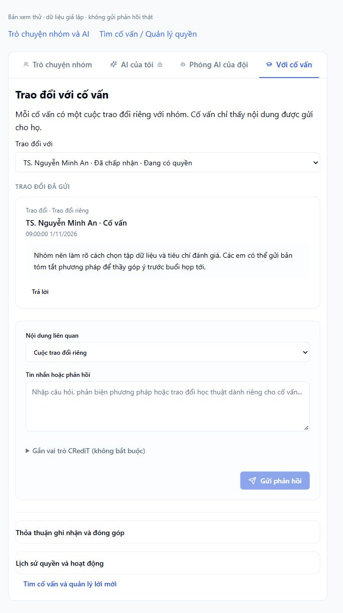

# Tổ chức lại trao đổi với cố vấn

## Quyết định

Đặt cuộc trao đổi trong **Trò chuyện nhóm và AI → Với cố vấn**. Đây là công việc diễn ra sau khi nhận hướng dẫn, khác với tìm người và quản lý lời mời. Tái sử dụng API `mentor-access`, không dùng chat nhóm hay AI để lưu nội dung này.

- `support`: tìm người, lời mời, quyền và nội dung chia sẻ. Có lối tắt mở cuộc trao đổi đúng cố vấn.
- `chat&channel=mentors`: chọn cố vấn, xem lịch sử và gửi phản hồi. Lời mời chưa được chấp nhận không xuất hiện như một cuộc trao đổi.
- `mentorAccess` và `mentorPage` giúp lối tắt mở đúng bản ghi kể cả ở trang sau. Nếu bản ghi không còn khả dụng, không tự chọn một cố vấn khác để gửi.
- Giảng viên tiếp tục sử dụng trang cố vấn riêng và chỉ đọc tài nguyên được chia sẻ. Việc thay vị trí giao diện không mở thêm quyền.

## Giao diện và dữ liệu

- Lịch sử xuất hiện trước biểu mẫu gửi. CRediT là tùy chọn thu gọn, không được chọn sẵn cho tin nhắn thông thường.
- Bỏ select ẩn phục vụ test và dãy chip trùng lặp; dùng một nhóm checkbox có nhãn.
- Vai trò trong phản hồi và vai trò trong thỏa thuận ghi nhận có state riêng.
- Tin nhắn thông thường không mang nhãn “Chờ xử lý” hay thao tác xử lý nhận xét khoa học.
- Giữ bản nháp khi gửi lỗi, khi xác nhận rời kênh bị hủy và khi tải nền lỗi. Quyền bị thu hồi chuyển cuộc trao đổi sang chỉ đọc.
- Tab đang chọn được đưa vào vùng nhìn thấy ở màn hình hẹp.

## Xác minh

- 55/55 ca trong `mentor-conversation`, `project-chat-usability`, `academic-support` đã qua.
- Typecheck, production build, bundle budget và ESLint các file liên quan đã qua.
- Kiểm tra fixture với hai cố vấn: lịch sử riêng, lối tắt từ quản lý, CRediT thu gọn/mở, viewport 375 px không tràn ngang.
- Fixture `apps/web/scripts/mentor-conversation-preview.mjs` giả lập API và chặn `/api/`. Không gửi phản hồi thật.
- Phiên kiểm tra chưa có quyền vào dự án thật tại localhost:8080, nên chưa xác minh thao tác với dữ liệu dự án đó.
- Kiểm tra i18n toàn repo còn thất bại do nhiều chuỗi chưa có trong dictionary, gồm các màn ngoài thay đổi này. Nhãn điều hướng mới đã bổ sung vào dictionary tiếng Anh và tiếng Việt; không coi lần kiểm tra toàn repo là đã qua.

[Ảnh mobile](2026-11-01-mentor-conversation-mobile.png)
