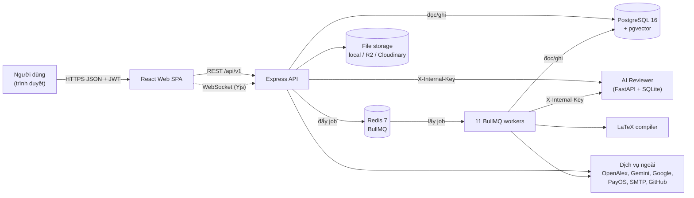

# 01 — LumiGap: Tổng quan dự án từ A đến Z

> Bộ tài liệu tổng hợp cho người phụ trách documentation (Nguyễn Đức Hoàng).
> Lập ngày 28/10/2026, chỉ dựa trên tài liệu dự án đang có. Không đọc source code. Riêng số liệu lịch sử Git thì lấy từ `git log`/`git diff`, có ghi `[GIT]`.
>
> Các file trong bộ:
> [01 Tổng quan](01_PROJECT_COMPLETE_OVERVIEW.md) · [02 Toàn bộ luồng](02_PROJECT_ALL_FLOWS.md) · [03 Audit tài liệu](03_DOCUMENTATION_AUDIT.md) · [04 Việc của tôi](04_MY_DOCUMENTATION_TASKS.md) · [05 Hỏi đáp](05_PROJECT_KNOWLEDGE_QA.md) · [07 Nội dung tài liệu](07_REPORT_CONTENT_SUMMARY.md) · [08 Ký hiệu sơ đồ](08_DIAGRAM_NOTATION_GUIDE.md)

---

## 0. Cách đọc và ký hiệu nguồn

Mọi kết luận quan trọng đều có mã nguồn trong ngoặc vuông. Danh sách đầy đủ, kèm đường dẫn file, nằm ở [03 §1](03_DOCUMENTATION_AUDIT.md#1-kiểm-kê-toàn-bộ-tài-liệu).

| Mã | Tài liệu | Mốc nội dung |
|---|---|---|
| [R1] | `Reports_Output/LumiGap_Report1_v2.docx` — Project Introduction | cập nhật 21/10 |
| [R2] | `Reports_Output/LumiGap_Report2_Project_ManagementPlan_v2.docx` — Project Management Plan | cập nhật 21/10 |
| [R3] | `Reports_Output/LumiGap_Report3_v2.docx` — SRS | code `main` ca8fe4d (26/10) |
| [R4] | `Reports_Output/LumiGap_Report4_SDD.docx` — SDD | code `main` ca8fe4d (26/10) |
| [R5] | `Reports_Output/LumiGap_Report5_Test_Documentation.docx` + `_Test_Report.xlsx` + `_Unit_Test.xls` | kế hoạch test, 26/10 |
| [BM01]…[BM04] | `Review2_Output/SWP490_FA26SE004_R2_{DesignBrief,SelfReview,RecordOfChanges,Commitment}.docx` | 21–26/10 |
| [HD] | `Downloads/SWP490_R2_Huong-dan-chuan-bi-Review-2_1.pdf` — hướng dẫn Review 2 của môn (7 trang) | v1.0, 10/2026 |
| [GIT] | Lịch sử Git của repo (log, diff), xem ngày 28/10/2026 | — |

Ký hiệu "§" là số mục trong tài liệu. Trong file Word, số trang thay đổi mỗi lần cập nhật mục lục, nên bộ này dẫn theo số mục (§), số hình và số bảng.

---

## 1. Dự án tên gì?

| Mục | Nội dung | Nguồn |
|---|---|---|
| Tên đề tài | **LumiGap – An Intelligent Research Gap Discovery and Academic Management System for Undergraduate Researchers** | [R1 §1.1] |
| Mã đề tài / nhóm | FA26SE004 / GFA26SE61 | [R1 §1.1] |
| Loại phần mềm | Web Application and AI-assisted Research Platform | [R1 §1.1] |
| GVHD | Trương Long (longt5@fpt.edu.vn) | [R1 §1.2] |
| Thành viên | Lê Anh Hòa (Leader, SE181702), Phan Lý Văn Khoa (SE181656), Nguyễn Đức Hoàng (SE181655), Hồ Đình Anh (SE180670), Nguyễn Đình Thanh (SE182854) | [R1 §1.2], [R2 §4] |
| Tên hiển thị trên web | Tiêu đề trang web hiện là "LumiGap - Publication Trend System". Tên cũ trong các bản nháp là "PaperLens", hiện không còn trong code | [R1 §2], [R1 Record of Changes, dòng 21/10] |

> ⚠ Các tài liệu gọi tên sản phẩm chưa thống nhất: [R3 §1] vẫn viết "presented under the PaperLens product name", trái với [R1 §2]. Chi tiết ở [03 §3.2](03_DOCUMENTATION_AUDIT.md#32-tính-nhất-quán-e2).

---

## 2. Dự án giải quyết bài toán gì? Tại sao cần?

**Bài toán** [R1 §2]: Sinh viên làm nghiên cứu thường bắt đầu từ một chủ đề rộng, rồi phải tự lọc qua rất nhiều bài báo rải rác. Từ đó họ phải hiểu các nghiên cứu liên quan đến nhau thế nào, tìm ra hạn chế hoặc kết quả mâu thuẫn, rồi chuyển thành một câu hỏi nghiên cứu bảo vệ được. Sinh viên ít kinh nghiệm dễ tưởng mình đã thấy một "khoảng trống" (gap), trong khi thật ra chỉ là do đọc chưa đủ.

**Vì sao cần một hệ thống mới** [R1 §2, §3, §4]: Hiện mỗi công cụ chỉ lo một khâu. Semantic Scholar dùng để tìm bài. Elicit dùng để tổng hợp bằng chứng. ResearchRabbit dùng để vẽ bản đồ quan hệ giữa các bài. Overleaf dùng để viết bài. Người dùng phải chuyển qua lại giữa các công cụ nên bị mất mạch. Không có công cụ nào nối liền cả chuỗi **bằng chứng → research gap → dự án → review**. LumiGap gom các khâu đó vào một nơi và giữ được dấu vết suốt chuỗi.

**Tầm nhìn sản phẩm** [R1 §5]: LumiGap là nền tảng hỗ trợ khám phá tài liệu và cộng tác học thuật, có AI hỗ trợ. Nó nối việc tìm bài, tổng hợp bằng chứng, phân tích gap, workspace dự án, thảo luận, tìm cộng sự, hỗ trợ từ giảng viên và review có cấu trúc. **AI chỉ đưa gợi ý; người dùng con người (sinh viên, giảng viên, reviewer) quyết định cuối cùng.**

---

## 3. Ai sử dụng hệ thống?

Danh sách actor theo [R3 §2.1]. Trong code chỉ có hai system role là `user` và `admin`. Các vai còn lại là vai trò học thuật hoặc vai trò gắn với từng đối tượng cụ thể.

| Actor | Là ai | Làm được gì (tóm tắt) |
|---|---|---|
| Guest | Khách chưa đăng nhập | Đăng ký, đăng nhập, tìm bài, xem bài, xem xu hướng, đọc forum, xem danh bạ giảng viên |
| User (Student/Researcher) | Tài khoản đã đăng ký. Student và Researcher là *loại hồ sơ học thuật*, không phải role riêng | Report, gap analysis, project, bookmark, credit, AI review, forum, submission |
| Lecturer | User có academic role là LECTURER. Khi admin xác minh xong thì có thêm capability REVIEW_ARTIFACT, STRUCTURED_REVIEW, MENTOR_PROJECT | Làm mentor, làm peer reviewer |
| Gap validation expert | User có capability GAP_VALIDATION | Bỏ phiếu thẩm định gap. **Hiện chưa có đường cấp quyền tự động** [R3 §3.4.7], [BM01 §5 G-06] |
| Project owner / member / Author | Vai trò trong từng project | Quản lý dự án, nộp bài |
| Community moderator | Vai trò owner hoặc moderator trong một community | Kiểm duyệt nội dung trong community đó |
| External reviewer | Người ngoài được mời qua email, token có hạn 14 ngày | Review một bài cụ thể |
| Administrator | System role ADMIN | Quản lý user, corpus, sync, pipeline, xác minh giảng viên, kiểm duyệt |
| Hệ thống bên ngoài | OpenAlex, Gemini/Ollama/AI của người dùng, Google OIDC, PayOS, SMTP, LibreTranslate, R2/Cloudinary/local, GitHub | Cung cấp dữ liệu và dịch vụ |

---

## 4. Chức năng chính và mỗi chức năng giải quyết vấn đề gì

[R1 §6.1] chia phạm vi thành **8 nhóm tính năng**. [R2 §1.1] dùng các mã WBS FE-01…FE-08 tương ứng. [R3 §3.2–3.9] cụ thể hóa thành **53 functional requirement (FR-01…FR-53)** và **45 use case (UC-01…UC-45)**.

| # | Nhóm tính năng | Giải quyết vấn đề gì | FR chính |
|---|---|---|---|
| 1 | Khám phá tài liệu (Research discovery) | Tìm bài theo nghĩa (semantic search) thay vì chỉ khớp từ khóa. Xem chi tiết bài, dịch, so sánh bài, lưu bookmark | FR-07…FR-10, FR-12, FR-13 |
| 2 | Trí tuệ nghiên cứu (Research intelligence) | Biết chủ đề nào đang tăng hoặc giảm (trends). Có report bám bằng chứng. Phát hiện gap kèm bằng chứng ủng hộ và phản bác. Chuyên gia thẩm định gap. Kiểm tra gap đã bị lấp chưa (Gap Closure Protocol) | FR-11, FR-14…FR-21 |
| 3 | Cộng tác dự án (Research projects) | Biến gap thành dự án nhóm: thành viên, lời mời, sàng lọc tài liệu, AI chat theo dữ liệu dự án, chat nhóm, viết LaTeX chung, tuyển cộng sự | FR-22…FR-28 |
| 4 | Hỗ trợ bài báo bằng AI (AI paper support) | Cho AI nhận xét bài PDF và kiểm tra định dạng theo mẫu (ví dụ IEEE) | FR-29, FR-30 |
| 5 | Cộng đồng học thuật | Forum, community, báo cáo vi phạm và kiểm duyệt | FR-40…FR-42 |
| 6 | Danh tính học thuật và review của con người | Xác minh giảng viên. Nộp bài, gửi yêu cầu peer review, review theo rubric, chu kỳ chỉnh sửa. Lưu lại đóng góp. Mentor | FR-43…FR-53 |
| 7 | Tài khoản và tương tác | Đăng ký, đăng nhập, Google, khôi phục mật khẩu, credit, nạp tiền qua PayOS, thông báo, bảng xếp hạng | FR-01…FR-06, FR-31…FR-35 |
| 8 | Quản trị và vận hành dữ liệu | Quản lý user và corpus. Đồng bộ và nạp dữ liệu OpenAlex. Theo dõi worker, hàng đợi, chất lượng AI | FR-36…FR-39 |

Tình trạng theo [R3]: **48 FR "Implemented"**, **5 FR "Partial"**: FR-20 thẩm định gap, FR-27 soạn thảo LaTeX, FR-28 tuyển cộng sự, FR-29 AI review bài, FR-52 kho đóng góp.
> "Implemented" nghĩa là đã có code. Như vậy *chưa phải* đã được kiểm thử: [R5 §5] ghi rõ chưa test nào được chạy.

**15 tính năng bắt buộc cho Review 2 / Defense 1.1** [BM01 §6], [BM04 §3]: F-01…F-15, gom vào 5 main workflow (WF-01…WF-05). Mỗi thành viên sở hữu một workflow. Xem chi tiết ở [02 Phần B](02_PROJECT_ALL_FLOWS.md#phần-b--5-main-workflow-đã-cam-kết).

---

## 5. Hệ thống gồm những thành phần nào (giải thích dễ hiểu)

Nguồn: [R4 §1.1, bảng "Component descriptions"], [BM01 §3 D1–D5], [R2 §6.3].

| Thành phần | Nó là gì | Vì sao cần (theo tài liệu) | Phối hợp với ai |
|---|---|---|---|
| **React web SPA** (`apps/web`) | Giao diện chạy trên trình duyệt (React 18 + Vite 6) | Mọi thao tác của người dùng: tìm bài, report, gap, project, editor, review, forum, admin | Gửi request HTTPS JSON tới API kèm JWT. Mở WebSocket khi soạn LaTeX chung |
| **Express REST API** (`/api/v1`) | "Quầy tiếp nhận" xử lý mọi yêu cầu (Express 5, Node 22) | Kiểm tra quyền (JWT, capability), kiểm tra dữ liệu đầu vào (Zod), áp dụng quy tắc nghiệp vụ, trừ credit | Đọc và ghi PostgreSQL. Đẩy job vào Redis/BullMQ. Gọi AI Reviewer và dịch vụ ngoài |
| **Redis + BullMQ** | Redis là bộ nhớ nhanh; BullMQ là thư viện **hàng đợi công việc** chạy trên Redis | Việc nặng như sinh report hay phân tích gap mất vài chục giây đến vài phút. API không bắt người dùng chờ: nó tạo bản ghi `queued`, đẩy job vào hàng đợi rồi trả lời ngay. Redis còn dùng làm cache câu trả lời LLM, rate limit và heartbeat của worker | API đẩy job vào; worker lấy job ra xử lý |
| **11 BullMQ worker** | Các tiến trình Node chạy nền, giống "nhân viên hậu trường" | Xử lý report, gaps, ai-jobs, embedding, paper-analysis, notification, corpus-validation, community-summary, manuscript-compile, sync, openalex-ingest | Lấy job từ Redis, đọc dữ liệu từ PostgreSQL, gọi AI, ghi kết quả và trạng thái cuối |
| **PostgreSQL 16 + pgvector** | Cơ sở dữ liệu chính: 188 bảng, 93 migration ở baseline | **Một kho duy nhất** cho dữ liệu, sổ cái credit và vector. Lý do chọn: giữ giao dịch nhất quán, không phải tách document store và vector DB riêng [BM01 D1]. pgvector cho phép tìm bài "gần nghĩa" bằng vector embedding 768 chiều | Truy cập qua Prisma 7 |
| **AI Reviewer** (`apps/ai-reviewer`) | Dịch vụ Python FastAPI riêng, có SQLite riêng | Nhận xét bài PDF, kiểm tra định dạng, pre-review bài nộp. Tách riêng để xử lý PDF bằng hệ sinh thái Python [BM01 D3] | API và ai-jobs worker gọi tới, kèm header `X-Internal-Key` |
| **LaTeX compiler sidecar** | Dịch vụ biên dịch LaTeX chạy trong sandbox | Biên dịch bản thảo LaTeX ra PDF | Gọi qua manuscript-compile worker |
| **File storage** | Ổ đĩa local, Cloudflare R2 hoặc Cloudinary, chọn bằng `STORAGE_PROVIDER` | Lưu PDF, các bản revision, minh chứng xác minh, ảnh | API lưu file và cấp URL có hạn (mặc định 300 giây) |
| **Dịch vụ ngoài** | OpenAlex (metadata bài báo), Gemini/Ollama/AI của người dùng (LLM và embedding), Google OIDC, PayOS, SMTP, LibreTranslate, GitHub | Cung cấp dữ liệu, AI, đăng nhập, thanh toán, email, dịch, đồng bộ bản thảo | Xem [R4 §1.3.1, Bảng 1] |

**Ba ý dễ nhớ khi thuyết trình:**
1. **Việc nhanh thì làm ngay, việc chậm thì đưa vào hàng đợi.** API trả lời ngay, worker làm sau. Web hỏi lại trạng thái mỗi 3 giây [R4 §3.1].
2. **Tiền (credit) luôn đi kèm "khóa chống trùng" (idempotency key).** Trừ hoặc hoàn credit chỉ xảy ra đúng một lần, kể cả khi job chạy lại [R3 BR-04], [R4 §3.1].
3. **AI chỉ là trợ lý.** Kết quả phải dẫn về bài báo làm bằng chứng. Citation không khớp bằng chứng thì bị loại [R4 §3.1.4 design note], [R3 BR-07].

*Hình 01-1. Kiến trúc tổng quan đã rút gọn để thuyết trình. Bản chuẩn là C4 Level 2 trong [R4 §1.1, Hình 1–4].*

---

## 6. Công nghệ được sử dụng (theo tài liệu)

Nguồn: [R4 §1.3.2, Bảng 2] và [R2 §6.3]. Chỉ liệt kê các mục chính.

| Lớp | Công nghệ |
|---|---|
| Monorepo | pnpm 11.3.0, Turborepo, TypeScript 5.x |
| Frontend | React 18.3, Vite 6, Tailwind 3, React Router 6, TanStack Query 5, Zustand, CodeMirror 6 + Yjs, KaTeX, pdfjs; chạy trên nginx 1.27 |
| Backend | Node 22, Express 5, Prisma 7.10, BullMQ 5, ioredis, zod, pino, helmet, jose (JWT RS256), argon2, nodemailer, ws |
| Dữ liệu | PostgreSQL 16 + pgvector 0.8.1; Redis 7; SQLite (riêng của AI Reviewer) |
| AI | Google Gemini (LLM mặc định và embedding 768 chiều), Ollama (tùy chọn), endpoint AI do người dùng tự khai báo (key mã hóa AES-256-GCM), OpenAI/Gemini trong AI Reviewer |
| AI Reviewer | Python 3.12, FastAPI, pypdf, pdfplumber, docling-core, tesseract |
| Test | Vitest, Playwright 1.55, pytest |
| CI/CD | GitHub Actions: migrate, typecheck, Vitest, 6 bộ integration test. Jenkins: build image, kiểm tra env production, deploy lên lumigap.uk |
| Hạ tầng | Docker, Docker Compose (local), Nginx Proxy Manager (production) |

---

## 7. Dữ liệu được thu thập, xử lý, lưu trữ và sử dụng thế nào

| Giai đoạn | Diễn ra thế nào | Nguồn |
|---|---|---|
| **Thu thập** | Metadata bài báo lấy từ **OpenAlex** qua `sync` worker (lịch mặc định `0 2 * * *`) và `openalex-ingest` worker (chiến dịch nạp lớn có chia partition, lease, retry, dead letter). User có thể gửi yêu cầu thêm bài (100 credit), admin duyệt | [R3 §3.1.4 #5–6], [R3 FR-13, FR-38] |
| **Xử lý/làm giàu** | `embedding` worker tạo vector 768 chiều (lịch `0 3 * * *`). `paper-analysis` worker phân tích cấu trúc bài bằng AI (`0 4 * * *`). `corpus-validation` worker kiểm tra chất lượng sau khi nạp | [R3 §3.1.4 #3,4,7] |
| **Lưu trữ** | PostgreSQL: 188 model và 93 migration SQL viết tay ở baseline; ràng buộc khóa ngoại nằm trong migration. File lưu ở local/R2/Cloudinary. Redis giữ cache và hàng đợi. AI Reviewer dùng SQLite riêng | [R4 §2.1], [R3 §3.1.5] |
| **Sử dụng** | Tìm kiếm semantic/keyword. Trends (OpenAlex trước, nếu không được thì dùng corpus local). Report và gap analysis dùng bằng chứng lấy từ corpus. AI chat của project dùng bài trong project làm nền | [R3 FR-07, FR-11, FR-14…FR-17, FR-25] |
| **Bảo vệ** | Tài liệu và PDF riêng tư chỉ cấp URL có thời hạn. Key AI cá nhân và token GitHub được mã hóa. Hành động nhạy cảm được ghi vào `audit_logs` | [R3 §5.2], [R4 §1.3.1] |

Các nhóm dữ liệu chính, theo cách chia ERD trong [R3 §3.1.5] và [R4 §2.1.1–2.1.10]: Identity & academic profile · Scholarly corpus · Reports/gaps/validation · Projects/collaboration · Submission & peer review · Credits & payments · Community/forum · Operations · Manuscript workspace · Data migration control.

---

## 8. AI đóng vai trò gì?

| Nơi dùng AI | Vai trò | Cơ chế an toàn (theo tài liệu) |
|---|---|---|
| Tìm kiếm (re-rank) | Tùy chọn. Chấm lại điểm 20 kết quả đầu, 5 credit | Chỉ tính phí khi không có sẵn trong cache. Nếu lỗi thì quay về thứ tự vector và hoàn credit [R3 BR-05] |
| Trends explain | Giải thích các con số thống kê | Lời giải thích phải bám vào số liệu thật; nếu kiểm tra không qua thì trả HTTP 503 [R3 FR-11] |
| Report (RAG) | Viết report có trích dẫn [n] | Chỉ chấp nhận citation trỏ đúng tới bằng chứng đã đánh số. Ở chế độ deep, LLM được gọi MCP tool (search_papers, get_trends, count_papers) [R4 §3.1.4] |
| Gap analysis và research directions | Đề xuất gap và hướng nghiên cứu | Gap chỉ là *ứng viên*. Số bài ít không đủ để kết luận là gap (phải qua kiểm định thống kê và bằng chứng ngoài). Phải có ít nhất 2 chuyên gia thẩm định [R3 BR-08, BR-09] |
| Project AI chat | Trả lời dựa trên bài của dự án, 1 credit mỗi tin | Hoàn credit nếu LLM lỗi [R3 FR-25] |
| AI Reviewer | Nhận xét bài, kiểm tra định dạng, pre-review bài nộp | Pre-review chỉ mang tính tư vấn. Người review thật là giảng viên đã được xác minh [R3 BR-12] |
| Vận hành | Đánh giá chất lượng, tóm tắt community | Theo dõi trong trang admin [R3 FR-39] |

Nguyên tắc chung [R1 LI-01], [R3 BR-07]: **AI chỉ đưa gợi ý; kết quả phải truy được về bài báo; job AI thất bại thì hoàn credit.**

---

## 9. Các luồng nghiệp vụ quan trọng (tóm tắt)

Chuỗi giá trị cốt lõi [R2 §1.2], [R1 §4]:

**Tìm tài liệu → Report bám bằng chứng → Research gap → Thẩm định gap → Dự án nhóm → Viết bản thảo → Nộp bài → Peer review → Chỉnh sửa và nộp lại**, cùng hai luồng phụ trợ: **xác minh giảng viên** và **nạp credit**.

5 main workflow đã cam kết [BM01 Phụ lục A1]:

| WF | Tên | Người sở hữu |
|---|---|---|
| WF-01 | Sinh report có bằng chứng | Lê Anh Hòa |
| WF-02 | Phân tích gap và thẩm định của chuyên gia | Hồ Đình Anh |
| WF-03 | Nộp bản thảo và peer review | Phan Lý Văn Khoa |
| WF-04 | Xác minh giảng viên | Nguyễn Đình Thanh |
| WF-05 | Nạp credit qua PayOS | **Nguyễn Đức Hoàng** |

Mô tả đầy đủ từng luồng, sơ đồ Mermaid và lỗi/ngoại lệ có trong [02_PROJECT_ALL_FLOWS.md](02_PROJECT_ALL_FLOWS.md).

---

## 10. Những gì đã hoàn thành theo tài liệu

| Hạng mục | Kết quả được ghi nhận | Mức bằng chứng |
|---|---|---|
| Code Iteration 1 | 179 commit, 43 PR merge (#6–#55) tính tới baseline ca8fe4d | [R4 §1.3.3 Bảng 3] — có trong Git |
| Chức năng | 48/53 FR "Implemented", 5 "Partial"; mỗi FR có dẫn chứng file code | [R3 §3.2–3.9] — mô tả thiết kế, **chưa có kết quả test** |
| Report 1–4 | Đã sửa lại theo code (bản v2). Report 4 SDD dài 163 trang, 121 hình | [R3/R4 Record of Changes], [DIAGRAM_QA_REPORT] |
| Sơ đồ | 133+ sơ đồ: C4, UML, ERD. ERD được kiểm bằng validator, 0 lỗi so với 93 migration | [DIAGRAM_CHANGELOG cập nhật 23/10 và 26/10] |
| Report 5 | **Mới có kế hoạch test**: 79 test case, 127 unit case. Chưa viết test, chưa chạy | [R5 §1, §5] |
| Hồ sơ Review 2 | BM01–BM04 đã có bản nháp. BM02 có 51 finding; trong 17 finding High có 11 Fixed và 6 Planned | [BM02 §3], [BM01 §5] |
| CI | GitHub Actions chạy migrate, typecheck, Vitest và 6 bộ integration test. Chưa chạy lint, Playwright, pytest | [R4 §1.3.3 #06–07] |
| Production | Jenkins deploy lên https://lumigap.uk và https://api.lumigap.uk | [R4 §1.3.4 #03] |

---

## 11. Những vấn đề còn tồn tại (theo tài liệu)

| Nhóm | Vấn đề | Nguồn |
|---|---|---|
| Môi trường | **Chưa có staging**, trong khi demo Defense 1.1 bắt buộc chạy trên staging | [BM01 R1, G-01], [HD mục 09.2] |
| Kiểm thử | Chưa có test cho luồng report (SR-33) và credit/PayOS (SR-34). Playwright và pytest không chạy trong CI | [BM01 §5], [R5 §1.4] |
| Dữ liệu demo | `seed.ts` chỉ tạo 2 bài, không có embedding. Cần script nạp corpus fixture | [BM01 G-03] |
| Quyền | Chưa có đường cấp GAP_VALIDATION lúc chạy (chỉ có qua seed) | [BM01 G-06], [R3 §3.4.7] |
| Bảo mật | Webhook PayOS chỉ kiểm chữ ký khi có cấu hình `PAYOS_CHECKSUM_KEY` | [R3 NFR-SEC-02], [R4 §3.5.3] |
| Thiết kế và code | Submission có trạng thái "chết" (accepted/rejected/withdrawn không bao giờ được gán). PaymentOrder kẹt ở `pending` khi người dùng hủy | [BM02 SR-22, SR-26], [R4 §2.3.7, §2.3.10] |
| Lỗi phát hiện khi đối chiếu | 8 defect liệt kê trong [R3 §5.4], ví dụ guard tuyển cộng sự thực tế chỉ admin dùng được; personal key cho AI review không cấu hình được | [R3 §5.4] |
| Quản trị repo | Chưa có tag `review-2`. Nguồn sơ đồ chưa nằm trên `main` | [BM01 G-02, SR-38] |
| **Lệch baseline (phát hiện mới)** | Từ 26/10 đến 28/10, `main` đã có thêm PR #56–#66 (341 file thay đổi, 4 migration mới, 191 model). **Tài liệu chưa phản ánh các thay đổi này** | [GIT], xem [03 §3.3](03_DOCUMENTATION_AUDIT.md#33-tính-chính-xác-e3) |

---

## 12. Kế hoạch tiếp theo (theo tài liệu)

| Hạn | Việc | Nguồn |
|---|---|---|
| Trước Review 2 (ngày TBD) | Tạo tag `review-2`. Xuất PDF 4 hồ sơ. Nộp phiếu đăng ký kèm BM03 | [HD mục 03, 11], [BM01 G-02] |
| Trong vòng 3 ngày làm việc sau Review 2 | Hoàn thiện BM04 Commitment, có xác nhận của 2 giảng viên phản biện và GVHD | [HD mục 08] |
| 04/11/2026 | Nhóm việc phải sửa (RF) hạn sớm, gồm RF-13 (nguồn sơ đồ), RF-22, RF-27 | [BM04 §9] |
| 11/11/2026 | Staging, corpus fixture, PayOS test key. Các phần tài liệu của Report 5. Các RF hạn 11/11 | [R5 §3.3], [BM04 §9] |
| 18/11/2026 | Viết xong 79 test case (73 test tự động) và unit test. Thêm job Playwright vào CI | [R5 §3.3] |
| Defense 1.1 (TBD) | Đạt đủ ngưỡng [HD 09.4]: 100% workflow chạy end-to-end; ≥90% test đạt; ≥50% test chạy trong CI; 0 defect Critical/High. Nộp Report 1–6 | [HD mục 08, 09.4] |
| Viva | Report 7, slide bảo vệ, bộ sản phẩm cuối | [HD mục 08], [R2 §3.1] |

---

## 13. Thuật ngữ cần nắm

| Thuật ngữ | Nghĩa ngắn |
|---|---|
| Research gap | Khoảng trống nghiên cứu: câu hỏi chưa được nghiên cứu đủ, cần bằng chứng mới chứng minh được |
| RAG | Retrieval-Augmented Generation: lấy bài liên quan trước, rồi cho LLM viết dựa trên các bài đó |
| Embedding / pgvector | Biến văn bản thành vector số để tìm "gần nghĩa"; pgvector là phần mở rộng của PostgreSQL để lưu và tìm các vector này |
| BullMQ worker | Tiến trình chạy nền, lấy job từ hàng đợi Redis ra xử lý |
| Idempotency key | Khóa đảm bảo một thao tác (trừ hoặc hoàn credit) chỉ có tác dụng một lần, dù bị gọi lại |
| Capability | Quyền chi tiết gắn với user, ví dụ STRUCTURED_REVIEW, GAP_VALIDATION |
| Quorum | Số phiếu tối thiểu để chốt kết quả thẩm định (ở đây là 2) |
| State machine | Sơ đồ các trạng thái của một thực thể và điều kiện chuyển giữa chúng |
| C4 model | Cách vẽ kiến trúc theo 4 mức: Context, Container, Component, Code |
| Main workflow (theo môn học) | Luồng nghiệp vụ trọn vẹn, có ≥2 actor hoặc đi qua ≥3 tính năng bắt buộc, và làm đổi trạng thái của ít nhất một thực thể chính [HD 09.1] |
| Baseline | Phiên bản code mà tài liệu mô tả (hiện là ca8fe4d) |
| Tag `review-2` | Nhãn Git đánh dấu phiên bản code nộp cho Review 2 [HD mục 03] |

---

## 14. Giới hạn của bộ tài liệu tổng hợp này

- Không đọc source code. Mọi mô tả hành vi là **theo tài liệu**. Tài liệu R3 và R4 tự ghi là đã đối chiếu code tại ca8fe4d, nhưng bộ này không kiểm chứng lại.
- Các tài liệu kỹ thuật trong thư mục `docs/` của repo (khoảng 150 file trên `main`) chỉ được kiểm kê, **không** dùng làm bằng chứng, vì nhóm chưa đối chiếu chúng với code. Xem [03 §1.3](03_DOCUMENTATION_AUDIT.md#13-tài-liệu-kỹ-thuật-trong-repo-docs).
- Phiếu đăng ký đề tài (registration form) gốc **không có** trong các thư mục đã rà, nên không đối chiếu được.
- Không có kết quả test, biên bản họp hay báo cáo tuần nào trong các nguồn đã rà.
- Các thay đổi trên `main` sau ca8fe4d chỉ được định lượng qua Git (số PR, migration, model). Nội dung các thay đổi đó **chưa được mô tả** trong tài liệu nào.
