# 02 — Project Flow Atlas: toàn bộ luồng của LumiGap

> [01 Tổng quan](01_PROJECT_COMPLETE_OVERVIEW.md) · **02 Toàn bộ luồng** · [03 Audit](03_DOCUMENTATION_AUDIT.md) · [04 Việc của tôi](04_MY_DOCUMENTATION_TASKS.md) · [05 Hỏi đáp](05_PROJECT_KNOWLEDGE_QA.md)
>
> Nguồn và ký hiệu như [01 §0](01_PROJECT_COMPLETE_OVERVIEW.md#0-cách-đọc-và-ký-hiệu-nguồn). Mọi sơ đồ Mermaid dưới đây vẽ **từ tài liệu**. Sơ đồ chuẩn để nộp nằm trong R3/R4: nguồn `.puml`/`.drawio` ở `docs/diagrams/` (nhánh `docs/review2-cleanup`).
> Ký hiệu trạng thái: ✅ tài liệu ghi Implemented · 🟡 Partial · ⚠ chưa xác minh / tài liệu tự ghi TBD · ⛔ tài liệu ghi là không có.

## Mục lục

- [Phần A — Sơ đồ toàn cảnh](#phần-a--sơ-đồ-toàn-cảnh): A1 System Context · A2 Architecture · A3 Use case tổng quan · A4 Business process end-to-end · A5 User journey · A6 Data Flow Diagram
- [Phần B — 5 main workflow đã cam kết](#phần-b--5-main-workflow-đã-cam-kết): WF-01 … WF-05
- [Phần C — Các luồng nghiệp vụ hỗ trợ](#phần-c--các-luồng-nghiệp-vụ-hỗ-trợ) (C1–C8)
- [Phần D — Luồng hệ thống chạy nền](#phần-d--luồng-hệ-thống-chạy-nền)
- [Phần E — Luồng ↔ sơ đồ trong báo cáo, chỗ còn thiếu](#phần-e--đối-chiếu-luồng--sơ-đồ-trong-báo-cáo)

---

## Phần A — Sơ đồ toàn cảnh

### A1. System Context (mức C4 L1)

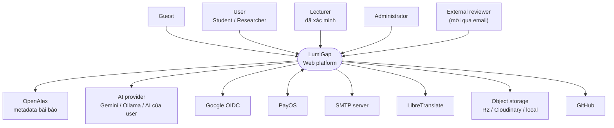
**Ý nghĩa để thuyết trình:** Hình cho biết *ai dùng* LumiGap và LumiGap *nói chuyện với những hệ thống nào*. Workers, AI Reviewer và LaTeX compiler là thành phần **bên trong** LumiGap nên không vẽ thành actor [R3 §2.1]. PayOS là mũi tên hai chiều vì PayOS gọi ngược webhook về hệ thống [R3 §4.1]. Bản chuẩn: [R3 Hình 1, `R3_C4_L1_SystemContext.drawio`].

### A2. Architecture overview (mức C4 L2, rút gọn)

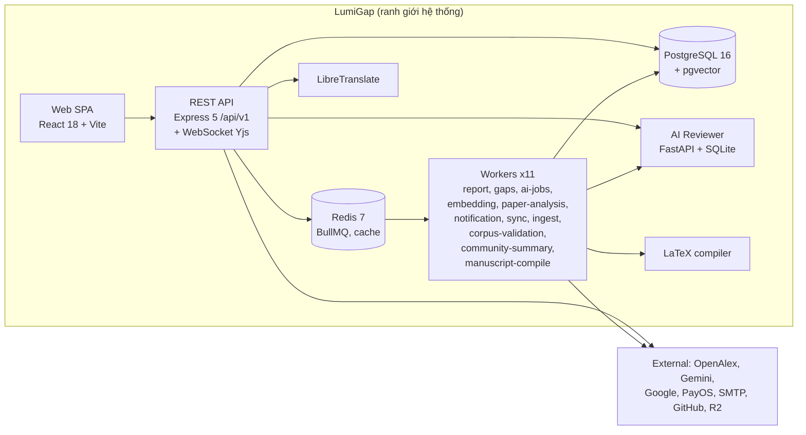
**Ý nghĩa:** Có hai con đường xử lý.
1. **Đồng bộ** (Web → API → DB): kiểm tra quyền, đọc ghi dữ liệu và trả kết quả ngay.
2. **Bất đồng bộ** (API → Redis → Worker): dành cho việc AI và việc dữ liệu nặng.

Ngoại lệ được ghi trong [R4 §1.1]: AI paper review, format check và dịch tiêu đề/abstract được gọi **đồng bộ** ngay trong request. Đây là điểm BM02 SR-45 nêu ra. Bản chuẩn: [R4 Hình 1–4].

### A3. Use case tổng quan (gom theo nhóm)

> Mermaid không có ký hiệu use case UML, nên hình dưới dùng flowchart để mô phỏng. Sơ đồ UML chuẩn là [R3 Hình 2(a)–5].

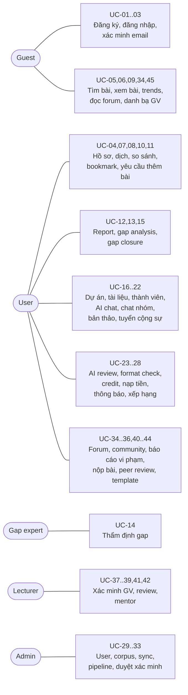
**Ý nghĩa:** Hình chia 45 use case theo vai trò. Có thể nói khi thuyết trình: Guest chỉ *xem*; User *làm nghiên cứu*; Lecturer *thẩm định và hướng dẫn*; Admin *vận hành*.

### A4. Business process end-to-end (chuỗi giá trị chính)

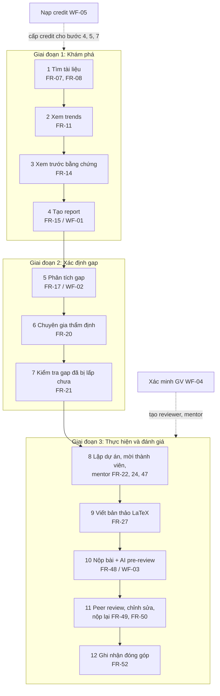
**Ý nghĩa:** Đây là câu chuyện chính của sản phẩm [R1 §4], [R2 §1.2]. Năm workflow cam kết là các *đoạn* của chuỗi này. WF-04 và WF-05 là luồng *hỗ trợ*: một luồng tạo ra reviewer đủ điều kiện, một luồng tạo ra credit.
⚠ Từ bước 5 sang bước 8 (biến gap thành dự án) chưa có workflow nào cam kết, cũng chưa có activity diagram riêng. [R2 §1.2] nêu "research gap to a collaborative project" là một trong bốn journey chính, nhưng BM01 không đưa journey này vào WF.

### A5. User journey của sinh viên

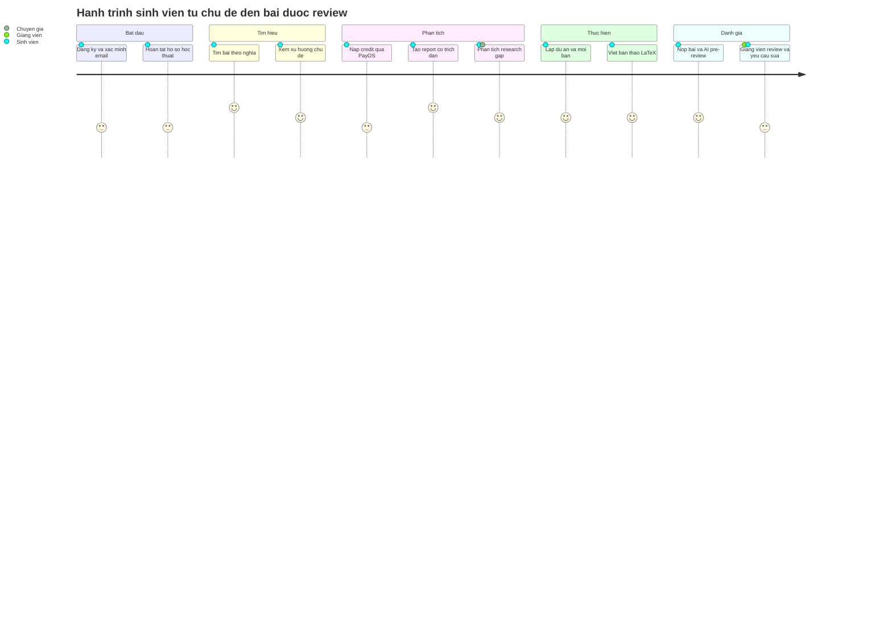
**Ý nghĩa:** Hình mô tả trải nghiệm theo thời gian. Điểm số 1–5 là **minh họa** mức hài lòng mong đợi, ⚠ *không phải dữ liệu đo*: chưa có usability test [R3 NFR-USA-03 TBD]. Mermaid journey không hiển thị tốt tiếng Việt có dấu nên nhãn trong hình viết không dấu.

### A6. Data Flow Diagram

**DFD mức 0 (context):**
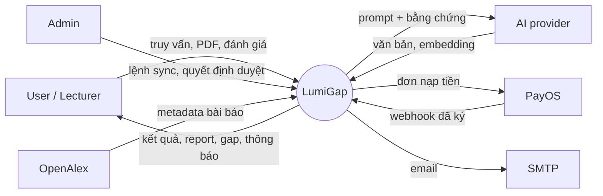

**DFD mức 1 (các tiến trình chính và kho dữ liệu):**
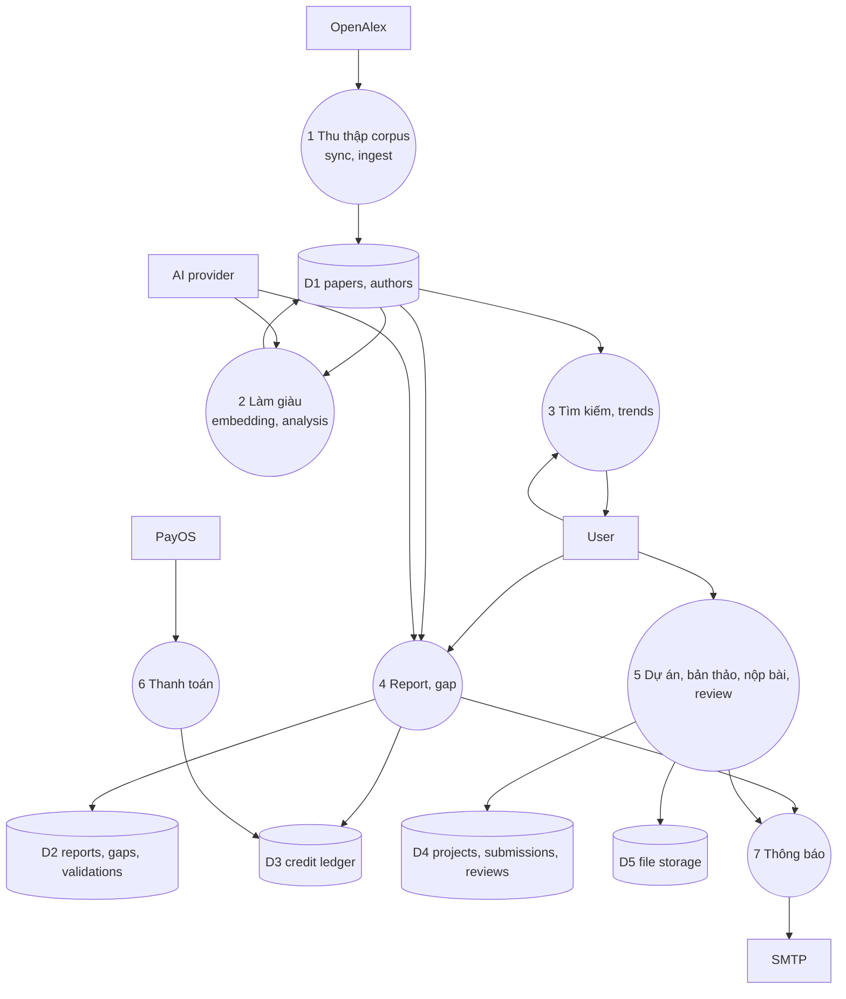
**Ý nghĩa:** DFD trả lời câu hỏi *dữ liệu đi đâu*. Kho D3 (sổ cái credit) nhận dữ liệu từ hai nơi: trừ hoặc hoàn khi chạy AI (P4) và cộng khi thanh toán (P6). Vì vậy idempotency rất quan trọng [R3 BR-04, NFR-REL-05].
⚠ Báo cáo hiện **không có DFD**. Hướng dẫn môn học cũng không bắt buộc DFD [HD mục 03]. Hai hình trên là bản tổng hợp, dùng để thuyết trình.

---

## Phần B — 5 main workflow đã cam kết

Nguồn chung: [BM01 Phụ lục A1–A3], [BM04 §6.1–6.5], [R4 §3.1–3.5], [R3 FR liên quan]. Năm workflow đều thỏa định nghĩa main workflow của môn học: có ≥2 actor hoặc qua ≥3 tính năng bắt buộc, và đổi trạng thái của một thực thể chính [HD 09.1].

### WF-01 — Sinh report phân tích có bằng chứng (owner: Lê Anh Hòa)

| # | Mục | Nội dung |
|---|---|---|
| 1 | Tên | Generate an evidence-grounded analytical report (F-01, F-02, F-03 ↔ FR-14, FR-15, FR-16) |
| 2 | Mục đích | Biến một câu hỏi nghiên cứu thành report có trích dẫn [n] trỏ tới các bài trong corpus |
| 3 | Actor/kích hoạt | Researcher. Kích hoạt bằng `POST /reports` sau khi xem trước bằng chứng. Report worker xử lý phần nền |
| 4 | Điều kiện bắt đầu | Đã đăng nhập, email đã xác minh (BR-01). Đủ credit: fast 20 / standard 50 / deep 100. Có dưới 2 report đang chạy. Tạo dưới 10 report trong giờ đó |
| 5 | Các bước | (1) `POST /reports/evidence-preview` miễn phí, trả danh sách bài làm bằng chứng → (2) `POST /reports`: kiểm tra dữ liệu, trừ credit với khóa `report:<id>`, tạo Report ở trạng thái `queued`, đẩy job (5 lần thử, backoff 2 s) → (3) worker nhận job theo cách atomic, chuyển sang `generating` → (4) tạo embedding cho truy vấn, gom bằng chứng (bài được chọn trước, phần còn lại lấy bằng retrieval) → (5) LLM sinh nội dung (có cache; chế độ deep được gọi MCP tool) → (6) kiểm tra citation hợp lệ → (7) lưu kết quả, chuyển `ready`, gửi thông báo `report_ready`, kích hoạt gap fan-out → web hỏi lại `GET /reports/:id` mỗi 3 giây |
| 6 | Thành phần | Web (ReportsListPage), reportRouter/Controller, reportService, creditService, Redis/BullMQ, report.worker, ragService, LLM (Gemini), PostgreSQL (Report, ReportPaper, CreditTransaction) |
| 7 | Đầu vào | query (3–500 ký tự), mode, title, topic, artifactType, khoảng năm, bài được chọn |
| 8 | Đầu ra | Report (markdown, danh sách bài làm bằng chứng, groundingChecks), giao dịch credit, thông báo |
| 9 | Kết quả cuối | `ready` và đã trừ credit; hoặc `failed` và đã hoàn credit đúng một lần. Nếu trúng cache thì `ready` và credit được hoàn |
| 10 | Lỗi/ngoại lệ | Thiếu credit → 400, không tạo report · đã có 2 report đang chạy → 429 · tạo quá 10 report/giờ → 429 · không có bằng chứng → `failed` ngay, không thử lại, hoàn credit (DS-01b) · lỗi tạm thời → thử lại tối đa 5 lần · kẹt quá 5 phút ở `generating` hoặc 30 phút ở `queued` → sweep chuyển `failed` · đẩy job lỗi → hoàn credit, report nằm ở `queued` đến khi sweep xử lý [R4 §2.3.1] |
| 11 | Chức năng liên quan | FR-14…16; gián tiếp FR-17 (gap fan-out), FR-31 (ledger), FR-34 (thông báo) |
| 12 | Mô tả ở đâu | [R3 §3.4.1–3.4.3], [R4 §3.1 (Hình 75–82), §2.3.1–2.3.2], [BM01 §6, A1, A2 DS-01a/b] |
| 13 | Tình trạng báo cáo | FR-14…16 ✅. F-01…F-03 "In progress" [BM01 §6]. **Chưa có test luồng report (SR-33 High, RF-11 hạn 18/11)** |
| 14 | Thiếu/chưa rõ | Report `failed` là ngõ cụt, chưa có endpoint tạo lại (SR-23, RF-21) · sweep viết inline trong worker nên khó unit test [R5 §1.4] · chưa có corpus fixture để demo (G-03) · NFR N4 chưa có số đo nền |

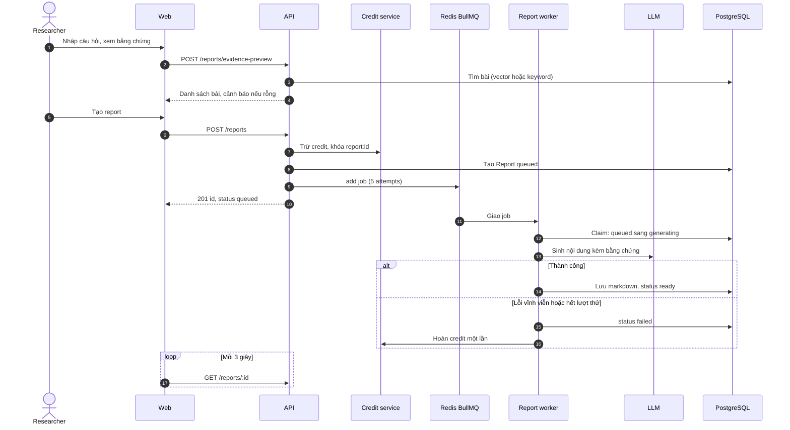

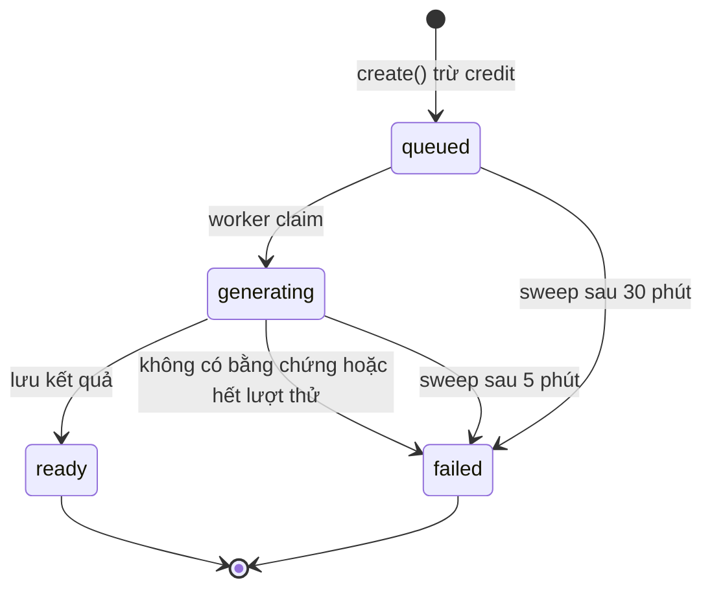

### WF-02 — Phân tích gap và thẩm định của chuyên gia (owner: Hồ Đình Anh)

| # | Mục | Nội dung |
|---|---|---|
| 1 | Tên | Gap analysis and expert validation (F-04, F-05, F-06 ↔ FR-17, FR-18, FR-20) |
| 2 | Mục đích | Tìm khoảng trống nghiên cứu kèm bằng chứng, rồi cho chuyên gia độc lập thẩm định |
| 3 | Actor/kích hoạt | Researcher hoặc project member gọi `POST /gaps/analyze`. Chuyên gia có GAP_VALIDATION. Gaps worker |
| 4 | Điều kiện | Đã xác minh email. Đủ 30 credit. Dưới 10 lần phân tích/giờ. Chế độ selected cần ≥3 bài (phân tích trong project cần ≥2 bài và đã review synthesis). Mỗi project chỉ chạy một phân tích cùng lúc |
| 5 | Các bước | (1) `POST /gaps/evidence-preview` miễn phí → (2) `POST /gaps/analyze`: trừ 30 credit, tạo phân tích `queued` → (3) worker chuyển `analyzing`, chạy kiểm định thống kê observed/expected và lấy bằng chứng ngoài → (4) `ready`, lưu các gap ứng viên kèm bài làm bằng chứng → (5) chủ gap gửi yêu cầu thẩm định (`request-validation`) → (6) chuyên gia ngoài dự án bỏ phiếu VALIDATE, REJECT hoặc REFINE_SCOPE → (7) đủ quorum 2 thì chốt VALIDATED, REJECTED hoặc REFINED. Nếu thất bại: (8) `POST /gaps/analyze/:id/retry` tạo một phân tích **mới** và trừ 30 credit lần nữa [BM01 F-05] |
| 6 | Thành phần | Web (/research-gaps, /research-gaps/validation), gaps routes/service, credit, BullMQ, gaps.worker, LLM, OpenAlex (bằng chứng toàn cục), PostgreSQL (GapAnalysis, ResearchGap, GapValidation, GapEvidenceRecord) |
| 7 | Đầu vào | topic (3–200), khoảng năm, evidenceMode auto/selected/hybrid, selectedPaperIds (≤10) |
| 8 | Đầu ra | Gap ứng viên, bằng chứng ủng hộ/phản bác, phiếu thẩm định, trạng thái thẩm định |
| 9 | Kết quả cuối | GapAnalysis `ready` có gap; gap được chốt VALIDATED, REJECTED hoặc REFINED |
| 10 | Lỗi/ngoại lệ | Thiếu credit → 400, không tạo phân tích (DS-02b) · quá 10 lần/giờ → 429 · chọn <3 bài → 400 · project đang có phân tích chạy → 409 · đẩy job lỗi → `failed` và hoàn credit · trúng cache → hoàn credit · chuyên gia là thành viên dự án → 409 · tự thẩm định gap của mình → 409 · không có capability → 403 |
| 11 | Chức năng liên quan | FR-17, 18, 20; mở rộng: FR-19 (directions), FR-21 (closure) |
| 12 | Mô tả ở đâu | [R3 §3.4.4–3.4.7], [R4 §3.2, §2.3.3–2.3.4], [BM01 A1, DS-02a/b] |
| 13 | Tình trạng | FR-17, FR-18 ✅; **FR-20 🟡** vì chưa có đường cấp GAP_VALIDATION lúc chạy, chỉ seed mới có (G-06, RF-30 hạn 11/11). Demo dùng tài khoản lecturer có sẵn từ seed |
| 14 | Thiếu/chưa rõ | ⚠ **R3 FR-18 viết "re-queues the caller's own analysis" (xếp lại chính bản cũ), còn BM01 F-05 viết "creates a NEW queued analysis"**: hai tài liệu mâu thuẫn, cần sửa R3 · gap/validation transitions chưa gắn FR (SR-24) · trạng thái ARCHIVED của gap không bao giờ được gán |

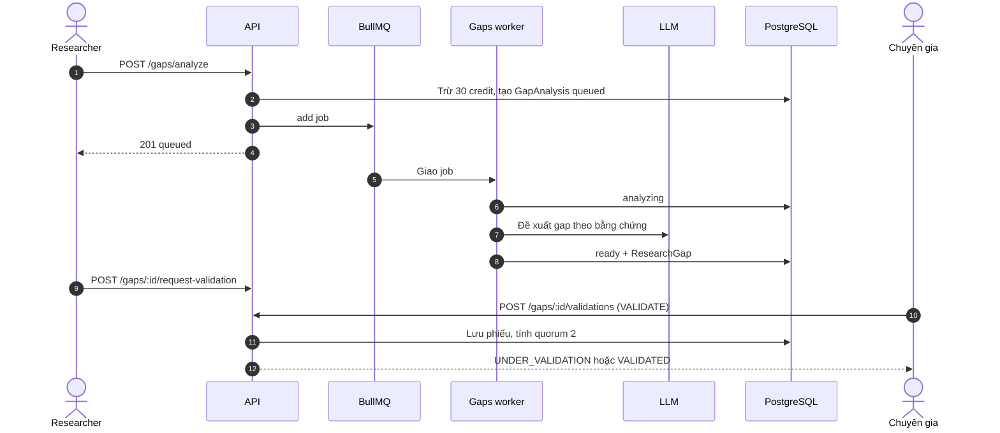

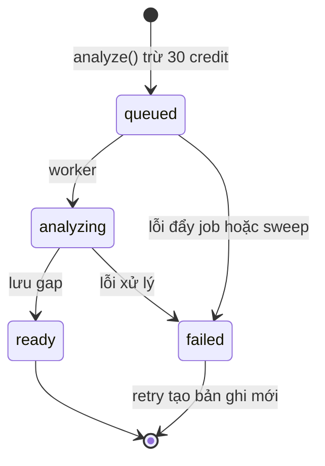

### WF-03 — Nộp bản thảo và peer review (owner: Phan Lý Văn Khoa)

| # | Mục | Nội dung |
|---|---|---|
| 1 | Tên | Manuscript submission and peer review (F-07, F-08, F-09 ↔ FR-48, FR-49, FR-50) |
| 2 | Mục đích | Cho bài của dự án được AI pre-review rồi giảng viên đã xác minh review có cấu trúc, qua các vòng sửa |
| 3 | Actor | Author (project member), reviewer (lecturer đã xác minh hoặc external reviewer), ai-jobs worker, AI Reviewer |
| 4 | Điều kiện | Có project chưa archive. Có file PDF. Reviewer có trạng thái ACTIVE, email đã xác minh, vị trí lecturer VERIFIED, không phải thành viên hay người đóng góp của dự án. Template đã được publish |
| 5 | Các bước | (1) `POST /submissions` (multipart PDF): tạo revision 1, trạng thái `submitted` → (2) author gọi `POST /submissions/:id/ai-pre-review` → trả 202, AiPreReview `QUEUED` → worker chuyển `PROCESSING` và gọi AI Reviewer → `COMPLETED`, submission chuyển `ready_for_review` → (3) `POST /review-requests`: tạo ReviewRequest `REQUESTED` kèm ReviewerAssignment và phiên bản template được ghim; submission chuyển `under_review` → (4) reviewer chấp nhận (`ACCEPTED`) hoặc từ chối (`DECLINED`); quá hạn thì `EXPIRED` → (5) reviewer lưu nháp (`IN_REVIEW`) rồi submit: kết quả MINOR/MAJOR_REVISION thì `REVISION_REQUESTED`, còn lại `COMPLETED` → (6) author trả lời từng mục sửa (OPEN → ADDRESSED) và nộp lại (`RESUBMITTED`) → quay về bước 5 |
| 6 | Thành phần | Web (/submissions, /reviews/:assignmentId), submission service, review-request service, review service, ai-jobs worker, AI Reviewer (FastAPI), file storage, PostgreSQL (Submission, SubmissionRevision, AiPreReview, ReviewRequest, ReviewerAssignment, HumanReview, ReviewResponse) |
| 7 | Đầu vào | PDF, metadata bài nộp, reviewer, template, nhận xét theo tiêu chí, phản hồi của author |
| 8 | Đầu ra | Kết quả pre-review (chỉ để tham khảo), vòng review bất biến, các mục cần sửa, contribution REVIEW (riêng tư) |
| 9 | Kết quả cuối | Review được ghi nhận. Request `COMPLETED`, hoặc yêu cầu sửa rồi `RESUBMITTED` |
| 10 | Lỗi/ngoại lệ | Pre-review lần hai khi lần đầu còn QUEUED/PROCESSING → 409 · file không phải PDF → 400 · project đã archive → 409 · reviewer từ chối rồi lại accept/save → bị từ chối, trạng thái giữ `DECLINED` (DS-03b) · tự review → 409 · vòng đã submit thì không sửa được · pre-review được thử lại 3 lần, giới hạn 5 lần/giờ |
| 11 | Chức năng liên quan | FR-48…50; liên quan FR-51 (template), FR-52 (contribution), FR-46 (availability) |
| 12 | Mô tả ở đâu | [R3 §3.9.9–3.9.12], [R4 §3.3, §2.3.5–2.3.8], [BM01 A1, DS-03a/b] |
| 13 | Tình trạng | FR-48…50 ✅; F-07…F-09 "Done" [BM01 §6]. ⚠ "Done" ở đây là đã có code, chưa phải đã có test |
| 14 | Thiếu/chưa rõ | Submission có trạng thái chết accepted/rejected/withdrawn, và shared-types viết hoa trong khi DB lưu chữ thường (SR-22 High, RF-09) · ReviewRequest.SUBMITTED là giá trị chết (SR-25) · hai mô hình trạng thái review chạy song song (ReviewRequest và ReviewerAssignment) · DS-03b cần thêm một tài khoản lecturer thứ hai đã xác minh (TBD) |

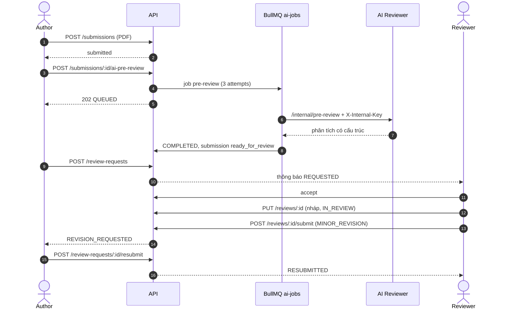

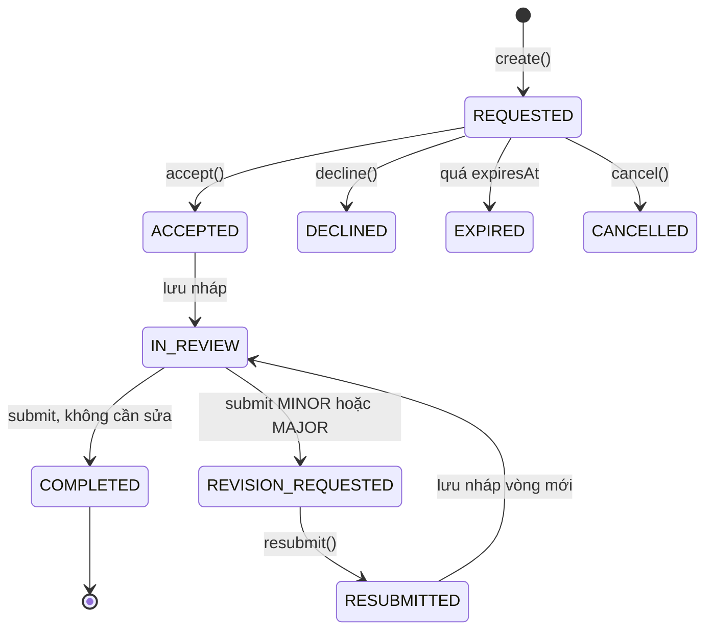
*Rút gọn từ [R4 §2.3.5]. Bản đầy đủ còn có ACCEPTED/IN_REVIEW → DECLINED/CANCELLED và đường external invitation đi thẳng vào ACCEPTED.*

### WF-04 — Xác minh giảng viên (owner: Nguyễn Đình Thanh)

| # | Mục | Nội dung |
|---|---|---|
| 1 | Tên | Lecturer verification (F-10, F-11, F-12 ↔ FR-43, FR-45, FR-44) |
| 2 | Mục đích | Chỉ cấp quyền review và mentor cho giảng viên thật, có minh chứng và được admin duyệt |
| 3 | Actor | Lecturer candidate (`POST /academic-profiles/me/verification-request`), Admin, hệ thống (vô hiệu hóa khi hồ sơ thay đổi) |
| 4 | Điều kiện | Email tài khoản đã xác minh. Đã chọn trường và vị trí Lecturer. Không có yêu cầu nào đang PENDING |
| 5 | Các bước | (1) Upload minh chứng (PDF riêng tư ≤10 MB, 1–6 mục), hoặc dùng email trường kèm link hồ sơ chính thức → (2) gửi yêu cầu: tạo evidence `PENDING`, hồ sơ chuyển PENDING → (3) admin mở /admin/academic-verifications, điền checklist → (4) admin chọn approve (`VERIFIED`, cấp REVIEW_ARTIFACT, STRUCTURED_REVIEW, MENTOR_PROJECT, gửi thông báo), more_info (`NEEDS_MORE_INFORMATION`) hoặc reject (`REJECTED`) → (5) nếu sau đó user đổi vị trí, trường hoặc email trường thì evidence PENDING hoặc NEEDS_MORE_INFORMATION chuyển `INVALIDATED`; capability được đánh giá lại |
| 6 | Thành phần | Web (/settings/verification/lecturer, /admin/academic-verifications), academic-profiles service, capability service, verification-evidence storage, notification, PostgreSQL (AcademicProfile, VerificationEvidence, UserCapability) |
| 7 | Đầu vào | Trường, vị trí, email trường, link hồ sơ, file PDF minh chứng, quyết định và lý do của admin (≥10 ký tự) |
| 8 | Đầu ra | Trạng thái evidence, trạng thái hồ sơ, capability, thông báo |
| 9 | Kết quả cuối | Hồ sơ VERIFIED và có capability giảng viên, hoặc bị từ chối, hoặc yêu cầu bổ sung |
| 10 | Lỗi/ngoại lệ | Gửi yêu cầu thứ hai khi đang PENDING → 409 (DS-04b) · đã VERIFIED → 409 · email chưa xác minh → 403 · không phải admin → 403 · quyết định lần hai → 409 · checklist chưa đủ → 400 |
| 11 | Chức năng liên quan | FR-43…45; mở khóa FR-47 (mentor), FR-49/50 (review) |
| 12 | Mô tả ở đâu | [R3 §3.9.4–3.9.6], [R4 §3.4, §2.3.9], [BM01 A1, DS-04a/b] |
| 13 | Tình trạng | FR-43…45 ✅; F-10, F-11 "Done", F-12 "In progress" [BM01 §6] |
| 14 | Thiếu/chưa rõ | Danh sách giá trị trong CHECK constraint giữa các migration chưa khớp nhau (SR-29) · DS-04a cần một tài khoản lecturer mới có email trường |

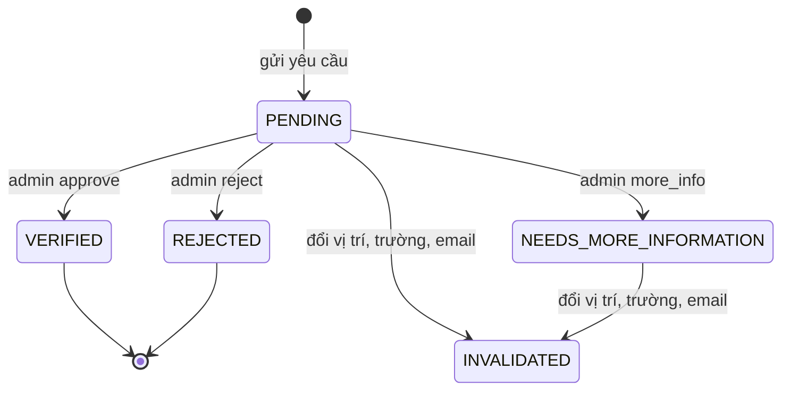

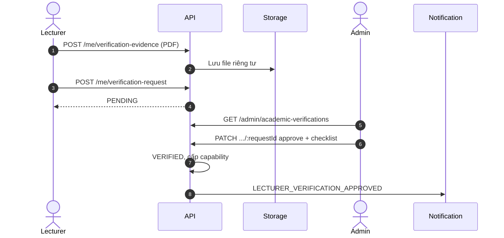

### WF-05 — Nạp credit qua PayOS (owner: **Nguyễn Đức Hoàng**)

| # | Mục | Nội dung |
|---|---|---|
| 1 | Tên | Credit top-up via PayOS (F-13, F-14, F-15 ↔ FR-32, FR-33, FR-31) |
| 2 | Mục đích | Người dùng mua credit để dùng các chức năng AI có tính phí |
| 3 | Actor | User (`POST /credits/payos/create-payment-link`), PayOS (gọi webhook) |
| 4 | Điều kiện | Đã đăng nhập. Số tiền ≥10.000 VND và là bội số của 100. Đã cấu hình key PayOS; muốn kiểm chữ ký thì phải có `PAYOS_CHECKSUM_KEY` |
| 5 | Các bước | (1) User nhập số tiền ở Settings > Credits → (2) API kiểm tra, tạo PaymentOrder `pending` (credit = floor(số tiền/100)), gọi PayOS lấy checkoutUrl → (3) user thanh toán trên trang PayOS → (4) PayOS gọi `POST /credits/payos/webhook` → (5) API kiểm chữ ký HMAC, kiểm `code == "00"` và số tiền khớp với đơn → (6) cộng credit với khóa `payos:<orderCode>` trong một transaction serializable, đơn chuyển `paid` → (7) user quay về /profile?tab=credits. **Số dư chỉ đổi nhờ webhook**, không đổi nhờ return URL |
| 6 | Thành phần | Web (CreditHistory), credit routes/controller, payosService, creditService, PayOS, PostgreSQL (PaymentOrder, CreditTransaction, User.credits) |
| 7 | Đầu vào | Số tiền (VND); payload webhook đã ký |
| 8 | Đầu ra | checkoutUrl, PaymentOrder, CreditTransaction `applied`, số dư mới |
| 9 | Kết quả cuối | Đơn `paid`, số dư tăng đúng một lần (DS-05a: 20.000 VND thành 200 credit) |
| 10 | Lỗi/ngoại lệ | <10.000 VND hoặc không chia hết cho 100 → 400 · PayOS lỗi → 400/503 · sai chữ ký → 400, không cộng (DS-05b) · sai số tiền → 400 · webhook lặp lại → "Order already paid", không cộng thêm · không có key PayOS → URL giả, đơn không bao giờ `paid` · không có checksum key → **bỏ qua kiểm tra chữ ký** (rủi ro) |
| 11 | Chức năng liên quan | FR-31…33; nguồn credit cho FR-07, 13, 15, 17, 19, 21, 25, 29 |
| 12 | Mô tả ở đâu | [R3 §3.7.1–3.7.3], [R4 §3.5 (Hình 112–117), §2.3.10], [BM01 A1, DS-05a/b], [BM04 §6.5, §7.3] |
| 13 | Tình trạng | FR-31…33 ✅; F-13…F-15 "In progress". **Chưa có test cho payos.service, webhook và credit.service** [R4 §3.5.3], SR-34 High (RF-12, hạn 18/11) |
| 14 | Thiếu/chưa rõ | PaymentOrder chỉ có pending → paid; `cancelled` và `expired` là giá trị chết, đơn bị bỏ dở kẹt ở `pending` (SR-26, RF-24) · chưa có PayOS test key (TBD) · NFR N3 phụ thuộc cấu hình · chưa có staging để nhận webhook thật |

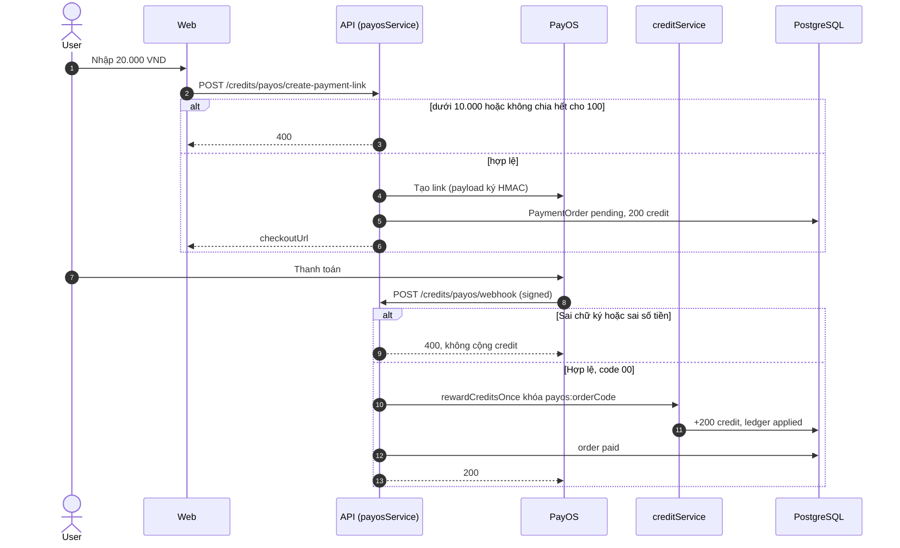

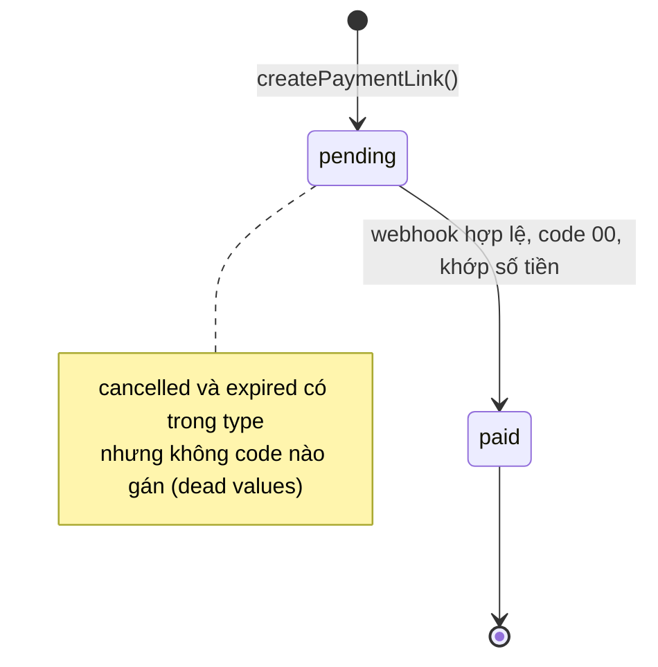

---

## Phần C — Các luồng nghiệp vụ hỗ trợ

Cột "Bước chính" gồm cả điều kiện bắt đầu và kết quả cuối. Nguồn chi tiết là FR tương ứng trong [R3].

### C1. Tài khoản và truy cập

| Luồng | Mục đích | Actor / kích hoạt | Bước chính | Thành phần | Vào → Ra | Lỗi chính | FR / UC | Trạng thái | Thiếu/chưa rõ |
|---|---|---|---|---|---|---|---|---|---|
| Đăng ký | Tạo tài khoản | Guest, `POST /auth/register` | Kiểm tra admission policy → tạo user USER/ACTIVE, 1000 credit, hồ sơ trống, capability BASIC_RESEARCH → gửi mail xác minh → trả token | API, DB, SMTP | form → token pair | 400, 409 email trùng, 429 | FR-01 / UC-01 | ✅ | Chưa có screen mock-up (TBD) |
| Đăng nhập email | Lấy phiên đăng nhập | Guest, `POST /auth/login` | Kiểm tra mật khẩu và trạng thái ACTIVE → access token RS256 15 phút + refresh token 7 ngày (lưu dạng hash) | API, DB | email/mật khẩu → token | 401 (lỗi giống nhau, chống dò tài khoản), 403, 429 (30 lần/15 phút) | FR-02 / UC-02 | ✅ | — |
| Refresh / logout | Giữ hoặc kết thúc phiên | Web client | Refresh dùng một lần (ROTATED) · dùng lại token cũ thì thu hồi cả family (REUSE_DETECTED) và ghi audit | API, DB | refresh token → token mới | 401 | FR-03 | ✅ | Có sequence [R4 Hình 119] |
| Google sign-in | Đăng nhập qua Google | Guest → Google OIDC | Chuyển hướng → callback → đổi mã một lần lấy token; liên kết hoặc tạo tài khoản | API, Google | code → token | 401 email Google chưa xác minh, 409 xung đột danh tính | FR-04 | ✅ | Có sequence [R4 Hình 120] |
| Xác minh email / quên mật khẩu | Chứng minh sở hữu email, đặt lại mật khẩu | Guest/User, SMTP | Token dùng một lần, có hạn; giới hạn 15 lần/giờ | API, SMTP | token → xác nhận | 400 token hết hạn, 429 | FR-05 / UC-03 | ✅ | Chưa có sequence diagram |
| Onboarding / hồ sơ | Bắt buộc khai báo hồ sơ học thuật | User (ProtectedRoute ép vào) | Chọn vai trò STUDENT/RESEARCHER/LECTURER, trường, lĩnh vực; đổi mật khẩu | Web, API | form → hồ sơ | 400, 403 email chưa xác minh | FR-06 / UC-04 | ✅ | — |

### C2. Khám phá tài liệu

| Luồng | Mục đích | Actor / kích hoạt | Bước chính | Thành phần | Vào → Ra | Lỗi chính | FR | Trạng thái | Thiếu |
|---|---|---|---|---|---|---|---|---|---|
| Tìm bài | Tìm theo nghĩa hoặc từ khóa | Guest/User, `GET /search`, `/papers` | Tìm vector bằng pgvector + filter → (tùy chọn) LLM re-rank 20 kết quả đầu, 5 credit nếu không có cache, lỗi thì quay về thứ tự vector và hoàn credit | API, pgvector, Redis, LLM | q → danh sách | 400, 401 khi re-rank chưa đăng nhập, 429 (60/phút; re-rank 30/giờ) | FR-07 / UC-05 | ✅ | — |
| Xem bài | Xem chi tiết | Guest/User | Metadata, tài liệu tham khảo, bài liên quan, số report trích dẫn; link PDF có hạn 300 giây, cần đăng nhập | API, storage | id → chi tiết | 404, 400 | FR-08 | ✅ | — |
| Dịch | Dịch tiêu đề và abstract | User | Provider disabled/libretranslate/gemini, timeout 15 s, 30 lần/giờ, **gọi đồng bộ** | API, LibreTranslate/Gemini | ngôn ngữ đích → bản dịch | 503 khi tắt, 400, 500, 429 | FR-09 / UC-07 | ✅ | Có trong SR-45 (đồng bộ) |
| So sánh | So sánh 2–4 bài bằng AI | User | LLM so sánh song song, 20 lần/giờ | API, LLM | id[] → bảng so sánh | 400, 429 | FR-10 / UC-08 | ✅ | — |
| Trends | Xem chủ đề tăng hay giảm | Guest/User | Số liệu xác định (không dùng LLM, miễn phí) → verdict rising/stable/declining/insufficient bằng Mann-Kendall + Benjamini-Hochberg → tab theo tháng/quý → (tùy chọn) AI giải thích | API, OpenAlex (fallback corpus local) | tham số → thống kê, verdict | 404, 503, 400 khi periods ngoài 5–24 | FR-11 / UC-09 | ✅ | ⚠ Trends đã thay đổi nhiều sau ca8fe4d (PR #56, #57, #60, #65, #66) [GIT] |
| Bookmark | Lưu bài hoặc report | User | Thêm, liệt kê, sửa ghi chú, xóa | API, DB | đối tượng → bookmark | 409 trùng, 404, 403 | FR-12 / UC-10 | ✅ | — |
| Yêu cầu thêm bài | Đưa bài mới vào corpus | User (không phải admin) | Trừ 100 credit → admin chuyển trạng thái → user nộp lại hoặc hủy (hoàn credit một lần) | API, DB, storage | metadata, PDF → paper request | 409 DOI/tiêu đề trùng, 403 admin, 400 không phải PDF | FR-13 / UC-11 | ✅ | Chưa có state machine cho paper request |

### C3. Trí tuệ nghiên cứu (ngoài WF-01/02)

| Luồng | Mục đích | Actor | Bước chính | Vào → Ra | Lỗi | FR | Trạng thái | Thiếu |
|---|---|---|---|---|---|---|---|---|
| Research directions | Gợi ý hướng nghiên cứu cho một gap | User có quyền với gap | 15 credit, khóa chống chạy song song, trúng cache thì hoàn credit | gap → directions | 409 đang chạy, 404, 429, 400 | FR-19 | ✅ | Không có sơ đồ |
| Gap Closure Protocol | Kiểm tra xem gap đã bị nghiên cứu khác lấp chưa | Chủ gap hoặc owner dự án | 10 credit → QUEUED → SEARCHING (OpenAlex) → SCREENING (gắn nhãn tài liệu) → DECIDED (CLOSED / OPEN_CERTIFIED / ABSTAIN) hoặc FAILED; có calibration để đo chất lượng | câu hỏi gap → quyết định | 400 thiếu câu hỏi, 409 đang chạy, 403 | FR-21 / UC-15 | ✅ | ⚠ Không có state machine, activity hay sequence · đã đổi sau baseline (migration closure_calibration_mode, PR #61/#62) [GIT] |

### C4. Cộng tác dự án

| Luồng | Mục đích | Actor | Bước chính | Lỗi | FR | Trạng thái | Thiếu |
|---|---|---|---|---|---|---|---|
| Vòng đời dự án | Tạo, sửa, archive, khôi phục, chuyển quyền | Owner | Có optimistic version · dự án đã có lịch sử thì chỉ archive, không xóa · owner phải chuyển quyền trước khi rời | 409 xung đột phiên bản, 400 | FR-22 / UC-16 | ✅ | Có state machine Project [R4 §2.3.12] |
| Tài liệu và sàng lọc | Thêm bài, gắn nhãn INCLUDED/EXCLUDED/MAYBE | Member | Loại bài phải ghi lý do · bài đang làm bằng chứng cho gap thì không xóa được | 409, 400 | FR-23 / UC-17 | ✅ | — |
| Thành viên và lời mời | Mời qua user hoặc email | Owner, invitee | PENDING → ACCEPTED/DECLINED/CANCELLED/EXPIRED; lời mời phải khớp email đã xác minh | 409, 403 | FR-24 / UC-18 | ✅ | Chưa có state machine ProjectInvitation |
| AI chat của dự án | Hỏi đáp dựa trên bài của dự án | Member | 1 credit mỗi tin, 40 tin/giờ, SSE, lỗi LLM thì hoàn credit; cần ≥1 bài không bị loại | 503, 409, 400, 429 | FR-25 / UC-19 | ✅ | Không có sequence |
| Chat nhóm | Nhắn tin giữa người với người | Member | SSE, đã đọc, xóa mềm, 20 tin/phút | 429, 403 | FR-26 / UC-20 | ✅ | — |
| Soạn bản thảo LaTeX chung | Viết LaTeX cùng nhau | Member, GitHub | Yjs qua WebSocket → snapshot, gợi ý chỉnh sửa, bình luận → compile qua hàng đợi và sidecar → đồng bộ GitHub | 403/404 | FR-27 / UC-21 | 🟡 | ⚠ Chỉ mô tả mức tóm tắt; không có sequence hay activity; nhiều thay đổi sau baseline [GIT] |
| Tuyển cộng sự | Đăng tin tuyển, ứng tuyển | Owner, applicant | open/closed/archived; mỗi người ứng tuyển một lần cho mỗi tin | 409, 403 | FR-28 / UC-22 | 🟡 | ⛔ Guard thực tế chỉ admin dùng được; không có giao diện web [R3 §5.4] |
| Mentor | Mời hoặc đề nghị giảng viên hướng dẫn | Owner, lecturer đã xác minh | Hai bên phải đồng ý · tối đa 1 mentor và 5 yêu cầu chờ · hết hạn sau 14 ngày · thành viên dự án không được làm mentor | 409, 400, 403 | FR-47 / UC-39 | ✅ | Chưa có state machine Mentorship (SR-27) |

### C5. AI hỗ trợ bài báo

| Luồng | Mục đích | Actor | Bước chính | Lỗi | FR | Trạng thái | Thiếu |
|---|---|---|---|---|---|---|---|
| AI review bài | Nhận xét bài PDF | User | Upload PDF (≤50 MB) → trừ 10 credit (3 nếu dùng key cá nhân) với khóa `review:<id>` → gọi AI Reviewer **đồng bộ** (timeout 180 s) → lưu lịch sử; lỗi thì hoàn credit | 400, 503 | FR-29 / UC-23 | 🟡 | ⛔ Không cấu hình được key cá nhân; không kiểm tra magic bytes của PDF; SR-45 |
| Kiểm tra định dạng | Đo layout so với preset (mặc định IEEE A4) | User | Gọi AI Reviewer đồng bộ, 60 s; **không trừ credit** dù policy ghi 2 | 400, 503 | FR-30 / UC-24 | ✅ | Chính sách giá và code không khớp (defect 5, R3 §5.4) |

### C6. Credit, thông báo, xếp hạng

| Luồng | Mục đích | Bước chính | FR | Trạng thái |
|---|---|---|---|---|
| Xem số dư và sổ cái | Minh bạch chi tiêu | Chỉ trả dữ liệu của chính người gọi; trừ credit thì ghi `applied`; hoàn credit thì đánh dấu bản gốc `refunded` và thêm dòng refund | FR-31 (F-15) | ✅ |
| Thông báo | Báo sự kiện cho người dùng | Service ghi vào bảng notifications → notification worker gửi email; người dùng đánh dấu đã đọc | FR-34 / UC-27 | ✅ |
| Xếp hạng | Bảng điểm | Không tính admin; xếp theo points, credits, tên; 10 mức level | FR-35 / UC-28 | ✅ |

### C7. Cộng đồng, kiểm duyệt, danh tính học thuật

| Luồng | Mục đích | Bước chính | Lỗi | FR | Trạng thái | Thiếu |
|---|---|---|---|---|---|---|
| Forum | Thảo luận học thuật có cấu trúc | Thread QUESTION/DISCUSSION/PAPER_DISCUSSION/RESEARCH_GAP_DISCUSSION → bình luận, vote, chọn câu trả lời; giới hạn tần suất | 400, 403 bị hạn chế, 429 | FR-40 / UC-34 | ✅ | — |
| Community | Nhóm học thuật | Admin hoặc lecturer/researcher đã xác minh mới tạo được → bản của non-admin vào PENDING_APPROVAL (tối đa 3) → tham gia (public thì ngay, private thì phải duyệt) → quản lý thành viên | 403, 409 trùng tên | FR-41 / UC-35 | ✅ | ⚠ Đã đổi sau baseline (PR #63/#64 bỏ discussion feed, AI summary, tab moderation) [GIT]; chưa có state machine community (SR-28) |
| Báo cáo và kiểm duyệt | Xử lý nội dung vi phạm | User báo cáo → moderator nhận và xử lý → leo thang lên admin (moderator khác, admin, bản quyền) → kháng nghị | 403, 409 | FR-42 / UC-36 | ✅ | Có state machine ContentReport [R4 §2.3.11] |
| Hồ sơ và lịch nhận review | Công khai hồ sơ, bật hoặc tắt nhận review | Tự chọn tham gia · đủ maximumActiveReviews thì không nhận thêm | 403 | FR-46 / UC-38 | ✅ | — |
| Template review | Rubric có phiên bản | SYSTEM/PERSONAL/PROJECT → publish rồi mới dùng được | 400 | FR-51 / UC-43 | ✅ | — |
| Kho đóng góp | Ghi nhận đóng góp | Contribution REVIEW được tạo khi review xong (PRIVATE) | 404 | FR-52 / UC-44 | 🟡 | Không có link trong app; quy tắc hiển thị chưa xác minh |
| Danh bạ giảng viên | Tìm giảng viên hoặc mentor | Mặc định chỉ hiện người đã xác minh; lọc theo chuyên môn, trường, lịch rảnh | 404 | FR-53 / UC-45 | ✅ | Không có link trong app |

### C8. Quản trị

| Luồng | Mục đích | Bước chính | FR | Trạng thái | Thiếu |
|---|---|---|---|---|---|
| Quản lý user | Vận hành tài khoản | Liệt kê, tạo, đổi role/status kèm lý do, thu hồi phiên; không hạ quyền hay vô hiệu admin cuối cùng | FR-36 / UC-29 | ✅ | — |
| Quản lý corpus | Duyệt yêu cầu thêm bài, xóa PDF hoặc bài | Bảng chuyển trạng thái trong paper-workflow | FR-37 / UC-30 | ✅ | — |
| Sync và ingest | Nạp dữ liệu OpenAlex | Preflight → plan → start/pause/cancel campaign → validation | FR-38 / UC-31 | ✅ | ⚠ Theo [R3 §3.1.4 #5], sync worker không chạy trong deployment production bình thường |
| Giám sát pipeline | Theo dõi sức khỏe hệ thống | Bộ đếm hàng đợi (backlog ngưỡng 50), heartbeat (cũ sau 2 phút), job kẹt; `/health`, `/ready` (503 khi DB hoặc Redis hỏng) | FR-39 / UC-32 | ✅ | — |

---

## Phần D — Luồng hệ thống chạy nền

Nguồn: [R3 §3.1.4], [R4 §1.1 bảng thành phần #04, luồng dữ liệu F1–F7].

| Luồng nền | Kích hoạt | Làm gì | Kết quả | Trạng thái / ghi chú |
|---|---|---|---|---|
| Embedding | Cron `0 3 * * *` hoặc admin `POST /admin/embed` | Tạo vector 768 chiều cho bài | Có thể tìm semantic | ✅ |
| Paper analysis | Cron `0 4 * * *` | AI phân tích cấu trúc bài | Dữ liệu cho trends và chất lượng | ✅ |
| Metadata sync | Cron `0 2 * * *` hoặc admin | Đồng bộ OpenAlex | Corpus cập nhật | ⚠ không chạy trong production bình thường |
| OpenAlex ingest | Theo yêu cầu | Nạp theo partition, có lease, retry, dead letter | Corpus lớn | ✅ |
| Corpus validation | Sau khi ingest | Kiểm tra chất lượng | Báo cáo kiểm tra | ✅ |
| Notification | Có thông báo mới; timer 60 s | Gửi email qua SMTP | Email tới người dùng | ✅ |
| AI jobs | Pre-review, manuscript AI, PDF import, quality evaluation | Gọi AI Reviewer hoặc LLM | Kết quả lưu DB | ✅ |
| Community summary | Theo job | AI tóm tắt community | ⚠ PR #63/#64 sau baseline ghi đã bỏ "AI summary" khỏi giao diện community [GIT]; tài liệu chưa cập nhật | — |
| Manuscript compile | Người dùng bấm compile | Gửi job tới LaTeX sidecar | PDF bản thảo | ✅ (sidecar là tùy chọn) |
| Stuck-job sweep | Worker khởi động | Chuyển job kẹt sang `failed` và hoàn credit | Không treo credit | ✅ |
| CI | PR hoặc push vào main | migrate → typecheck → Vitest → 6 bộ integration test | Báo pass/fail | ✅ không có lint, Playwright, pytest |
| CD (Jenkins) | Chạy pipeline | Build image theo git sha → kiểm env production → candidate backend phải qua /ready → thay container | Production lumigap.uk | ✅; ⚠ chưa xác minh AI Reviewer có trong Jenkins không [R3 §5.4] |

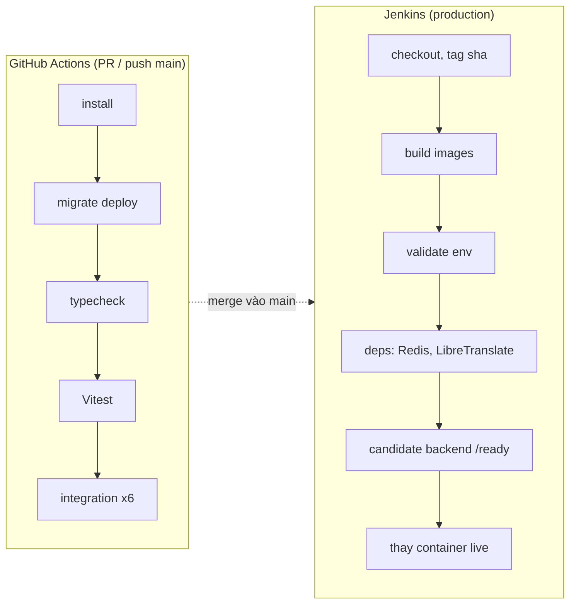
⚠ Mũi tên CI → CD chỉ là thứ tự logic. Tài liệu không ghi Jenkins tự động chạy sau khi merge [R4 §1.3.3 #08].

---

## Phần E — Đối chiếu luồng ↔ sơ đồ trong báo cáo

| Luồng | Use case | Activity | Sequence | State machine | Ghi chú |
|---|---|---|---|---|---|
| WF-01 Report | ✅ R3 Hình 3(a) | ✅ R4 Hình 81–82 | ✅ R4 Hình 77–80 | ✅ Report, ReportArtifact | Đủ |
| WF-02 Gap | ✅ | ✅ R4 §3.2.4 | ✅ R4 §3.2.2–3.2.3 | ✅ GapAnalysis, ResearchGap validation | Đủ |
| WF-03 Submission/review | ✅ R3 Hình 4(b) | ✅ R4 §3.3.4 | ✅ R4 §3.3.2–3.3.3 | ✅ ReviewRequest, ReviewerAssignment, Submission, AiPreReview | Đủ |
| WF-04 Xác minh GV | ✅ | ✅ R4 §3.4.3 | ✅ R4 §3.4.2 | ✅ VerificationEvidence | Đủ |
| WF-05 PayOS | ✅ R3 Hình 2(a) | ✅ R4 Hình 116–117 | ✅ R4 Hình 113–115 | ✅ PaymentOrder | Đủ |
| Xác thực | ✅ | — | ✅ R4 Hình 118–121 | — | Đủ ở mức thiết kế phụ trợ |
| Gap closure | ✅ UC-15 | ⛔ | ⛔ | ⛔ | Thiếu, xem [04](04_MY_DOCUMENTATION_TASKS.md) |
| Dự án, lời mời, mentor | ✅ | ⛔ | ⛔ | 🟡 chỉ Project | Thiếu Invitation và Mentorship (SR-27) |
| Bản thảo LaTeX | ✅ UC-21 | ⛔ | ⛔ | ⛔ | Thiếu, có nhiều thay đổi mới |
| Community, kiểm duyệt | ✅ | ⛔ | ⛔ | 🟡 ContentReport | Thiếu Community approval (SR-28) |
| Paper request | ✅ | ⛔ | ⛔ | ⛔ | Thiếu state machine |
| Trends | ✅ | ⛔ | ⛔ | — | Code đã đổi sau baseline |
| Gap → Project (journey 2 của R2) | — | ⛔ | ⛔ | — | Có trong mục tiêu R2 §1.2 nhưng không có WF hay sơ đồ |
| Luồng dữ liệu toàn hệ thống (DFD) | — | — | — | — | Không có trong báo cáo; môn không bắt buộc |

**Kết luận cho người làm tài liệu:**
- 5 workflow cam kết đã có **đủ** use case, activity, sequence và state machine theo yêu cầu [HD mục 03].
- Phần thiếu tập trung ở các luồng **ngoài cam kết**: gap closure, manuscript, community, mentorship. Đây là ưu tiên thấp hơn, trừ khi giảng viên hỏi.
- Rủi ro lớn hơn là các luồng **đã đổi trong code sau baseline** (trends, gap closure, community, projects) mà tài liệu chưa biết. Xem [03 §3.3](03_DOCUMENTATION_AUDIT.md#33-tính-chính-xác-e3) và [04 A-01](04_MY_DOCUMENTATION_TASKS.md).
