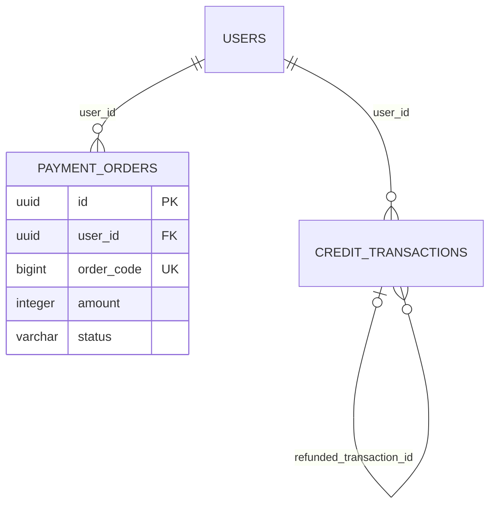
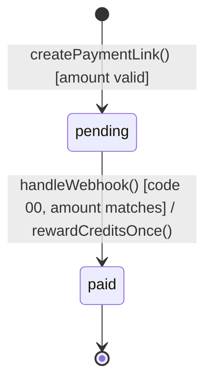
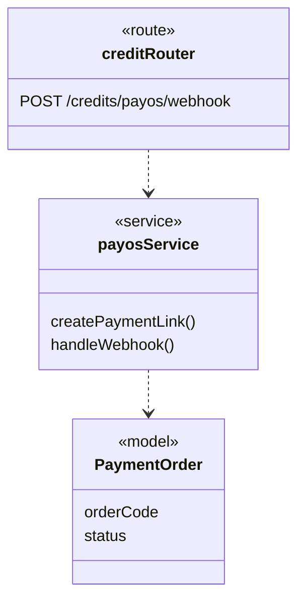
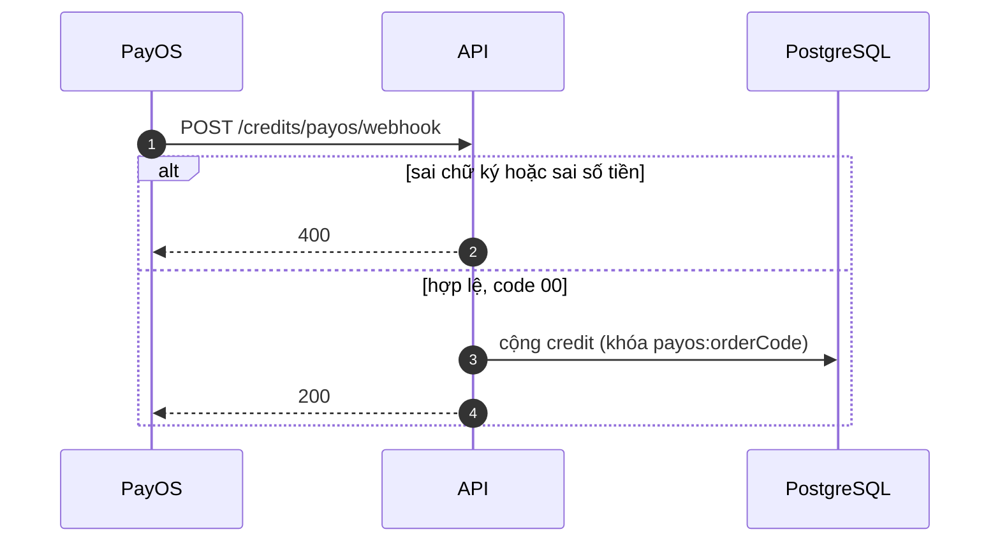

# 08 — Lý thuyết và ký hiệu các loại sơ đồ

> [01 Tổng quan](01_PROJECT_COMPLETE_OVERVIEW.md) · [02 Luồng](02_PROJECT_ALL_FLOWS.md) · [03 Audit](03_DOCUMENTATION_AUDIT.md) · [04 Việc của tôi](04_MY_DOCUMENTATION_TASKS.md) · [05 Hỏi đáp](05_PROJECT_KNOWLEDGE_QA.md) · [06 Ảnh chụp](06_SCREENSHOT_CHECKLIST.md) · [07 Nội dung tài liệu](07_REPORT_CONTENT_SUMMARY.md) · **08 Ký hiệu sơ đồ**
>
> Mỗi loại sơ đồ có: **dùng để làm gì**, **ký hiệu**, **quy ước riêng của LumiGap**, **hình ở đâu trong report**, và **câu hỏi hay gặp**. Chuẩn được áp dụng: UML 2.x (OMG), mô hình C4 (Simon Brown), ký hiệu ERD crow's foot (Information Engineering).

## 0. Quy ước chung của mọi sơ đồ LumiGap

| Quy ước | Ý nghĩa |
|---|---|
| **Màu theo vai trò** | Xanh dương = web/client · Xanh lá = API/service · Cam = worker/việc nền · Tím = kho dữ liệu (database, Redis, storage) · Xám = hệ thống ngoài · Đỏ = lỗi, thất bại |
| **Khung nét đứt xám** | Phần tử thuộc sơ đồ khác (chỉ vẽ để nối), hoặc màn hình không có link trong app, hoặc giá trị "chết" (dead value) |
| **«optional»** | Thành phần tùy chọn, có thể không bật (GitHub, LibreTranslate, R2/Cloudinary, LaTeX compiler) |
| **(a), (b), (c)…** | Sơ đồ lớn được tách thành nhiều phần để chữ đủ to khi in (từ 7 pt trở lên) |
| **Legend (khung vàng)** | Giải thích ký hiệu riêng của từng hình. Luôn đọc legend trước |
| **"source: diagrams/…"** | Caption ghi tên file nguồn trong `docs/diagrams/`. Mỗi hình có file `.puml` (PlantUML) và có thể có thêm `.drawio` (bản vẽ dùng trong report) |

---

## 1. Feature map (Report 1, Hình 1(a), 1(b), 2)

**Dùng để:** cho thấy phạm vi sản phẩm dạng cây: sản phẩm → nhóm tính năng → tính năng con. Đây không phải sơ đồ UML; template Report 1 gọi là "Major Feature Map".

**Ký hiệu:** khối giữa là sản phẩm; mỗi màu là một nhóm tính năng; khối viền đỏ đậm có nhãn **«new»** là tính năng mới bổ sung (đi kèm BM03).

**Câu hỏi hay gặp:** *"Bốn tính năng «new» là gì?"* → Collaborative LaTeX editor, GitHub connection, Gap Closure Protocol, user-supplied AI connections.

## 2. Process model (Report 2, Hình 1(a), 1(b))

**Dùng để:** mô tả quy trình làm việc lặp 2 tuần. Vẽ theo kiểu **UML activity diagram**.

**Ký hiệu:** chấm đen = bắt đầu · vòng tròn có chấm = kết thúc · hình chữ nhật bo góc = bước · hình thoi = quyết định, nhánh ra ghi điều kiện trong **[ngoặc vuông]** (ví dụ `[yes]`, `[no]`) · mũi tên quay lại = vòng lặp (lỗi review thì quay về bước implement).

## 3. C4 model: kiến trúc theo 4 mức zoom

C4 mô tả kiến trúc như bản đồ: mỗi mức "zoom" sâu hơn một bậc.

| Mức | Câu hỏi trả lời | Phần tử | Hình LumiGap |
|---|---|---|---|
| **L1 System Context** | Hệ thống nói chuyện với ai? | Person, Software System (chính), External System | R3 Hình 1 |
| **L2 Container** | Hệ thống gồm những "khối chạy được" nào? | Container: app, service, database, queue | R4 Hình 1–4 |
| **L3 Component** | Bên trong một container (API) có những module nào? | Component (module code) | R4 Hình 6–10 |
| **Deployment** | Container chạy ở đâu? | Node (máy, Docker host), container instance | R4 Hình 13–14 |

**Ký hiệu:**
- **Person**: hình người hoặc hộp có nhãn `[Person]`.
- **Box có `[công nghệ]`**: ví dụ `Express API [Node 22, Express 5]`; dòng dưới ghi trách nhiệm.
- **Đường nét đứt bao quanh = system boundary**: những gì nằm trong là LumiGap.
- **Mũi tên = quan hệ phụ thuộc hoặc gọi**, nhãn dạng **"động từ [giao thức]"**, ví dụ `REST [HTTPS]`, `jobs [BullMQ]`.

**Lưu ý:**
- "Container" trong C4 **không phải** Docker container. Nó là bất kỳ thứ gì chạy riêng hoặc lưu dữ liệu riêng (web app, API, database).
- Workers, AI Reviewer và compiler nằm **trong** boundary, vì là thành phần của LumiGap, không phải actor bên ngoài.

**Câu hỏi hay gặp:** *"Sao C4 L1 không có worker?"* → L1 chỉ thấy hệ thống như một hộp đen. Worker xuất hiện ở L2.

## 4. Use case diagram (Report 3, Hình 2(a)–5)

**Dùng để:** cho thấy **ai** (actor) dùng **chức năng gì** (use case). Đây là góc nhìn yêu cầu, không phải cách cài đặt.

| Ký hiệu | Ý nghĩa |
|---|---|
| Hình người | **Actor**: vai trò bên ngoài hệ thống (người hoặc hệ thống khác; hệ thống ngoài có nhãn «external system») |
| Hình elip | **Use case**: một mục tiêu người dùng đạt được (UC-xx) |
| Khung chữ nhật | **System boundary** (LumiGap) |
| Đường thẳng | **Association**: actor tham gia use case |
| Mũi tên tam giác rỗng giữa actor | **Generalization**: actor con kế thừa quyền của actor cha (ví dụ Lecturer là một User) |
| `«include»` nét đứt | Use case A **luôn** gọi B |
| `«extend»` nét đứt | B **có thể** mở rộng A khi có điều kiện |

**Câu hỏi hay gặp:** *"Gap validation expert có phải role riêng không?"* → Không. Đó là User có capability GAP_VALIDATION; sơ đồ dùng generalization để thể hiện.

## 5. Screen flow (Report 3, Hình 6(a)–9)

**Dùng để:** cho thấy người dùng đi từ màn hình này sang màn hình khác thế nào. Đây không phải UML; template Report 3 yêu cầu mục "Screens Flow".

| Ký hiệu | Ý nghĩa |
|---|---|
| Hộp xanh, dòng dưới là route | Một màn hình (`/reports`, `/papers/:id`) |
| Khung bao có tiêu đề "Header – … menu" | Nhóm màn hình mở được từ cùng một menu |
| Mũi tên có nhãn | Thao tác chuyển trang ("open report", "find gaps") |
| Hộp xám nét đứt | Màn hình vẽ ở sơ đồ khác, hoặc route không có link trong app |

## 6. ERD: Entity Relationship Diagram (R3 logic, R4 vật lý)

**Dùng để:** mô tả dữ liệu và quan hệ giữa các dữ liệu.

| | ERD **logic** (R3 Hình 10–14) | ERD **vật lý** (R4 Hình 15–61) |
|---|---|---|
| Mức | Nghiệp vụ (cần lưu gì) | Database thật (lưu thế nào) |
| Tên | Entity CamelCase (`ForumPost`) | Bảng snake_case (`forum_posts`) |
| Thuộc tính | Chỉ khóa và vài cột chính, không có kiểu dữ liệu | Cột kèm kiểu (`uuid`, `varchar(240)`…) |

**Ký hiệu khóa:**

| Ký hiệu | Ý nghĩa |
|---|---|
| `● id «PK»` | Primary key: định danh duy nhất của dòng |
| `«FK»` | Foreign key: trỏ tới bảng khác. `«FK users»` nghĩa là trỏ tới `users`, nhưng không vẽ đường nối cho đỡ rối |
| `«UK»` | Unique key: giá trị không được trùng |
| `«UK*»` | **Partial unique index**: chỉ không trùng với những dòng thỏa điều kiện WHERE (ví dụ chỉ một platform AI connection được active) |
| `«PK,FK»` | Vừa là khóa chính vừa là khóa ngoại (bảng nối n–n) |
| Phần trên đường kẻ đứt / phần dưới | Trên: các cột khóa. Dưới: cột nghiệp vụ |
| Hộp nét đứt | Entity thuộc sơ đồ khác, chỉ vẽ `id` để nối |

**Ký hiệu crow's foot (đầu đường nối):**

| Ký hiệu | Đọc là |
|---|---|
| `\|\|` (hai vạch) | Đúng 1 (bắt buộc) |
| `o\|` (vòng + vạch) | 0 hoặc 1 |
| `o{` (vòng + chân chim) | 0 hoặc nhiều |
| `\|{` (vạch + chân chim) | 1 hoặc nhiều |

**Quy ước LumiGap:** phía cha là "đúng 1" nếu cột FK là NOT NULL, là "0 hoặc 1" nếu cột FK cho phép NULL; phía con là "0 hoặc nhiều". Nhãn trên đường nối là **tên cột FK** của bảng con.

*Đọc: một user có 0 hoặc nhiều đơn nạp; một giao dịch có thể là hoàn tiền của 0 hoặc 1 giao dịch khác (quan hệ tự thân).*

**Câu hỏi hay gặp:**
- *"ERD có khớp database script không?"* → Có. Đã dựng lại database bằng cách chạy cả 99 migration, rồi dùng validator so từng bảng, cột và khóa ngoại: 0 lỗi.
- *"Sao 190 bảng mà không vẽ một hình?"* → Không đọc được nên tách theo nhóm nghiệp vụ, dùng hộp nét đứt để nối giữa các hình.

## 7. State machine diagram (Report 4, Hình 62–74)

**Dùng để:** mô tả **vòng đời** của một thực thể: nó có những trạng thái nào và chuyển trạng thái khi nào.

| Ký hiệu | Ý nghĩa |
|---|---|
| Chấm đen đặc | Trạng thái khởi đầu `[*]` |
| Vòng tròn có chấm giữa | Trạng thái kết thúc |
| Hộp bo góc | Trạng thái (`queued`, `PENDING`…) |
| Mũi tên có nhãn **`trigger [guard] / effect`** | Sự kiện kích hoạt · [điều kiện] · / tác dụng phụ. Ví dụ `handleWebhook() [code 00, amount matches] / rewardCreditsOnce()` |
| Hộp xám nét đứt | **Dead value**: giá trị có trong type hoặc CHECK constraint nhưng không code nào gán (ví dụ `cancelled`, `expired` của PaymentOrder) |
| Màu | Xanh nhạt = chờ · xanh đậm = đang xử lý · xanh lá = thành công · đỏ = thất bại |

**Câu hỏi hay gặp:** *"Sao có trạng thái mà không vẽ đường vào?"* → Đó là dead value. Nhóm ghi rõ trong note để trung thực, và đã đưa vào BM02 (SR-22, SR-25, SR-26).

## 8. Class diagram (Report 4, Hình 75, 76, 83, 84, 92–94, 105, 106, 112)

**Dùng để:** cho thấy **những class hoặc module nào** tham gia một workflow và chúng phụ thuộc nhau ra sao.

| Ký hiệu | Ý nghĩa |
|---|---|
| Hộp 3 ngăn | Tên (kèm stereotype) / thuộc tính hoặc file / phương thức chính |
| **Stereotype** `«page»` `«route»` `«controller»` `«service»` `«worker»` `«client»` `«model»` | Vai trò của class: trang web, router, controller, service, worker, client gọi ngoài, model Prisma |
| Mũi tên nét đứt `- - ->` | **Dependency**: A gọi hoặc dùng B |
| Đường liền có số `1`, `0..*`, `0..1` | **Association với multiplicity**: quan hệ dữ liệu giữa các model |
| Khung nét đứt có tên (Web, Backend, Data model) | Nhóm theo tầng |

## 9. Sequence diagram (Report 4, Hình 77–80, 85–89, 95–101, 107–110, 113–115, 118–121)

**Dùng để:** cho thấy **thứ tự các lời gọi** giữa các thành phần theo thời gian (từ trên xuống dưới).

| Ký hiệu | Ý nghĩa |
|---|---|
| Hình người / vòng tròn có vạch / vòng tròn có mũi tên / trụ | Lifeline: actor · boundary (giao diện) · control (router, service) · database |
| Đường kẻ dọc nét đứt | Lifeline: thời gian sống của đối tượng |
| Thanh chữ nhật hẹp | Activation: đang xử lý |
| Mũi tên liền đầu đặc → | **Lời gọi đồng bộ** (chờ kết quả) |
| Mũi tên đầu mở | **Lời gọi bất đồng bộ** (ví dụ đẩy job vào queue) |
| Mũi tên nét đứt ← | **Trả về** |
| Khung **alt** | Rẽ nhánh if/else, mỗi nhánh có [guard] |
| Khung **opt** | Chỉ chạy khi điều kiện đúng |
| Khung **loop** | Lặp (ví dụ web hỏi trạng thái mỗi 3 giây) |
| Số thứ tự 1, 2, 3… | Thứ tự bước |
| Note "continues in (b)" | Sơ đồ tiếp tục ở phần sau |

## 10. Activity diagram (Report 4, Hình 81, 82, 90, 91, 102–104, 111, 116, 117)

**Dùng để:** mô tả **luồng nghiệp vụ** ở mức actor: ai làm bước nào, rẽ nhánh ra sao. Theo hướng dẫn Review 2, mỗi main workflow phải có một activity diagram.

| Ký hiệu | Ý nghĩa |
|---|---|
| Cột có tiêu đề (swimlane / partition) | Mỗi cột là một actor (User, LumiGap platform, PayOS…) |
| Chấm đen / vòng tròn có chấm | Bắt đầu / kết thúc |
| Hộp bo góc | Hành động |
| Hình thoi | **Decision** (rẽ nhánh, ghi [guard]) hoặc **merge** (gộp nhánh) |
| Thanh đen ngang dày | **Fork / join**: các nhánh chạy song song rồi gộp lại |
| Note vàng | Ghi chú, ví dụ "Webhook handling in (b)" |

**Khác với sequence:** activity trả lời *"quy trình đi qua những bước nào, ai làm"*; sequence trả lời *"thành phần nào gọi thành phần nào, theo thứ tự nào"*.

## 11. Package diagram (Report 4, Hình 5, 11, 12)

**Dùng để:** cho thấy code được chia thành những gói nào và gói nào phụ thuộc gói nào.

| Ký hiệu | Ý nghĩa |
|---|---|
| Hình thư mục (folder có tab) | Package |
| Mũi tên nét đứt `«use»` | Gói A import gói B |
| Số như `4 / 2` trên mũi tên | Số lượt import theo mỗi chiều (đếm bằng script, là giới hạn dưới) |

## 12. Deployment diagram (Report 4, Hình 13, 14)

**Dùng để:** cho thấy phần mềm chạy ở đâu: máy nào, Docker network nào, cổng nào.

**Ký hiệu:** khối lớn = node (Docker host, network); khối nhỏ bên trong = container đang chạy, kèm image và cổng; mũi tên = kết nối mạng kèm giao thức; khung xám dưới cùng = những gì **không định nghĩa** trong code (staging, hosting).

---

## 13. Cách đọc một hình trong 30 giây (dùng khi bị hỏi bất ngờ)

1. **Đọc tiêu đề và caption**: loại sơ đồ gì, phần mấy, nguồn ở đâu.
2. **Đọc legend**: ký hiệu riêng của hình này.
3. **Tìm điểm bắt đầu**: chấm đen (state/activity), actor (use case/sequence), hoặc thực thể trung tâm (ERD).
4. **Đi theo mũi tên chính** (luồng thành công), rồi mới xem các nhánh lỗi (alt, [no], trạng thái đỏ).
5. **Nối với tài liệu**: hình nào ứng với FR nào, WF nào (xem [07](07_REPORT_CONTENT_SUMMARY.md)).

## 14. Câu hỏi về ký hiệu hay bị hỏi

| Câu hỏi | Trả lời ngắn |
|---|---|
| Use case khác activity thế nào? | Use case: *ai làm được gì*. Activity: *các bước diễn ra thế nào* |
| Sequence khác activity thế nào? | Sequence: thứ tự lời gọi giữa thành phần. Activity: thứ tự hành động theo actor |
| ERD logic khác ERD vật lý? | Logic: dữ liệu nghiệp vụ. Vật lý: bảng, cột, kiểu, ràng buộc thật |
| C4 khác UML component? | C4 là cách trình bày kiến trúc theo mức zoom, đơn giản hơn; UML có ký hiệu chặt hơn |
| `[guard]` và `/effect` nghĩa là gì? | Guard: điều kiện để chuyển. Effect: việc làm khi chuyển |
| Đường nét đứt nghĩa là gì? | Tùy loại hình: dependency (class, package), trả về (sequence), include/extend (use case), phần tử ở hình khác hoặc dead value (hộp nét đứt) |
| Sao một số FK không có đường nối? | FK tới `users` xuất hiện gần như ở mọi bảng; ghi `«FK users»` thay vì vẽ để hình đọc được |
| Sao sơ đồ có cả `.puml` lẫn `.drawio`? | Hướng dẫn yêu cầu nguồn ở dạng PlantUML hoặc Mermaid. `.drawio` là bản trình bày; hai bản có cùng phần tử và quan hệ |
