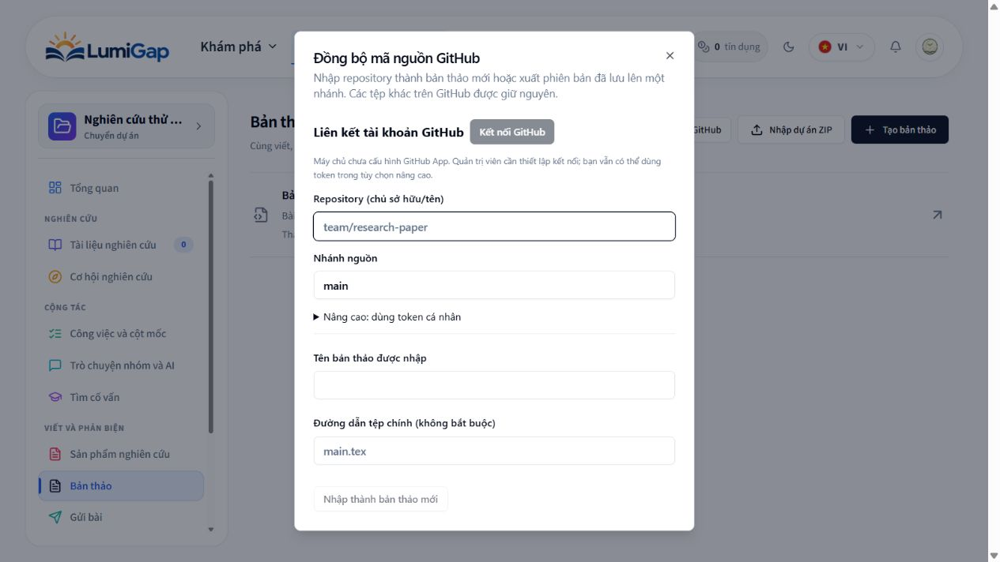

# GitHub App connection for manuscripts

The primary flow is **Manuscripts → GitHub → Kết nối GitHub → approve on GitHub →
return to the same manuscript → select an authorized repository/branch → inspect
and explicitly pull/push**. The dialog reopens after a successful callback. Manual
PAT access remains under **Nâng cao**. Existing snapshots, file-level conflict
choices and non-force branch updates remain in use.

This connection authorizes manuscript transfers. It does not sign in to LumiGap,
grant project membership, or share a project owner's credentials with teammates.
Every member connects their own GitHub account. The selected repo/branch binding
is manuscript data; credentials are private to each LumiGap user.

The Client ID/Secret belong to the LumiGap deployment and are configured once by
its operator. Ordinary users do not create an app, enter these secrets or generate
a PAT: they use **Kết nối GitHub**, approve access on GitHub and return to the
manuscript. The optional PAT field stays collapsed under Advanced.

## Register and configure once per deployment

Register a **GitHub App** in the GitHub account/organization that operates LumiGap.
This registration must be done by an administrator with that account's access.

1. Set the Homepage URL to the public LumiGap web origin.
2. Set a user authorization **Callback URL**:
   - Local Compose: `http://localhost:8080/integrations/github/callback`.
   - Native web dev: `http://localhost:3000/integrations/github/callback`.
   - Production: `https://YOUR_WEB_HOST/integrations/github/callback`.
   Use the frontend origin/path, not the backend OAuth completion endpoint.
3. Request repository **Contents: Read and write**. Metadata read is provided by
   GitHub. Do not request Actions, Workflows, administration or organization write.
4. Keep expiring user access tokens enabled. The authorization request also uses
   `offline_access` to opt into expiration. Device flow is not needed.
5. Disable Webhooks unless separately implementing webhook delivery. This feature
   syncs only on explicit user action. Leave automatic OAuth authorization during
   installation off: LumiGap starts a session-bound PKCE flow itself.
6. Generate a Client Secret on GitHub and provide these backend environment
   variables through the deployment secret configuration. Never commit real values:

   ```dotenv
   GITHUB_CLIENT_ID=YOUR_GITHUB_APP_CLIENT_ID
   GITHUB_CLIENT_SECRET=YOUR_GITHUB_APP_CLIENT_SECRET
   GITHUB_APP_SLUG=your-lumigap-app-slug
   GITHUB_CALLBACK_URL=http://localhost:8080/integrations/github/callback
   # Optional dedicated encryption secret: at least 32 random characters.
   GITHUB_CONNECTION_ENCRYPTION_KEY=YOUR_RANDOM_SERVER_SIDE_ENCRYPTION_SECRET
   ```

   If the dedicated encryption key is omitted, an independently derived key uses
   the existing `INTERNAL_SERVICE_KEY`. Rotating either effective encryption key
   requires users to reconnect. Credentials cannot be migrated by changing keys.
7. Install the app on the repositories the user/team wants to synchronize. Choose
   specific repositories when possible. Users can open **Quản lý quyền repository
   trên GitHub**, install/configure access, return and reload the repository list.
8. Apply migrations with `pnpm --filter backend db:migrate:deploy`, generate Prisma
   and rebuild backend/shared-types/web. Recreate the backend to load updated env.
   Local Compose already reads root `.env`; production must inject these variables.

`configured: false` is returned when Client ID/Secret are absent. The UI explains
the missing setup and disables OAuth while retaining the PAT fallback. No keys or
registration are fabricated. App ID/private key are not needed for this user-token
flow; installation tokens/background bot access are not implemented.

## Security and lifecycle

- Authorization uses a 256-bit random state, 10-minute Redis lifetime, single-use
  compare-and-delete, session/user binding and S256 PKCE. The callback frontend
  removes code/state from its URL and completes through an authenticated POST.
  A changed/revoked LumiGap session cannot complete the original connection.
- PostgreSQL stores AES-256-GCM ciphertext with user-bound associated data. Access
  and refresh tokens never appear in API responses, frontend storage or URLs.
  A connection revision invalidates old flows and disconnect races. Refreshes
  serialize across API instances using a PostgreSQL row lock.
- Connected Git requests use a narrow backend proxy to fixed HTTPS GitHub origins,
  rejecting redirects, arbitrary endpoints, force-push, unsupported source paths,
  tags and extra request fields. Every operation uses the current user's token.
  Calls have a 15-second timeout and bounded response/body sizes.
- Repository enumeration uses GitHub's authenticated user repository API, which
  applies the user token/app's access. Requests beyond that grant fail on GitHub.
  No repository is created, published or pushed merely by connecting an account.
- Invalid/revoked provider tokens clear the GitHub connection and return a 403;
  they do not invalidate the LumiGap login. Temporary GitHub outages retain saved
  credentials for retry. GitHub branch protections are still enforced.
- Disconnect clears local credentials before attempting upstream token revocation.
  If GitHub is unavailable, the UI explicitly asks the user to revoke LumiGap in
  GitHub settings. Disconnect does not uninstall the app or delete repositories.

## API

All endpoints require LumiGap bearer authentication and return private/no-store
responses under `/api/v1/integrations/github`:

| Method/path | Purpose |
| --- | --- |
| GET `/` | Safe configuration/connection status |
| POST `/start` | Create session-bound authorization URL; validated `returnTo` |
| POST `/complete` | Complete callback using `code` and `state` |
| GET `/repositories?page=1` | Paginated authorized repository choices |
| POST `/repository` | Validated source Git-object operations with saved token |
| DELETE `/` | Disconnect current user's saved credential |

## Verification

Automated checks cover encryption/tampering, callback state/session/replay,
superseded and disconnected callbacks, concurrent refresh rotation, expired and
revoked credentials, local disconnect during upstream outages, strict proxy
boundaries, authenticated HTTP routes, UI repository selection, callback
StrictMode handling and the existing PAT transport. Provider responses in these
checks are synthetic; persistence checks use disposable PostgreSQL and random
short-lived Redis keys. Live authorization requires the app registration above.

Verified 2026-10-20: 113 manuscript frontend tests, nine PostgreSQL/Redis OAuth
persistence tests, nine crypto/HTTP/schema/route tests and four PostgreSQL runtime
boundary tests passed (135 total). Shared-types/backend/web builds, targeted ESLint
and scoped whitespace checks passed. The additive migration was applied locally;
backend/web images were updated and `/ready` confirmed PostgreSQL and Redis.

A disposable browser project confirmed the Vietnamese connection dialog and its
explicit unconfigured state, with PAT entry collapsed under Advanced. The actual
local server has no registered GitHub App credentials, so the Connect action is
disabled until the administrator supplies the configuration. No real account was
linked and no repository was published during verification.

### Recheck 2026-10-30

The user's actual manuscript on port 8080 displays **Kết nối GitHub** with the
manual token fallback collapsed. The running backend has no `GITHUB_CLIENT_ID`,
`GITHUB_CLIENT_SECRET` or `GITHUB_APP_SLUG` configured, so authorization is correctly
disabled. The operator confirmed that a GitHub App already exists and will supply
the backend configuration. Do not substitute fake credentials or claim a completed
live authorization until those values are loaded and a user approves on GitHub.

Executed again: nine backend crypto/HTTP/schema/route tests and eleven frontend
callback/connection/connected-client/Git transport tests passed (20/20). These
checks use synthetic provider responses; PostgreSQL OAuth persistence tests were
not rerun in this recheck. No manuscript content, GitHub permission or repository
was changed. No new OAuth implementation was necessary.

After setting the server environment, recreate the backend with the same Compose
overrides used to launch it (including the isolated compiler configuration); a
plain container restart does not reload `env_file`. Refresh the manuscript and
open GitHub to load the configuration status. The registered user authorization
callback must exactly match `http://localhost:8080/integrations/github/callback`.

Later on 2026-10-30, at the operator's explicit request, the supplied Client ID,
Client Secret, app slug and frontend callback URL were written to the ignored
local `.env`, after a local backup. The backend was recreated with the existing
compiler-network override. Presence of all four settings was verified inside the
running container without printing the secret; `/ready` and the frontend callback
page returned HTTP 200. No RSA private key was stored or used by this user OAuth
flow. The registration's Callback URL still needs to match the frontend URL above;
an actual GitHub authorization/exchange has not been performed in this recheck.
Credentials disclosed in chat must be revoked/rotated in GitHub and replaced
locally; do not copy them into this document or version control.



References: [GitHub App user authorization](https://docs.github.com/en/apps/creating-github-apps/authenticating-with-a-github-app/generating-a-user-access-token-for-a-github-app),
[refresh rotation](https://docs.github.com/en/apps/creating-github-apps/authenticating-with-a-github-app/refreshing-user-access-tokens),
[repository API](https://docs.github.com/en/rest/repos/repos#list-repositories-for-the-authenticated-user).


## Manuscript GitHub tab (2026-10-30)

### Team model

- One manuscript has one shared repository and branch, stored in its remote binding.
- A GitHub connection belongs to a LumiGap user. Connecting or disconnecting it does not grant or revoke GitHub access for other members.
- One person coordinating synchronization is sufficient. Team members who only write in LumiGap need no GitHub connection. The project owner manages synchronization with their own GitHub account; there is no project-wide shared credential or mandatory connection count.
- Synchronizing requires project ownership, manuscript write permission and the project's existing source export policy. Pushing additionally requires the caller's own GitHub Contents write permission. GitHub read-only access can receive changes.
- Under the current policy, any eligible editor can select or change the shared target. The UI requires explicit confirmation before applying a plan targeting a different repository or branch. This is a coordination recommendation, not a new exclusive coordinator role.

### Interface and workflow

1. Open the **GitHub** tab beside **PDF preview**, or the GitHub toolbar action. A linked manuscript starts on **Synchronization**. An unlinked manuscript starts on **Connection settings**. Other members can view the shared binding and history; only the owner can open connection settings.
2. In **Connection settings**, connect a personal GitHub account. The saved-source preparation runs before OAuth redirect. Returning from OAuth selects the GitHub tab, without automatically synchronizing.
3. Choose an authorized repository (its default branch is selected automatically), then press **Connect repository**. This checks repository/branch access and stores the shared destination without transferring source or inventing a common baseline. A different existing destination requires confirmation before linking. App installation and GitHub repository permissions remain managed by GitHub. Successful linking returns to **Synchronization**.
4. On **Synchronization**, only the currently linked destination exposes **Inspect synchronization**. Inspection creates/reuses a recovery snapshot and compares local source, remote source and the last shared baseline. This step does not push or apply incoming source.
5. Review counts and per-file changes. Resolve every conflict explicitly. A different existing shared target requires confirmation.
6. **Pull merged source** applies the chosen merge in LumiGap. **Push merged source** applies the chosen merge locally and sends it to GitHub. These operations preserve the existing merge semantics: receiving does not discard local-only changes, and sending includes the resolved merge.
7. Recheck local source revision, GitHub branch head and binding revision before applying. Conflicting concurrent changes require inspection again. A successful operation updates the shared baseline and commit link. Compile after receiving source.

**History** is a separate view with the actor, timestamp and recorded commit.
Commit links use each event's repository metadata rather than the current target.
Loading, empty and failed history states are distinct; failed loading can be retried.
Synchronization contains neither account/repository forms nor the setup stepper or
history list. Account scope/team explanations and creation/replacement controls
live in settings. Returning to synchronization cancels an unlinked target choice;
it never changes the saved binding. Switching views performs no source transfer
and retains an existing comparison when the target has not changed. Leaving
settings unmounts its creation form. Section tabs support keyboard navigation and
cannot be changed while a connection/transfer operation is pending.

The tab keeps an ongoing transfer mounted when changing editor panels. It clears a manually entered token and a stale comparison after leaving the tab once the transfer finishes. Closing the page can still interrupt a transfer; existing snapshots and non-force Git commits provide recovery, and errors instruct the user to inspect again. Local database updates and GitHub commits are separate systems, not one atomic transaction.

### Repository setup improvements (2026-10-31)

- Personal authorization, shared repository linking and file synchronization are distinct steps. Entering/selecting a name cannot advance to comparison by itself.
- Linking uses the existing authenticated remote-binding endpoint with an empty baseline and expected manuscript/binding versions. Existing export policy, private-project restrictions and concurrency checks remain enforced by the backend.
- Personal reconnect/disconnect actions are disclosed separately. Repository selection uses the authorized list; manual owner/name entry and the editable branch field were removed to simplify setup. Choosing or creating a repository fills its default branch automatically. Existing remote bindings retain their stored branch until the owner explicitly chooses a target again.
- Refresh starts at page one, allowing repositories created outside LumiGap to appear. Load-more is offered only when another page exists. Missing newly created repositories have an explicit app-installation/access hint.
- Creating a repository inside LumiGap immediately inserts/selects it in the chooser and guides the user to connect it. Creation already requests GitHub's `auto_init`, so the new repository has an initial README commit.
- A README-only repository is a valid synchronization destination. It yields an empty remote manuscript-source set; local files can then be published explicitly. Importing an empty new draft remains rejected. For an externally created repository with no commits, linking displays **Initialize README and connect**. Only this explicit action calls the narrow initializer endpoint; ordinary linking never creates a commit. The initializer checks active membership, export policy, private-project restrictions, push permission, the default branch and an explicit empty-repository response. It creates a fixed README without a file SHA, so it cannot overwrite an existing README. No manuscript content is included. GitHub authentication/quota/validation/outage errors cannot authorize initialization.
- Initialization and binding are separate operations. If initialization succeeds but binding fails, retry ordinary linking. **Check repository again** also supports recovery after a lost response or initialization performed elsewhere. The UI clears the initialization state when the target or account changes.
- GitHub project-scoped endpoints accept preserved legacy project IDs as well as PostgreSQL UUIDs. Authorization/membership and audit records always use the resolved PostgreSQL project ID. This fixes the existing manuscript URL whose project segment is a 24-character legacy ID.

Executed verification for this change: 35 focused frontend tests and 28 backend
GitHub schema/access/route/crypto/HTTP tests passed. The access tests verify legacy
resolution, canonical audit attribution, new-repository export checks and rejection
of removed members before contacting GitHub. Initialization tests additionally verify
the fixed README payload, explicit opt-in, nonempty/error/permission rejection and
recovery after binding failure. Provider responses in those automated
tests are synthetic. Frontend TypeScript, scoped lint and production build passed.

Both local images were rebuilt and recreated on port 8080 with the existing
compiler Compose override; `/ready` returned 200. Live verification on the actual
manuscript confirmed that selecting `nguyendinhthanhh/LumiGap_GitHub` enables
**Connect repository** while **Inspect synchronization** remains absent. Ordinary
linking correctly detected the repository's missing initial commit and displayed
**Initialize README and connect** plus **Check repository again**, without the
former generic failure. No initialization commit, manuscript upload or successful
binding was performed on this live repository. The README-write and subsequent
binding flow are covered by synthetic tests, not a live GitHub write.


### Simplified repository picker (2026-10-31)

Removed manual repository entry and the editable source-branch field from both
GitHub setup and import. Selection/creation already supplies the default branch;
loading a previously saved binding does not change its branch. This follows the
list-based setup documented by [Overleaf](https://docs.overleaf.com/integrations-and-add-ons/git-integration-and-github-synchronization/github-synchronization).

Rechecked 24 connection/synchronization tests, scoped ESLint, TypeScript and the
production build, all passed. Rebuilt the local web image on port 8080. Live DOM
verification found zero manual-entry labels and zero branch textboxes, while the
existing linked repository retained `main`. No GitHub write was performed in this
picker simplification.


### GitHub workspace separation (2026-10-31)

Split the workspace into Synchronization, Connection settings and History.
Linked manuscripts open on Synchronization; initial setup opens on settings.
Account management and repository creation/replacement are confined to settings.

Verification: 31 focused frontend tests (27 synchronization and 4 connection),
scoped ESLint, frontend TypeScript and the production build passed. The local web
image was rebuilt and deployed on port 8080. Live checks on the actual manuscript
confirmed the compact default view, separate settings and history with actor,
timestamp and recorded commit. Opening the creation form and leaving settings
closes it; reopening settings shows no repository-name field until requested.
No repository creation or source transfer was submitted during these live checks.


### Owner-managed repository setup (2026-10-31)

Repository creation is a modal opened above the existing-repository picker. It
creates an initialized repository in the connected user's GitHub account, inserts
it into the picker and selects its default branch. Linking and source transfer
remain explicit separate actions. Creation errors stay inside the modal and keep
the user's entered fields for retry; pending requests block dismissal/submission.

For a linked manuscript, settings show the saved target and **Change repository**.
The picker and creation action are hidden until replacement is requested; no
repository-list request is made while hidden. Canceling replacement restores the
saved target. Replacing a selected target still requires explicit confirmation.

Only the LumiGap project owner can create/initialize repositories for a project,
change a manuscript binding or synchronize source. GitHub access and project
export policies remain required. Ordinary team members retain manuscript editing
and read access to the shared target/history. Backend checks enforce this even
for direct API calls. The detail DTO exposes `canManageGithub` for the UI; fresh
ownership is checked again before transfer, and source application rechecks it
inside the write transaction. Creation requests are pinned to the initiating user.

Executed verification: 35 focused frontend tests and 34 backend access/route/schema/
ownership tests passed, including ownership loss before applying source, active
member read access and creation failure/retry. Scoped ESLint and TypeScript passed
for both apps; backend and frontend production builds succeeded. After the final
form spacing adjustment, the frontend production bundle was rebuilt and packaged
into the existing local nginx image. Both services are running on the existing
4000/8080 ports and `/ready` returned 200.

Live browser verification confirmed the linked-target view hides creation, changing
repository reveals creation above the picker, the modal opens with a private default,
and canceling replacement retains the original repository/branch. No live repository
creation or source transfer was submitted; provider writes were tested synthetically.


### Verification scope

Tests cover reader visibility, OAuth return selecting the tab, keyboard tab navigation, comparison without remote/local source application, explicit target-change confirmation, unresolved conflicts, GitHub read-only access, stale local revision/remote head/shared binding, revoked manuscript write access and panel switching during a transfer. Live GitHub authorization and repository writes require an authorized user account and are not simulated against a real manuscript.

### Commit history and conflict recovery (2026-10-31)

Synchronization now lists the five most recent commits on the connected branch,
including first-line message, short SHA, author and date. This read-only request is
independent of source comparison and has its own loading, empty, retry and refresh
states. Responses are discarded when account, target or active section changes.
Commit links are constructed on github.com rather than trusting provider URLs.
The proxy permits only the exact bounded commit-list and SHA comparison paths.
API contract: [GitHub commit endpoints](https://docs.github.com/en/rest/commits/commits).

After comparison, **Receive changes from GitHub** applies the reviewed combined
source in LumiGap. **Send changes to GitHub** also advances the remote branch,
without force. Both retain non-conflicting changes from either side; the UI
explains this explicitly. The comparison itself never applies incoming source or
updates a GitHub ref.

Text conflicts can be automatically combined only when the saved baseline matches
the complete source tree at a verified ancestor commit. A bounded line LCS builds
edits against the common source. Disjoint edits are combined, identical edits are
deduplicated, and overlapping edits or ambiguous insertion boundaries require
review. UTF-8 is decoded strictly, preserving BOM, CRLF and final newline. Binary,
invalid UTF-8, control-character text, files above 128 KB and comparisons above
500,000 LCS cells remain manual conflicts. Fetching old source is limited to
eligible conflicting files. Missing or rewritten Git history leaves manual file
selection available without claiming a verified common ancestor.

An unresolved conflict offers an explicitly confirmed **Create conflict branch**
action when a common ancestor is verified. The branch starts at that common
commit, not the latest remote commit, so a PR retains the true divergent history.
It contains the prepared saved LumiGap source, including supported local deletions;
unrelated repository files remain in the base tree. Names include UTC time and a
random suffix. Fresh ownership/write permission, local source version, remote SHA
and shared binding are checked before export. Only a new ref is created; the
connected branch and manuscript source are not changed by this action.

The result includes a saved-commit link, a GitHub compare link for creating a PR,
and instructions to resolve, merge into the connected branch and compare again.
LumiGap does not automatically create or merge the PR. The result remains while
switching workspace sections in the current mounted session; the GitHub branch
itself remains on GitHub after page reload. Existing project export auditing also
records ref creation; this is not presented as a persisted manuscript sync event.

Verification: 58 focused frontend tests and 35 backend tests passed, including
ancestry, baseline mismatch, deletion preservation, non-force writes, overlapping
edits, source/binding/head/ownership changes, history failure/retry and late
responses from a previous account/repository. Scoped lint, frontend/backend
TypeScript and production builds passed. Backend and web were recreated using
the existing compiler Compose override; readiness returned 200.

Live verification on the actual manuscript loaded the two real repository commits
and compared the sources successfully (both sides identical, source version 7).
No receive/send action, new branch or PR was submitted against the real project.
GitHub write behavior was verified with synthetic provider responses.


### Direct receive/send and readable comparison (2026-10-31)

This revision supersedes the mandatory comparison step described above.
Connected owners now see Receive and Send immediately, with optional comparison
below them. A direct action prepares the saved source and checks GitHub internally.
It proceeds if safe; unresolved conflicts or the first combination of populated
independent histories pause for review without applying source or updating a ref.
Existing source-version, binding-version, ownership and non-force checks remain.
Using a previously displayed comparison also flushes pending editor changes and
rejects source that no longer matches the reviewed version.

Receiving when only local edits exist reports that GitHub has no incoming changes
and preserves the local edits. Identical sources do not call source application,
push or binding updates once a baseline exists. The first explicitly reviewed sync
of identical sources records the shared baseline without applying files or making
a GitHub commit. Repeated submissions are blocked while work is pending.

The comparison layout bug came from `.writing-sync-plan > div:not(.writing-actions)`
applying a two-column grid to the diff wrapper. It is now scoped to file rows.
Diff previews use stacked GitHub/LumiGap sections with constrained width, wrapped
monospace lines, line numbers and removed/added colors. The preview finds the first
and last differing lines, retaining surrounding context, instead of truncating
each file to its first 500 characters. Large regions and long lines are bounded
with explicit omission indicators; binary, oversized and invalid UTF-8 previews
show an explanation. Zero-count summary items are hidden.

Verification: 47 synchronization/UI tests plus the existing 21 client, merge and
connection tests passed. New cases cover direct receive/send, duplicate clicks,
unresolved conflicts, independent histories, read-only GitHub access, local-only
receive, identical sources, newly flushed editor changes and a late-file diff
containing HTML-like source. Scoped lint, frontend TypeScript and production build
passed. The web production bundle was repackaged into the existing local nginx
image and the web service recreated on port 8080.

Live visual verification after re-login confirmed that Receive and Send are
available before comparison on the actual manuscript. Optional comparison found
the existing local edit in `pages/page-1.tex` (`PURCHASE ORDER` on GitHub and
`PURCHASE ORDERS` in LumiGap). Both stacked previews rendered wrapped source,
line numbers and removed/added highlighting without overlapping text at the
1265px browser viewport. The two real recent commits also loaded successfully.
No real manuscript receive/send or GitHub write was performed in this revision;
write behavior is covered by the focused automated tests above.


