# Nâng cấp PDF → LaTeX có cấu trúc

Ngày kiểm tra: 20/10/2026. Phạm vi: chế độ **Trích xuất nội dung để chỉnh sửa · Docling**.

## 1. Nguyên nhân ở bản cũ

Code cũ bỏ khổ trang, lề và font nguồn để dùng article 11pt/lề 22mm; nhiều dòng ngắn thành paragraph có `medskip`. Bảng chỉ nhận theo đường kẻ mặc định, các cột bị chia đều và chưa giữ ô gộp. OCR mất tọa độ ngang và confidence. Đây là nguyên nhân cụ thể gây mất bảng và thay đổi khoảng cách; nâng phiên bản thư viện đơn thuần chưa giải quyết được.

Xem [audit và nguồn upstream](pdf-to-latex-layout-upgrade-research.md).

## 2. Kiến trúc hiện tại

```mermaid
flowchart LR
  A[PDF] --> B[Chuẩn hóa trang hiện có]
  B --> C[pdfplumber / OCR cục bộ]
  C --> D[Semantic + Layout IR / Docling Core]
  D --> E[Renderer LaTeX riêng]
  E --> F[AI phân loại tùy chọn]
  F --> G[XeLaTeX cô lập]
  G --> H[Đối chiếu PDF gốc và đầu ra]
  H --> I[Xem trước và chấp nhận]
  I --> J[Nhập bản thảo và cộng tác hiện có]
```

IR tách khỏi renderer, giữ trang/bbox hệ tọa độ góc trên trái, style, căn chỉnh, khoảng cách, thứ tự, confidence và nguồn. Bảng có hàng/cột/ô, spans và độ rộng cột. Bảng không viền chỉ được nhận khi có các cột lặp lại đủ rõ và dữ liệu số; cấu trúc yếu được giữ dưới dạng chữ.

Renderer tạo paragraph tự dàn lại, danh sách, nhóm thông tin cùng hàng, bảng thật và tài nguyên ảnh đóng gói. Cột tiền căn phải, số lượng căn giữa khi xác định được; bảng dài dùng `longtable`. Khổ trang, font tương đương, khoảng cách và chân trang được phục dựng gần nguồn. `main.tex` biên dịch độc lập, không nhúng PDF gốc hoặc ảnh nền toàn trang.

AI chỉ được trả nhãn cho ID đã biết: heading/paragraph/metadata/total/note/footer. Nội dung, số tiền, bảng, citation và thứ tự không được AI sửa. Tắt AI vẫn chạy đầy đủ; lỗi AI giữ bản trích xuất bằng thuật toán. Ngữ cảnh gửi ra ngoài có giới hạn và dùng nhà cung cấp hiện có của người dùng.

Đối chiếu dùng PDF vừa biên dịch thật: số trang, chữ và lần xuất hiện số liệu, vùng nội dung và thumbnail. Tối đa 5 trang mẫu; scan thiếu text layer không có điểm chữ/số. Kiểm tra này có giới hạn và không chứng nhận nội dung chính xác. Giữ luồng queue, xác thực, TTL riêng tư, preview và chấp nhận/import hiện có. Chế độ **Giữ bố cục PDF** không đổi renderer.

## 3. Thư viện

Không thêm dependency. Tái sử dụng Docling Core 2.99.0, pdfplumber 0.11.10, pypdf 6.19.0, pypdfium2 5.14.0, Pillow 12.3.0, Tesseract Việt/Anh và XeLaTeX hiện có. Docling Core dùng làm mô hình semantic/table; đây chưa phải pipeline neural Docling đầy đủ.

Đã đối chiếu source Docling/Core và tài liệu chính thức PyMuPDF. Không tích hợp PyMuPDF vì các chức năng cần thiết đã có trong dependency hiện tại, đồng thời tránh thêm quyết định giấy phép AGPL/commercial. Không sao chép source upstream.

## 4. File của đợt nâng cấp

**Python — sửa:**

- `apps/ai-reviewer/app/pdf_to_latex_structured.py`
- `apps/ai-reviewer/app/pdf_to_latex_worker.py`
- `apps/ai-reviewer/app/rag_routes.py`

**Python — thêm:**

- `apps/ai-reviewer/app/pdf_structured_model.py`
- `apps/ai-reviewer/app/pdf_structured_layout.py`
- `apps/ai-reviewer/app/pdf_structured_render.py`
- `apps/ai-reviewer/app/pdf_comparison.py`

**Backend/types/UI — sửa:**

- `apps/backend/src/modules/workspaces/manuscript-pdf-import.ts`
- `apps/backend/src/modules/workspaces/manuscript-pdf-structure.ts`
- `packages/shared-types/src/manuscript.ts`
- `apps/web/src/features/manuscripts/manuscript-pdf-import.tsx`
- `apps/web/src/i18n/locales/manuscripts.ts`

**Backend/UI — thêm:**

- `apps/backend/src/modules/workspaces/manuscript-pdf-quality.ts`
- `apps/web/src/features/manuscripts/pdf-conversion-quality.tsx`

**Kiểm thử — thêm/sửa:**

- `apps/ai-reviewer/tests/test_pdf_structured_layout.py`
- `apps/ai-reviewer/tests/pdf_structured_fixtures.py`
- `apps/ai-reviewer/tests/test_pdf_comparison.py`
- `apps/ai-reviewer/tests/test_pdf_comparison_routes.py`
- `apps/ai-reviewer/tests/fixtures/pdf-structured/receipt-ruled.tex`
- `apps/ai-reviewer/tests/fixtures/pdf-structured/receipt-borderless.tex`
- `apps/backend/src/modules/workspaces/__tests__/manuscript-pdf-quality.test.ts`
- `apps/backend/src/modules/workspaces/__tests__/manuscript-pdf-structure.test.ts`
- `apps/backend/src/modules/workspaces/__tests__/manuscript-pdf-import.persistence.test.ts`
- `apps/web/src/features/manuscripts/__tests__/manuscript-pdf-import.test.tsx`

**Tài liệu/kết quả:** báo cáo này, `docs/pdf-to-latex.md`, `docs/pdf-to-latex-layout-upgrade-research.md`, `docs/pdf-structured-validation.md` và ảnh/PDF/ZIP kiểm thử trong `docs/assets/pdf-structured/`. Không xóa file. Các script đóng gói local ở thư mục uploads bị Git bỏ qua.

## 5. Kết quả thực nghiệm

Xem [báo cáo kiểm thử chi tiết](pdf-structured-validation.md) với fixture, lệnh chạy, kiểm tra nội dung, biên dịch độc lập và chỉnh sửa/thêm hàng.

Kiểm thử cuối cùng trên bản triển khai:

- 46/46 bài kiểm thử Python, 23/23 backend và 6/6 frontend đạt.
- 11 bài kiểm thử tích hợp với PostgreSQL, Redis và compiler thật đạt; một bài gọi AI bên ngoài được bỏ qua có chủ đích.
- Luồng chuyển đổi → biên dịch → đối chiếu → xem trước → nhập bản thảo chạy thành công. Đã kiểm tra quyền riêng tư, thu hồi quyền, nhập trùng, hết hạn và trường hợp compiler hoặc đối chiếu không khả dụng.
- Tài liệu 100 trang được chuyển đổi và nhập đủ 100 trang.
- 10/10 tình huống biên dịch XeLaTeX độc lập đạt, không cung cấp PDF gốc làm nền. Đã xem toàn bộ 12 trang đầu ra; trên các fixture này không thấy chữ chồng/cắt, bảng hỏng hoặc cảnh báo tràn/mất glyph.
- Sửa đoạn dài, kéo dài tên sản phẩm và thêm hàng bảng vẫn biên dịch được và giữ nội dung chỉnh sửa.
- Build shared-types, backend TypeScript, web production và ESLint frontend theo phạm vi thay đổi đạt.

Nhật ký tích hợp cuối: `apps/backend/uploads/pdf-structured-final-integration.log` (11 đạt, một bỏ qua, 25,07 giây). Nhật ký web build: `apps/backend/uploads/pdf-structured-final-web-build.log`. Các lần chạy Docker bị gián đoạn trước đó đã được thay bằng các lần chạy cuối thành công.

Đã cập nhật bản chạy local, gồm giao diện cảnh báo kiểm tra ô bảng suy luận. Sau triển khai, frontend `http://localhost:8080/` và backend `/ready` trả HTTP 200; backend và ai-reviewer báo healthy, hai worker AI/biên dịch đang chạy. Không commit hoặc push trong đợt nâng cấp này.

Hai hóa đơn giả lập có viền và không viền được so sánh trên **cùng PDF đầu vào** giữa converter cũ và mới. Cả hai vẫn 1 trang; không dùng kết quả này để tuyên bố đã sửa một ca 2→1 trang chưa đo được.

| Chỉ số | Có viền: cũ → mới | Không viền: cũ → mới |
| --- | --- | --- |
| Bảng thật | 1 → 1, cột đúng tỷ lệ hơn | 0 → 1 |
| Khớp chữ lấy mẫu | 100% → 100% | 100% → 100% |
| Khớp lần xuất hiện số | 93,75% → 100% | 93,75% → 100% |
| Tương đồng bố cục thumbnail | 77,76% → 96,27% | 55,85% → 92,83% |
| Khổ trang sau dựng | A4 → khổ gốc | A4 → khổ gốc |

Điểm số chỉ là chẩn đoán trên fixture, không phải cam kết cho mọi PDF. Số thừa ở bản cũ có thể gồm số trang tự sinh. Không đánh đồng text recall với đúng quan hệ ô bảng.

- [Ảnh có viền: gốc / trước / sau](assets/pdf-structured/receipt-ruled-comparison.png)
- [Ảnh không viền: gốc / trước / sau](assets/pdf-structured/receipt-borderless-comparison.png)

## 6. Giới hạn và bước tiếp theo

- Công thức in sẵn giữ dưới dạng ký tự, chưa khôi phục đầy đủ cấu trúc toán LaTeX; không đoán phương trình hoặc dữ liệu khoa học.
- Bố cục nhiều cột, bảng ít hàng/thiếu tín hiệu số, ô gộp phức tạp và OCR kém vẫn cần xem lại.
- Font thay bằng font Unicode tương đương; định dạng đậm/nghiêng xen kẽ trong cùng đoạn có thể chưa giữ chính xác.
- Hình vector và đồ họa trong scan có thể chưa dựng riêng, có cảnh báo. Scan không có baseline chữ đáng tin để tự xác nhận số tiền.
- Chỉnh sửa nội dung có thể tăng số trang; đây là nội dung tự dàn lại, không phải bản sao hình thức tuyệt đối.
- Chưa kiểm thử trên hóa đơn riêng của người dùng vì chưa có tệp gốc trong yêu cầu hiện tại. Fixture là dữ liệu giả lập và được công khai kèm source.

Bước tiếp theo có ích là bổ sung corpus PDF thực tế đã được phép sử dụng, mapping nhiều cột tốt hơn, giữ style theo span và bộ nhận diện bảng/công thức chuyên dụng nếu tài nguyên và giấy phép phù hợp. Không cần thêm các framework ML lớn để dùng bản nâng cấp này.
