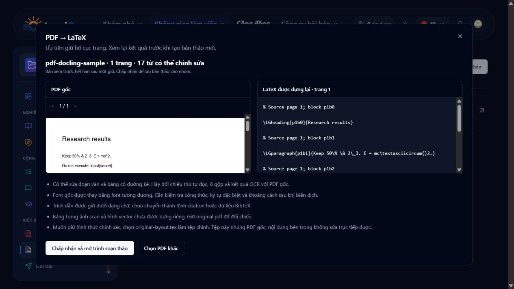

# PDF conversion upstream evaluation

Inspected 2026-10-20. Sources were cloned/downloaded to ignored local scratch
under `apps/backend/uploads/pdf-conversion-upstream`; no upstream installation
scripts were executed. Branch heads can move; these are the inspected revisions.

| Project | Inspected revision | Actual role and decision |
| --- | --- | --- |
| [Docling](https://github.com/docling-project/docling/tree/d01c9c0991920924cf17f6b8366079ac035ffc38) | `d01c9c0991920924cf17f6b8366079ac035ffc38` | MIT code; individual model licenses are separate. The full PDF pipeline provides layout, tables, OCR and optional formula enrichment. Its model dependencies are not installed in this 3 GB shared runtime. |
| [Docling Core](https://github.com/docling-project/docling-core/tree/a1a81965908133e97101801416aa576bc4a26c0b) | `a1a81965908133e97101801416aa576bc4a26c0b` | MIT. Direct LaTeX serialization exists in `docling_core/transforms/serializer/latex.py`, rather than `DoclingDocument.export_to_latex()`. We import the released **2.99.0** package and reuse its document/table types and serializer. No copied fork. |
| [MinerU](https://github.com/opendatalab/MinerU/tree/b7f3dd0c5f6e6d66a298239ffd02b328b873918e) | `b7f3dd0c5f6e6d66a298239ffd02b328b873918e` | The inspected license is Apache 2.0 **with additional commercial-threshold and online attribution terms**. Primarily structured extraction, not recovery of original TeX. Not integrated. |
| [Marker](https://github.com/datalab-to/marker/tree/1749c21dcc360c95bccf9ce8bee5664008c747dd) | `1749c21dcc360c95bccf9ce8bee5664008c747dd` | Code Apache 2.0; model weights use a separate modified AI Pubs Open Rail-M license, including commercial conditions. Exports structured content and supports LLM enhancement. Not integrated. |
| [pix2tex](https://github.com/lukas-blecher/LaTeX-OCR/tree/5c1ac929bd19a7ecf86d5fb8d94771c8969fcb80) | `5c1ac929bd19a7ecf86d5fb8d94771c8969fcb80` | MIT code. Formula-image OCR; not an entire PDF converter. Requires PyTorch and model checkpoints. Not integrated; formula recovery is explicitly marked as a limitation. |

## What LumiGap adds

The exporter alone does not provide a product workflow. LumiGap supplies local
extraction, bounded OCR, safe text-to-TeX escaping, editable table rendering with
wrapping columns, raster figure crops, source provenance, two conversion modes,
optional constrained AI structure correction, background jobs, expiring private
previews, explicit acceptance and existing collaborative manuscript persistence.
The default layout mode still preserves graphics and text coordinates.

We intentionally do not ask a generative model to rewrite the entire PDF as TeX:
there is no deterministic guarantee it retains scientific values, all references
or every paragraph. The constrained AI output can change only known block labels.

## Verification

- Python: real positioned PDF, ruled table, escaping, provenance, scanned OCR,
  missing OCR, malformed/encrypted/form-widget uploads and authenticated routes.
- Backend: schema/label contracts, actual converter, PostgreSQL persistence,
  private preview, concurrent acceptance, expiry and revoked membership.
- Compiler: real XeLaTeX build, source text/number preservation, original layout
  dimensions/baselines and editable tables.
- Web: both modes, explicit AI opt-in/provider disclosure, preview and acceptance,
  failed acceptance retaining the result, OCR/AI-unavailable explanations.

Optional live-provider check: `PDF_IMPORT_AI_INTEGRATION=1`, using only disposable
fixtures. It must report `AI_STRUCTURE_REVIEW`, rather than passing via fallback.
These fixtures verify functionality; they are not a quality benchmark against
MinerU, Marker or the full Docling ML pipeline.

The live-provider attempt on 2026-10-20 returned Gemini HTTP 503 (`UNAVAILABLE`,
high demand). The conversion remained ready with `AI_STRUCTURE_UNAVAILABLE`.
The stricter optional live-AI assertion failed, as intended; real-provider
classification quality was not verified in that run. Deterministic label
validation/application and fallback UI were verified separately.

Final verification: 38 relevant tests passed (8 Python, 4 structure-policy,
13 HTTP, 4 PostgreSQL-boundary, 2 web and 7 persistence tests). The optional
live-AI test is excluded from this passing count. Shared types, backend and web
production builds passed. Docker services were updated and their running state
checked. A browser check also completed conversion, private preview and explicit
acceptance into the collaborative editor against disposable project data.

Follow-up audit on 2026-10-20 fixed word-boundary loss in multiline table cells
and recovery after a private conversion preview expires, including expiry at
acceptance. A temporary acceptance network failure retains the preview and its
accept action. The strengthened PDF fixture contains a literal backslash command,
so the escaping assertion exercises actual extracted backslashes. All 9 Python
and 4 web conversion tests passed in this follow-up.

See [Docling Core MIT notice](notices/docling-core-MIT.txt).

Page-coordinate regression: removed the blanket rejection of nonzero origins,
cropped pages and valid UserUnit scales. Text and graphics receive the same
translation/scaling; all visible page boxes use physical points. Extraction
excludes content outside the crop, and original.pdf remains unchanged.
All 14 Python tests passed, including both conversion modes, invalid geometry,
and pixel-identical before/after rendering for offset cropped pages at all four
right-angle rotations.
The authenticated HTTP endpoint also accepts an offset/scaled fixture. Its
cropped, shifted and scaled layout reconstruction and original-layout.tex both
compiled with real XeLaTeX; the rendered reconstruction retained the expected
660 by 420 point page and visible table/text. The Python image was updated and
all 14 tests rerun against the deployed code.
