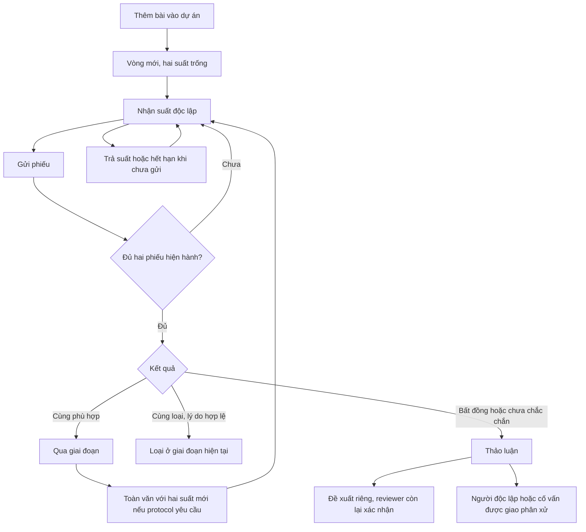

# Sàng lọc cộng tác V6

## Quy tắc sản phẩm

Mặc định mỗi bài, mỗi giai đoạn có đúng **hai suất reviewer thường**. Nhận suất
khác gửi phiếu. Suất đã gửi vẫn chiếm chỗ; người phân xử tạo quyết định riêng.
Chế độ `SIMPLE` một reviewer phải được chủ dự án cấu hình rõ. Quy tắc của vòng
được chụp lại khi khởi tạo, thay đổi cấu hình chỉ áp dụng cho vòng mới.

Vòng tóm tắt qua sàng lọc không tự trở thành lựa chọn toàn văn. Khi cấu hình hai
giai đoạn, hệ thống mở vòng toàn văn mới; phải có hai phiếu của vòng đó và nguồn
toàn văn đã đọc. Nếu hai lý do loại toàn văn khác nhau, cần giải quyết lý do.
`UNSURE` đưa vòng về cần xem xét thêm.

## Những mâu thuẫn đã xử lý

- Claim trước đây có thể tính khác phân công có sẵn; hàng đợi không phản ánh đúng
  suất đã gửi hoặc phân công không thời hạn.
- Thao tác nhận lại, gia hạn và nhận bài tiếp theo chưa dùng chung chính sách.
- Mặc định solo theo số thành viên tạo các trường hợp một reviewer không có lựa
  chọn rõ ràng; cấu hình độc lập từng cho phép ba reviewer.
- Quy trình review có form đánh giá song song với giao diện đọc bài.
- Bộ lọc thư viện đọc giá trị DOM sau một bước xác nhận bất đồng bộ, có thể mất
  lựa chọn người dùng vừa nhập.
- Bộ bài nháp chưa truyền định danh vào API phân tích; scope bài được chọn chính
  thức khiến bộ nháp bị từ chối.
- Một số bản tóm tắt dùng năm hiện tại khi thiếu metadata, hoặc hiển thị quyết
  định cũ sau khi mở sửa phiếu.
- Hết suất phù hợp từng gợi ý nhập thêm bài dù nhóm còn việc. Màn hình nay mở
  Thư viện để theo dõi; không suy ra thiếu tài liệu từ hàng đợi trống.

## Các màn hình

| Khu vực | Công việc |
| --- | --- |
| Việc của tôi | Suất đang giữ, hạn, tiến độ trung lập của đồng reviewer, phản hồi đồng thuận, thảo luận và phân xử cần làm, phiếu đã gửi, bản nháp hết hạn |
| Hàng đợi đánh giá | Chỉ bài người dùng đủ điều kiện nhận, ưu tiên bài đã có một phiếu rồi tới bài có người giữ suất |
| Tôi đã đề xuất | Giữ người đề xuất, lý do, tiến độ và bài đã loại |
| Thư viện | Tìm kiếm, lọc, phân trang, đọc bài, đánh giá và mở bảng bằng chứng |
| Quy trình review | Công cụ phụ để cấu hình, giám sát, thống kê và rà soát dữ liệu cũ; mở bài về cùng workspace đọc |

`research-literature.tsx` sở hữu điều hướng bốn khu vực. `my-work-view.tsx`,
`screening-queue-view.tsx`, `my-proposals-view.tsx`, `collaborative-library.tsx`
hiển thị dữ liệu. `screening-round.tsx` là form đánh giá trong màn hình đọc dùng
chung. `screening-workspace.tsx` chỉ quản lý và theo dõi quy trình.

## Backend và API

Không tạo subsystem screening hay bảng claim thứ hai. Dùng
`ScreeningRound`, `ScreeningAssignment`, phiên bản `ScreeningReview`,
`ScreeningFinalDecision` và audit hiện có.

- `screening-slots.ts`: cùng một phép tính suất hợp lệ và thứ tự hàng đợi cho
  board, nhận bài cụ thể và nhận bài tiếp theo.
- `screening-context.ts`: snapshot quy tắc, quyền xem, tự tính kết quả, chuyển
  giai đoạn, giao dịch và idempotency.
- `screening-bootstrap.ts`: bài mới bắt đầu với suất trống, không tự gán người.
- `screening.service.ts`: claim, release, extend, submit, consensus, adjudication,
  summary và board dùng các thực thể hiện có.
- API giữ trong `/projects/:id/research/screening-v2`; không nhân đôi form/API.
- Mỗi lệnh kiểm tra tài khoản, thành viên và trạng thái dự án dưới khóa dự án;
  idempotency key gắn với nội dung và vòng. Trigger PostgreSQL kiểm tra sức chứa
  cho snapshot V6, bổ sung cho việc khóa ở ứng dụng.
- Phiếu, lý do, quyết định và lịch sử được lọc ở backend; Owner cũng không được
  đọc phiếu người khác khi vòng còn đang đánh giá độc lập.

## Giữ chỗ và hết hạn

- Giữ chính sách hiện có: claim tự nhận 24 giờ, gia hạn thủ công thêm đúng 24 giờ
  từ hạn hiện tại. Chưa áp giới hạn số claim mỗi người.
- Không tự áp 72 giờ cho toàn văn. Toàn văn vẫn theo 24 giờ hiện có; giao diện
  quản lý nói rõ chính sách này. Chính sách lâu hơn cần được cấu hình riêng trong
  một thay đổi sản phẩm tiếp theo.
- Phân công cũ không có hạn tiếp tục chiếm suất và không hiện nút gia hạn.
- Hết hạn chỉ vô hiệu phân công chưa gửi. Phiếu đã gửi được giữ; một reviewer
  khác có thể nhận suất trống còn lại.
- GET không ghi dữ liệu. Phép đọc dùng hạn server; lệnh ghi kế tiếp ghi audit hết
  hạn trong giao dịch. Không phụ thuộc tab trình duyệt mở hay đóng.
- Bản nháp riêng được giữ trên thiết bị; gửi chính thức cần có suất hợp lệ.
- Mở sửa phiếu lưu phiên bản mới; sau công bố phiếu, không nhận reviewer thường
  thay thế. Kết quả và ý kiến cũ tiếp tục tồn tại trong lịch sử.

## Bất đồng và cố vấn

Hai reviewer thảo luận trước. Một người đề xuất kết quả và lý do, người còn lại
xác nhận; Owner không được xác nhận thay. Phiếu cá nhân không bị sửa để tạo đồng
thuận. Phiếu thay đổi làm đề xuất cũ mất hiệu lực.

Người phân xử phải được chỉ định và độc lập với hai reviewer. Với cố vấn, cần
quan hệ đã chấp nhận, quyền phù hợp và gói chia sẻ được chủ dự án duyệt. Gói có
bài, tiêu chí, các phiếu và thảo luận được chọn; không mở toàn bộ dự án.
Quyết định phân xử có lý do và được lưu riêng, không tạo phiếu thường thứ ba.

## Migration và dữ liệu cũ

`20261101160000_screening_two_slot_integrity` bổ sung
`ScreeningRound.legacyNeedsAudit`, audit chuyển quy tắc tương lai, trigger sức
chứa và index hết hạn. Không xóa phân công, phiếu hay quyết định.

Các cohort như 0/3, 2/3 khi mục tiêu là hai được chặn ghi và đánh dấu cần rà soát.
Chủ dự án xác nhận mở vòng mới theo cấu hình hiện tại; vòng cũ giữ nguyên.
Không chọn ngẫu nhiên hai trong ba người. Kết quả một reviewer lịch sử tiếp tục
mang nhãn lịch sử; ngoại lệ một reviewer đã cấu hình rõ được giữ.

Audit local ngày 01/11/2026 ghi nhận hai cohort ba phân công. Sau migration:
**15 phân công, 5 phiếu, 0 quyết định** được giữ nguyên. Bản tổng hợp trước và sau
ở `docs/audits/2026-11-01-screening-{before,after}-migration.json`.

## Bằng chứng

Giữ bảng và API trích xuất hiện có vì đã có thông tin nguồn, quotation, locator,
RQ và phiên bản. Điểm mở bảng chuyển vào Thư viện và ngữ cảnh sau sàng lọc.
Chưa qua giai đoạn bắt buộc thì chưa mở trích xuất mới. Minh chứng lịch sử không
bị xóa khi nguồn đổi trạng thái; trạng thái kiểm chứng cần được xem lại.

Phân tích nháp từ một bộ bài được chụp rõ là `DRAFT`, không nâng thành quyết định
chọn bài hay bằng chứng đã kiểm chứng. Không đổi số review thành % đóng góp.

## Kiểm chứng

- PostgreSQL riêng: `node apps/backend/scripts/test-screening-workflow.mjs --regression`:
  **154/154** ca qua sau rà soát cuối, gồm concurrency, expire, blinding, consensus, mentor packet,
  phân trang, bảo toàn lịch sử, HTTP auth, scope giữa dự án và migration dữ liệu cũ.
- Web: ba suite screening/task-first/adjudication **45/45** ca qua; năm suite thư
  viện/workflow/synthesis/literature/related-papers **70/70** ca qua.
- Schema claim và ranh giới PostgreSQL: **9/9** ca qua.
- Backend typecheck, web production build, lint phạm vi thay đổi và Docker image
  backend/web đều thành công. Đã cập nhật backend, web và worker gaps tại local.
- Trình duyệt với hai tài khoản trên database riêng: khởi tạo vòng có 0/2 suất,
  nhận suất, gửi phiếu thứ nhất, reviewer còn lại chỉ thấy tiến độ trung lập,
  gửi phiếu thứ hai cùng Phù hợp, tự mở vòng Toàn văn mới với 0/2 suất. Trích
  xuất vẫn bị khóa. Kiểm tra màn hình 412×892 và chuyển bài 12 sang 13 thành công.
- Dự án thật mở được sau đăng nhập; chỉ kiểm tra hiển thị, không gửi phiếu hoặc
  mở lại các vòng khoa học thật. Bản sửa hành động hàng đợi trống được kiểm tra
  lại bằng suite task-first **4/4** (nằm trong 115 ca web nói trên).
- Log kiểm tra, build và ảnh thực tế được lưu cùng tiền tố
  `docs/audits/2026-11-01-screening-`.

## Rà soát bổ sung ngày 01/11/2026

Hai lỗi được tái hiện trên PostgreSQL riêng bằng ba ca hồi quy mới:

1. Hai phiếu toàn văn cùng loại nhưng khác lý do tạo `NEEDS_RESOLUTION`; điều
   kiện mở đồng thuận/phân xử lại chỉ nhận bất đồng lựa chọn hoặc `UNSURE`.
   Đã dùng chung phép kiểm tra lý do loại ở bước tính trạng thái và bước xác
   nhận đã thảo luận. Nhóm có thể thống nhất lý do riêng hoặc giao người độc
   lập phân xử, không sửa hai phiếu cá nhân.
2. Hàng đợi bỏ qua tài khoản không còn đủ điều kiện, nhưng phân công chưa gửi
   vẫn còn active trong database và chặn trigger sức chứa. Khi nhận suất thay
   thế, giao dịch nay thu hồi phân công chưa gửi của người không đủ điều kiện,
   ghi `ASSIGNMENT_REVOKED`, rồi mới nhận suất. Phiếu đã gửi vẫn được giữ dù
   tài khoản đã bị khóa; không mở thêm suất thứ ba.

Log tái hiện trước sửa: `docs/audits/2026-11-01-screening-recheck-before.log`
(3 ca mới thất bại, 110 ca còn lại qua).
Sau sửa, chạy lại sáu suite PostgreSQL: **151/151** ca qua; bao gồm cả hai
đường giải quyết lý do loại khác nhau và thu hồi suất tài khoản bị khóa mà vẫn
giữ phiếu đã gửi. Backend typecheck và lint phạm vi thay đổi đều qua.
Log: `docs/audits/2026-11-01-screening-recheck-after.log`.

## Rà soát cuối ngày 01/11/2026

- Sửa tiến độ bài đề xuất và reviewer đồng hành trong Việc của tôi: suất chưa
  gửi của tài khoản không còn đủ điều kiện không được tính là đang giữ. Phiếu
  đã gửi vẫn được tính, giống hàng đợi và chi tiết vòng. Hai ca kiểm thử đối
  chiếu cả hai tình huống và xác nhận các GET không sửa phân công.
- Mỗi thảo luận mới lưu ID của các phiên bản phiếu đang được trao đổi. Điều
  kiện mở đồng thuận/phân xử đối chiếu snapshot này, tránh lệch thứ tự do
  `now()` của PostgreSQL lấy thời điểm bắt đầu transaction trước khi chờ khóa
  dự án. Thảo luận phiên bản cũ không đáp ứng điều kiện của phiếu đã mở sửa.
  Thảo luận lịch sử chưa có snapshot tiếp tục dùng điều kiện thời gian cũ.
  Ca hồi quy tạo dữ liệu có timestamp lệch trước/sau, giữ audit bất biến và
  kiểm tra cần cả hai reviewer trao đổi lại sau khi sửa phiếu.
- Chạy lại sáu suite PostgreSQL riêng: **154/154** qua. Tám suite giao diện:
  **115/115** qua. Backend typecheck, lint ba file thay đổi và kiểm tra khoảng
  trắng đều qua. Log: `docs/audits/2026-11-01-screening-final-*.log`.
- Đã build lại và cập nhật riêng backend local. Container healthy; `/ready`
  trả HTTP 200 với PostgreSQL và Redis đều sẵn sàng.

## Giới hạn

- Không khẳng định tuân thủ PRISMA; chưa làm báo cáo PRISMA hay protocol nâng cao.
- Metadata đáng ngờ được đánh dấu và chặn claim, chưa có hệ thống tự sửa metadata.
- Phiên bản trước công bố lại không thể xóa hiểu biết reviewer đã đọc; vòng bị
  đánh dấu ảnh hưởng tính độc lập và loại khỏi phép đo phù hợp.
- Kiểm thử AI dùng provider giả lập để xác nhận scope, snapshot và lỗi; không
  thực hiện đánh giá chất lượng khoa học bằng một lần gọi LLM thật.
- Workspace cập nhật bằng polling hiện có; chưa bổ sung lịch nhắc trước khi hết
  hạn claim. Thông báo đề xuất đồng thuận, giao phân xử và kết thúc giai đoạn
  dùng hạ tầng thông báo hiện có.

Hướng dẫn phương pháp đã đối chiếu: [Cochrane, lựa chọn nghiên cứu](https://www.cochrane.org/authors/handbooks-and-manuals/handbook/current/chapter-04),
[Rayyan, đánh giá ẩn](https://help.rayyan.ai/hc/en-us/articles/17460918624145-How-to-Use-Blind-Mode-in-Rayyan),
[UW–Madison, trích xuất dữ liệu](https://researchguides.library.wisc.edu/literature_review/data_extraction).
Hai reviewer là mặc định cộng tác của LumiGap; yêu cầu phương pháp cụ thể phụ
thuộc loại nghiên cứu và protocol của từng dự án.
