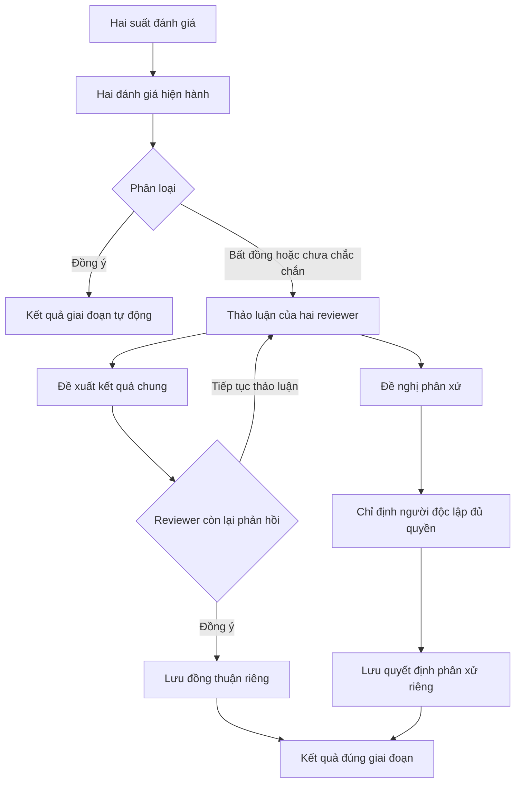

# Project Papers v7 — hai reviewer, đồng thuận và phân xử

Ngày xác minh: 02/11/2026.

## Phạm vi đã triển khai

Luồng mặc định tiếp tục dùng Screening V2 hiện có: hai suất đánh giá độc lập cho
mỗi vòng, thảo luận gắn với bài và vòng, đề xuất kết quả chung, xác nhận của người
còn lại, hoặc phân xử độc lập. Không tạo engine bỏ phiếu, chat hay mô hình quyết
định cuối thứ hai.

Các vòng mới lưu `workflowVersion: 7`. Snapshot của vòng cũ được giữ nguyên.
Ngoại lệ SIMPLE và chế độ COLLABORATIVE lịch sử vẫn được hỗ trợ theo snapshot.

## Những mâu thuẫn đã xử lý

- Tách INCLUDE/EXCLUDE khỏi các trường hợp có UNSURE; không gọi mọi cặp khác nhau
  là bất đồng nhị phân.
- Đánh giá đã gửi kết thúc công việc giữ suất; DTO không còn trả hạn đếm ngược
  cho đánh giá đã hoàn tất. Bất đồng không mở suất thứ ba hoặc quay lại hàng đợi.
- Đưa công việc sau đánh giá vào **Việc của tôi → Cần tôi giải quyết**, ưu tiên
  xác nhận, thảo luận/làm rõ, rồi phân xử được giao; loại bỏ việc trùng vòng.
- Chặn chuyển đọc toàn văn đơn phương. Reviewer đề xuất kết quả sơ bộ cần thêm
  thông tin, reviewer còn lại xác nhận riêng trước khi mở vòng toàn văn mới.
- Không cho Owner hoặc người đề xuất bài tự ghi đè một bất đồng. Người phân xử
  không được là một trong hai reviewer; ưu tiên người không đề xuất bài.
- Reviewer rời nhóm làm mất khả năng đồng thuận thay họ. Reviewer còn lại và
  Owner có thể dùng nhánh phân xử độc lập; không suy diễn sự đồng ý.
- Cố vấn có danh sách việc phân xử riêng và trao đổi chỉ trong phạm vi bài
  được giao. Thu hồi quyền được kiểm tra lại trên backend.

## Phân loại tập trung

`screening.calculator.ts::classifyScreeningPair` chỉ nhận đúng hai reviewer khác
nhau của cùng một vòng. Lớp context đối chiếu assignment, phiên bản review, phạm
vi đọc và trạng thái công bố trước khi trả phân loại.

| Hai đánh giá hiện hành | Phân loại |
| --- | --- |
| INCLUDE + INCLUDE | AGREEMENT_INCLUDE |
| EXCLUDE + EXCLUDE | AGREEMENT_EXCLUDE |
| INCLUDE + EXCLUDE, cả hai thứ tự | CONFLICT |
| Một UNSURE + một INCLUDE/EXCLUDE | NEEDS_CLARIFICATION |
| UNSURE + UNSURE | NEEDS_MORE_INFORMATION |
| Hai EXCLUDE với lý do chính khác nhau ở toàn văn theo chính sách | EXCLUSION_REASON_MISMATCH |
| Thiếu phiếu, trùng reviewer hoặc khác vòng | Không phân loại cặp |

`classification` là thuộc tính dẫn xuất; không thay thế trạng thái vòng trong
database. NEEDS_MORE_INFO có thể là thiếu bằng chứng chưa giải quyết, hoặc một
kết quả cần thêm thông tin đã được ghi riêng trong `resolution`.

## Dữ liệu và chuyển trạng thái



- Phiếu ban đầu và phiên bản sửa vẫn nằm trong `ScreeningReview`.
- Đề xuất, sự đồng ý của tác giả, xác nhận của người còn lại, từ chối, thảo luận,
  yêu cầu phân xử, phân công và sửa quyết định dùng `ScreeningAudit` hiện có.
- Kết quả có thẩm quyền dùng `ScreeningFinalDecision` hiện có, bổ sung nullable
  `resolutionType`, `exclusionReason`, `sourceMaterial`.
- Ba nguồn kết quả: `AGREEMENT_FROM_REVIEWS`, `CONSENSUS_AFTER_DISCUSSION`,
  `ADJUDICATION`. Lịch sử không có đủ thông tin được giữ NULL.
- V7 yêu cầu ghi nguồn đã xem xét khi giải quyết bất đồng; loại bài phải có lý
  do chính thức thuộc tiêu chí đã đóng băng nếu vòng đã khai báo tiêu chí.
- Kết quả cần thêm thông tin không cấp quyền trích xuất và không giả thành đã
  đọc toàn văn. Chuyển giai đoạn tạo một vòng FULL_TEXT riêng chưa có phiếu.
- Kết quả đã ghi cần quy trình mở lại có lý do trước khi sửa. Không thể giao lại
  người phân xử để lách kết quả cần thêm thông tin đã lưu.

## Phân quyền, đồng thời và phạm vi cố vấn

Các lệnh ghi dùng transaction, khóa tài khoản theo thứ tự rồi khóa project,
`expectedVersion`, phiên bản phiếu nguồn và `clientKey` gắn với hash payload.
Hai đề xuất cạnh tranh, xác nhận cũ và lệnh chốt đồng thời không tạo hai kết quả
có thẩm quyền. Retry không tạo thêm phiếu, quyết định hoặc thông báo.

Mentor phải có quan hệ đã chấp nhận còn hiệu lực, PAPERS_VIEW/PAPERS_COMMENT,
phân công đúng vòng và gói được Owner duyệt. Gói chứa metadata/tóm tắt, tiêu chí,
câu hỏi nghiên cứu, hai phiếu, phiên bản quy trình, các lần thử đồng thuận và
những thảo luận được chọn. Các trường mới optional để đọc gói lịch sử.

Thảo luận tiếp theo chỉ vào luồng cố vấn khi thành viên chọn chia sẻ rõ ràng;
lời đáp cố vấn được gắn với bản phân công tương ứng. Tin nhắn nội bộ và tài
nguyên khác không được cấp quyền qua một phân công phân xử.

`GET .../screening-v2/adjudications` trả danh sách tối thiểu những việc thực sự
được giao, còn hiệu lực và còn quyền. Giao diện cố vấn có CTA đến đúng vòng.

Thông báo dùng hạ tầng hiện có cho phát hiện bất đồng, đề xuất, từ chối/xác nhận,
phân công, hoàn tất và mở lại. Nội dung tối thiểu; không phát tán phiếu trước
công bố. Deep link mở đúng bài hoặc gói phân xử. UI dùng polling hiện có.

Contribution Evidence Ledger và Decision Log không bị thay bằng bộ máy mới;
lịch sử sàng lọc giữ actor, thời gian server, phiên bản và các phiếu nguồn.
Không quy đổi số tin nhắn hoặc số phiếu thành phần trăm đóng góp.

## Migration và dữ liệu thật

Migration `20261102090000_screening_resolution_provenance` chỉ thêm ba cột và
CHECK constraint cho nguồn kết quả. Không xóa review, chọn hai người từ ba
assignment cũ, backfill sự đồng ý hay sửa quyết định lịch sử.

`prisma migrate status` và `migrate deploy` trên database cục bộ đều xác nhận
125 migration đã hiện diện, không còn migration cần áp dụng ở lần kiểm tra này.

Audit chỉ đọc trước/sau kiểm tra schema cho cùng kết quả:

| Dữ liệu | Trước | Sau |
| --- | ---: | ---: |
| Vòng đang hoạt động | 13 | 13 |
| Assignment | 19 | 19 |
| Phiếu review | 7 | 7 |
| Quyết định cuối | 0 | 0 |

Các cohort lịch sử có ba assignment vẫn được bảo toàn. Dữ liệu mơ hồ tiếp tục
hiển thị nhánh rà soát/mở vòng mới có thẩm quyền của cơ chế two-slot hiện có.

Chứng cứ tổng hợp không chứa credential, email hay nội dung review:

- [Trước](audits/2026-11-02-screening-v7-before.json)
- [Sau](audits/2026-11-02-screening-v7-after.json)

## Kiểm tra đã thực thi

### Backend: 175/175 pass, 6 suite

```text
node apps/backend/scripts/test-screening-workflow.mjs --regression
```

Runner tự tạo/chọn database PostgreSQL `_test` riêng, migrate tại đó và tắt gửi
email. Không chạy persistence test trên database ứng dụng.

| Suite | Số test |
| --- | ---: |
| screening.persistence | 78 |
| screening.calculator | 27 |
| screening-slots.persistence | 31 |
| screening-migration.persistence | 1 |
| workspace-collaboration.persistence | 26 |
| collaborative-research.persistence | 12 |

Bao gồm bảng phân loại; công việc của đúng reviewer; hết hạn trước gửi và bảo
toàn sau gửi; nguyên tắc hai suất; đồng thuận/xác nhận/từ chối; lệnh cạnh tranh;
review sửa và xác nhận cũ; không giả sự đồng ý của reviewer đã rời nhóm; phân xử
cố vấn và thu hồi; source evidence; khác lý do loại toàn văn; không tạo phiếu
thứ ba; tách giai đoạn; DOI, PDF riêng tư, chat, Decision Log và Evidence Matrix.

### Web: 116/116 pass, 6 suite

Chạy từ `apps/web`:

```text
node ../../node_modules/vitest/vitest.mjs run src/features/projects/__tests__/screening-workspace.test.tsx src/features/projects/__tests__/screening-adjudication.test.tsx src/features/projects/__tests__/task-first-papers-workspace.test.tsx src/features/projects/__tests__/collaborative-library.test.tsx src/features/projects/__tests__/mentor-conversation.test.tsx src/features/notifications/utils/notification-destination.test.ts --maxWorkers=1 --minWorkers=1
```

Số test theo thứ tự: 25, 16, 5, 9, 12, 49. Kiểm tra thứ tự công việc, loại trùng,
CTA mở đúng bài, gói cố vấn an toàn, draft cũ, xác nhận chủ động và deep link.

TypeScript đã pass: build `packages/shared-types`, backend `tsc --noEmit`, web
`tsc --noEmit -p tsconfig.app.json`.

Các lượt đầu phát hiện và đã sửa import runtime sai, yêu cầu evidence áp nhầm
COLLABORATIVE và kỳ vọng test cũ. Một lượt timeout tại fixture khi chạy đồng thời
typecheck; lượt PostgreSQL cuối chạy riêng pass toàn bộ.

### Xác minh ứng dụng thật

Đã reload và kiểm tra trang localhost qua accessibility tree:

- Việc của tôi có nhóm Đang đánh giá và Cần tôi giải quyết riêng.
- Bài bất đồng hiện `2/2 đánh giá đã gửi`, hai reviewer đã khóa không còn hạn.
- Hai phiếu hiện sau công bố; Thảo luận và Đề xuất quyết định chung nằm ngay
  trong panel chi tiết bài.
- Người đề xuất xem trạng thái chính xác trong danh sách đã đề xuất.

Không gửi tin nhắn hoặc thay đổi kết luận khoa học trong dữ liệu thật để QA.

## Giới hạn được giữ rõ

- Gói cố vấn cung cấp DOI/nguồn công khai và nguồn toàn văn reviewer đã ghi.
  Chưa bổ sung cơ chế cấp quyền tải PDF riêng của project theo từng phân xử;
  không tự mở quyền file riêng khi giao cố vấn.
- Đồng bộ dùng polling, chưa bổ sung kênh WebSocket mới.
- API screenshot/viewport của trình duyệt trong phiên QA trả
  `browser.user is unavailable`. Vì vậy chưa xác minh hình ảnh desktop/mobile
  hoặc chụp ảnh kết quả trong phiên này; kiểm tra UI nói trên là accessibility
  và component tests, không phải kiểm thử trình duyệt gửi quyết định đầu-cuối.

## Thuật ngữ và phương pháp

Đối chiếu [JBI study selection](https://jbi-global.atlassian.net/wiki/spaces/MANUAL/pages/355828227/4.2.6+Selection+of+studies),
[Cochrane chương 4](https://www.cochrane.org/authors/handbooks-and-manuals/handbook/current/chapter-04),
[Covidence conflict resolution](https://www.covidence.org/blog/how-to-resolve-conflicts-during-screening/),
[Rayyan conflicts](https://help.rayyan.ai/hc/en-us/articles/25316026225041-How-to-Resolve-Screening-Conflicts-in-Rayyan)
và [Rayyan blind mode](https://help.rayyan.ai/hc/en-us/articles/17460918624145-How-to-Use-Blind-Mode-in-Rayyan).
Quy tắc UNSURE cụ thể của LumiGap trong yêu cầu này là thẩm quyền triển khai.
Không mặc định mọi literature review là systematic review chuẩn hóa.
