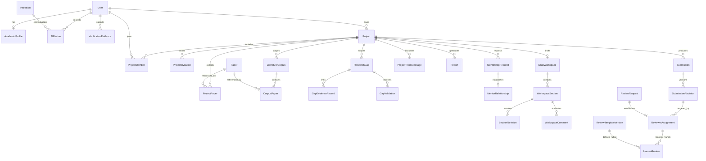
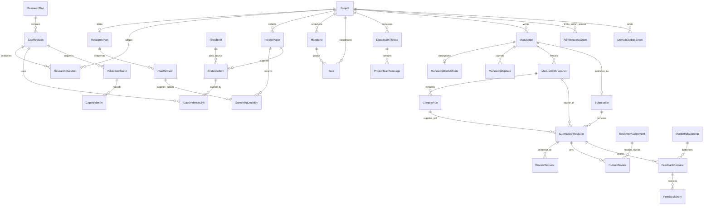
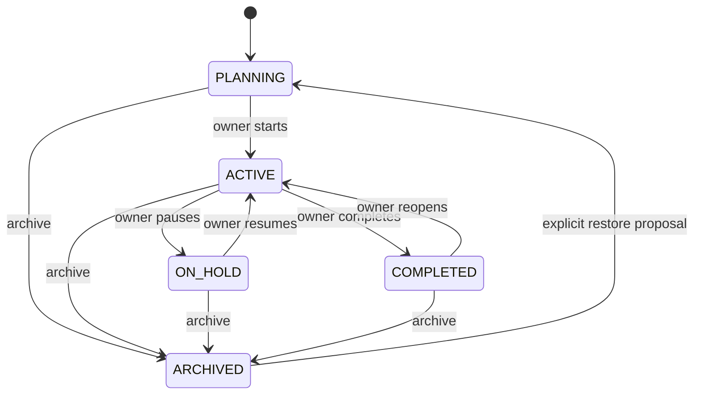
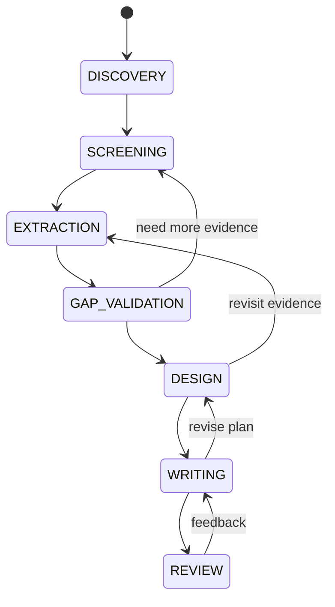
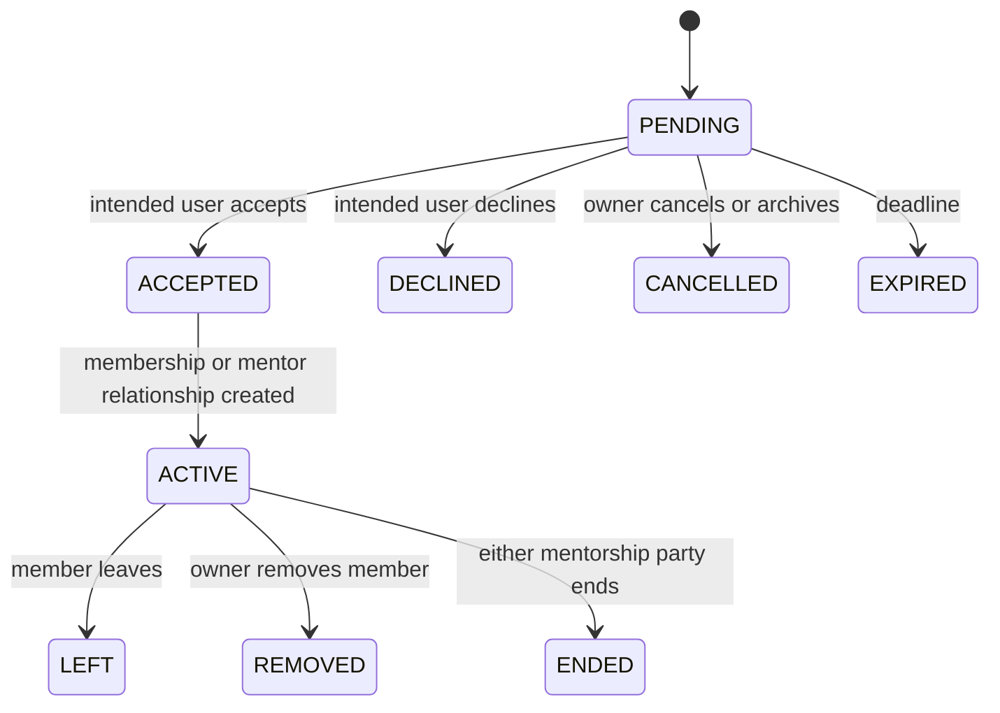
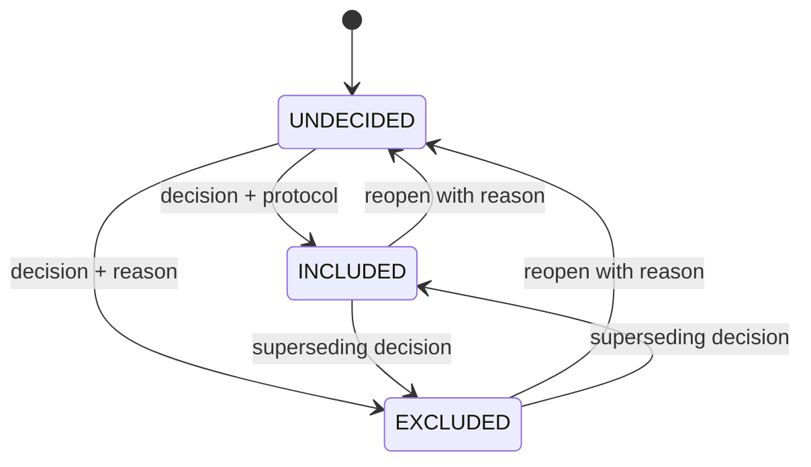
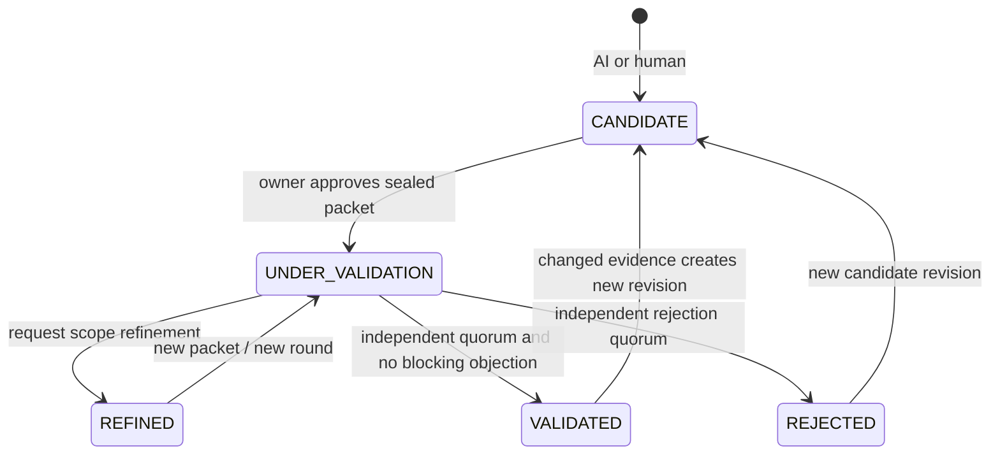
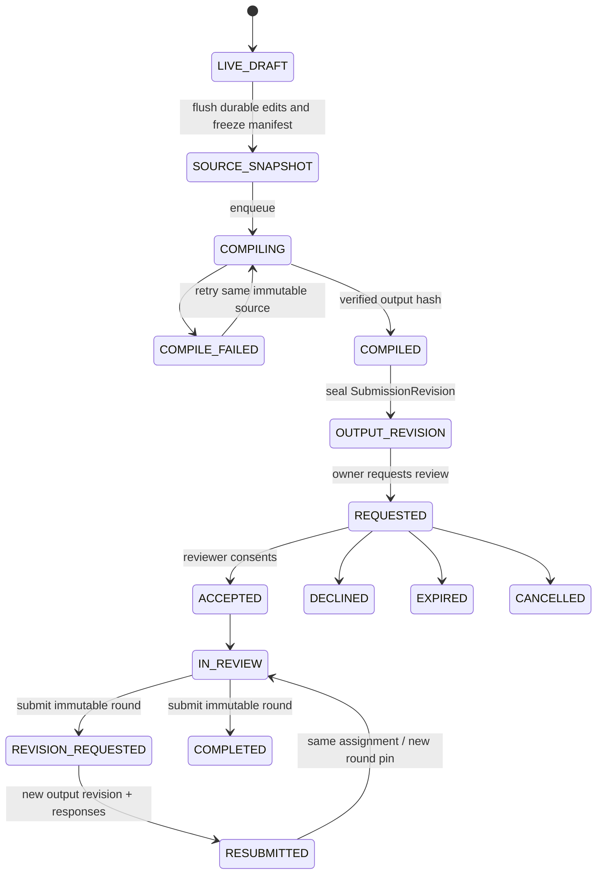
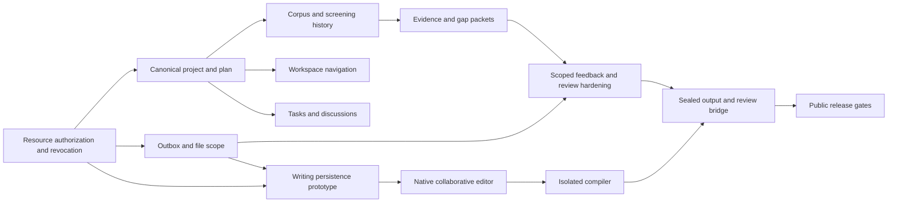

# Research Project Workspace: repository audit and target architecture

Date: **2026-10-14**. Status: **architecture proposal; no feature implementation or database migration applied**.

Repository baseline: `db20cc6627afc71ec91a6338b76e2bb76802f2ce`, branch `codex/fix-home-search-fixtures`, including the existing working-tree changes. The working tree contains earlier UI work and unrelated artifacts; this audit does not treat those changes as committed or deployed. Source references describe this checkout, not a separately verified production deployment.

## Reading guide

This document contains all fourteen requested architecture deliverables. Detailed contracts, the writing decision, and executable implementation slices are in:

- [API contracts](research-workspace-api-contracts.md).
- [ADR 0001: collaborative LaTeX](adr/0001-collaborative-latex.md).
- [Implementation and database migration plan](research-workspace-implementation-plan.md).

**Existing** means found in executable source/schema/migrations. **Proposed** means a decision for subsequent feature work. An older design document is context, not proof that a feature is implemented. In particular, the historical [Phase D design](superpowers/specs/2026-06-15-phase-d-design.md) contains MongoDB-era descriptions; current runtime authority is PostgreSQL and the checked-in code. [CLAUDE.md](../CLAUDE.md) and [migration rules](prisma-migrations.md) remain applicable.

### Recommended direction

1. Keep the modular Express application, PostgreSQL, Redis/BullMQ, and React/Vite client.
2. Fix inconsistent resource authorization before extending private collaboration.
3. Keep project lifecycle, research stage, public-summary publication, and mentor discovery independent.
4. Make `ProjectPaper` the authority for project corpus membership and current screening; collections must not introduce another screening truth.
5. Preserve human decisions and the evidence/version they reviewed. AI creates candidates, never authoritative validation.
6. Reuse `Submission`/`SubmissionRevision` for reviewable outputs. Add manuscript editing and source snapshots around them instead of creating a competing review/version system.
7. Build native CodeMirror 6 + Yjs collaboration in LumiGap with a maintained authenticated gateway and isolated compilation. External Overleaf export can be an interim convenience.
8. Organize the workspace around seven destinations, with research activities nested under Research.

## 1. Current repository audit

### 1.1 Actual technology

| Area | Observed implementation | Evidence and qualification |
| --- | --- | --- |
| Monorepo | pnpm 11.3.0, Turborepo, shared TypeScript package | [Root manifest](../package.json), [workspace manifest](../pnpm-workspace.yaml). No Turbo configuration change is proposed here. |
| Web | React 18, Vite 6, React Router 6, TanStack Query, Zustand | [Web manifest](../apps/web/package.json), [routes](../apps/web/src/routes/app-routes.tsx). This is not a Next.js app. |
| UI | Tailwind/shadcn primitives, feature CSS, Source Sans 3 design direction | [Design language](DESIGN_LANGUAGE.md), [project navigation](../apps/web/src/features/projects/components/project-section-nav.tsx), [workspace styles](../apps/web/src/features/projects/project-workspace.css). |
| API | Node 22 container, Express 5, TypeScript, Zod, Pino, Helmet | [Backend manifest](../apps/backend/package.json), [app composition](../apps/backend/src/app.ts), [Dockerfile](../Dockerfile.backend). |
| Persistence | PostgreSQL 16 + pgvector; Prisma 7.10.0 and pg adapter | [Schema](../apps/backend/prisma/schema.prisma), [Compose](../docker-compose.yml), [migration guide](prisma-migrations.md). SQL migrations contain constraints absent from Prisma relation declarations. |
| Jobs/cache | BullMQ + ioredis; separate worker processes | [Queues](../apps/backend/src/infrastructure/queue.ts), [workers](../apps/backend/src/workers). Existing retry defaults have exceptions, including AI jobs. |
| Authentication | RS256 access JWT; hashed rotating refresh tokens and session families; Argon2id with legacy bcrypt verification | [Token service](../apps/backend/src/modules/auth/token.service.ts), [auth middleware](../apps/backend/src/common/middleware/auth.ts), [password service](../apps/backend/src/modules/auth/password.service.ts). Web persists tokens in browser storage. |
| AI/RAG | Central Node LLM abstraction, personal-provider runtime, Gemini defaults, embeddings and pgvector, page/chunk grounding | [LLM](../apps/backend/src/modules/llm/llm.run.ts), [personal runtime](../apps/backend/src/modules/user-ai/user-ai.runtime.ts), [knowledge ingest](../apps/backend/src/modules/knowledge/knowledge.ingest.ts). |
| Python sidecar | FastAPI/Uvicorn, PDF extraction, format checking and AI review; separate legacy accounts/storage and SQLite | [Main](../apps/ai-reviewer/app/main.py), [SQLite persistence](../apps/ai-reviewer/app/db.py), [requirements](../apps/ai-reviewer/requirements.txt). The Node PostgreSQL-only import guard does not audit this service. Do not use its accounts/SQLite as project authority. |
| Files | One PDF abstraction over local files, R2/S3-compatible storage, authenticated Cloudinary | [PDF storage](../apps/backend/src/infrastructure/pdf-storage.service.ts), [submission downloads](../apps/backend/src/modules/submissions/submission.service.ts#L280). The Express app does not mount an unrestricted static `/uploads` directory. Bucket/deployment ACLs were not inspected live. |
| Notifications | PostgreSQL notifications, BullMQ, Expo push, Nodemailer-backed domain email delivery | [Notification service](../apps/backend/src/modules/notifications/notification.service.ts), [worker](../apps/backend/src/workers/notification.worker.ts), [mentorship delivery](../apps/backend/src/modules/projects/mentorship-notifications.ts). |
| Realtime | HTTP SSE for team chat and shared AI chat; process-local event hubs | [Team controller](../apps/backend/src/modules/projects/project-team-chat.controller.ts#L44), [hub](../apps/backend/src/modules/projects/project-team-chat.events.ts). No manuscript WebSocket/CRDT server found. |
| Deployment | Docker Compose, Nginx web container, API and separate workers; CI/Jenkins assets also exist | [Compose](../docker-compose.yml), [web Dockerfile](../Dockerfile.web), [Nginx](../deploy/nginx/default.conf). This audit did not inspect cloud infrastructure or running service versions. |

### 1.2 Capability matrix

Required labels are used literally:

- `EXISTS_AND_WORKS`: a bounded capability has an implemented path and supporting source/rule-test evidence; this is not a claim that all production integrations were exercised.
- `EXISTS_INCOMPLETE`: implementation exists but misses part of the requested architecture or needs integration/security verification.
- `MISSING`: no corresponding implementation found in the audited runtime/schema/routes.
- `BROKEN`: a concrete contradictory or unsafe path is visible in source; findings below state the evidence and verification limits.
- `DUPLICATED`: multiple representations overlap and require a canonical authority, even when both have legitimate legacy uses.

| Capability | Classification | Evidence / current boundary |
| --- | --- | --- |
| Public registration across institutions | EXISTS_AND_WORKS | [Registration DTO](../apps/backend/src/modules/auth/dto/auth.schema.ts#L4), [admission policy](../apps/backend/src/modules/identity/admission-policy.service.ts#L19) accept personal email without an invitation. Host-institution admission is attribution, not the only entry path. |
| Onboarded academic user gate for projects | EXISTS_INCOMPLETE | [Research access](../apps/backend/src/modules/authorization/research-access.service.ts#L5) checks active account and, for non-admins, verified email; ADMIN bypasses its email check. It does not check completed onboarding; the [client gate](../apps/web/src/components/protected-route.tsx) does check onboarding. |
| Unaffiliated academic onboarding | BROKEN | [Profile DTO](../apps/backend/src/modules/auth/dto/auth.schema.ts#L44) rejects `noAffiliation` unconditionally. This conflicts with the requested affiliation-independent participation. |
| Canonical system / academic / project roles | EXISTS_AND_WORKS | [User types](../packages/shared-types/src/user.ts), [project types](../packages/shared-types/src/project.ts#L8), [identity schema](../apps/backend/prisma/identity.prisma). Canonical values already match the requested taxonomies. |
| Legacy role/profile mirrors | DUPLICATED | [Legacy permission map](../apps/backend/src/common/authorization/permissions.ts), `User.role`, `academicProfileType`, profile mirrors. They must not become new authorization authorities. |
| Project / ProjectMember, CRUD, transfer, archive | EXISTS_INCOMPLETE | [Schema](../apps/backend/prisma/collaboration.prisma#L1), [service](../apps/backend/src/modules/projects/project.service.ts#L295), [rules](../apps/backend/src/modules/projects/project-workspace.rules.ts). No distinct creator, approach or research-stage fields; mutation checks are not uniformly serialized. |
| Private membership and owner-only settings rules | EXISTS_AND_WORKS | [Rules](../apps/backend/src/modules/projects/project-workspace.rules.ts#L6); owner/member/outsider/archive rules passed in this audit. Does not certify all downstream modules. |
| Pending invitations and verified-email acceptance | EXISTS_AND_WORKS | [Invitation model](../apps/backend/prisma/collaboration.prisma#L61), [hashed-token service](../apps/backend/src/modules/projects/project.service.ts#L459), [ownership rule](../apps/backend/src/modules/projects/project-workspace.rules.ts#L22); rule tests passed. |
| Institution affiliation and lecturer verification | EXISTS_INCOMPLETE | [Affiliation / evidence](../apps/backend/prisma/identity.prisma#L161), [lecturer verification](../apps/backend/src/modules/academic-profiles/lecturer-verification.service.ts), [live eligibility](../apps/backend/src/modules/projects/academic-relationship-access.ts). No separate `LecturerVerification` table is needed; verification is already represented by evidence/history and profile state. Persistence suites inspected, not executed. |
| Mutual-consent mentorship | EXISTS_AND_WORKS | [Requests / relationships](../apps/backend/prisma/collaboration.prisma#L98), [service](../apps/backend/src/modules/projects/project-mentorship.service.ts), [rules](../apps/backend/src/modules/projects/project-mentorship.rules.ts); rule tests passed. Pending requests do not create project membership. |
| Mentor discovery, context and guidance | EXISTS_INCOMPLETE | [Discovery](../apps/backend/src/modules/projects/mentorship-discovery.service.ts), [context](../apps/backend/src/modules/projects/mentorship-context.service.ts), [workspace](../apps/backend/src/modules/projects/project-mentorship.service.ts#L267). Active mentors can read research context including paper notes/report text; guidance is stored in project activity, without version-specific feedback requests. |
| Assigned, revision-scoped formal review | EXISTS_AND_WORKS | [ReviewerAssignment](../apps/backend/prisma/review.prisma#L74), [admission](../apps/backend/src/modules/reviews/peer-review-access.ts), [review service](../apps/backend/src/modules/reviews/review.service.ts), [round rules](../apps/backend/src/modules/reviews/academic-review.rules.ts). Rule tests passed; immutable submitted rounds are enforced in service transactions. |
| Formal-review governance completeness | EXISTS_INCOMPLETE | [Request service](../apps/backend/src/modules/reviews/review-request.service.ts), [submission access](../apps/backend/src/modules/submissions/submission.service.ts#L42): generic administrative bypass and historical-author access remain; mentor conflict requires an explicit policy. |
| Paper metadata, identities, citations and discovery | EXISTS_INCOMPLETE | [Scholarly schema](../apps/backend/prisma/scholarly.prisma#L89), [papers](../apps/backend/src/modules/papers), [retrieval](../apps/backend/src/modules/retrieval), [search](../apps/backend/src/modules/search). Metadata and citation counts exist; a citation count is not verified claim-level support. No end-to-end provider calls were made. |
| Project corpus and screening | EXISTS_INCOMPLETE | [ProjectPaper](../apps/backend/prisma/collaboration.prisma#L39), [screening service](../apps/backend/src/modules/projects/project.service.ts#L418). Current decision, actor/date and exclusion reasons exist; no immutable decision history tied to a protocol version. |
| Screening inclusion rationale retention | BROKEN | [Update service](../apps/backend/src/modules/projects/project.service.ts#L428) writes `inclusionReason`, then overwrites it with `null` for an `INCLUDED` update. Source-confirmed ordering defect; the safe rule suite does not cover this service branch. |
| Literature collections and extraction fields | DUPLICATED | [LiteratureCorpus / CorpusPaper](../apps/backend/prisma/research.prisma#L274) carry `included` independently of `ProjectPaper.screeningStatus`. Multiple corpora can belong to one project. |
| Structured evidence, PDF/abstract provenance | EXISTS_INCOMPLETE | [Knowledge ingest](../apps/backend/src/modules/knowledge/knowledge.ingest.ts), [structured evidence](../apps/backend/src/modules/gaps/structured-evidence.ts), [gap evidence](../apps/backend/prisma/research.prisma#L232). Strong foundations; no general immutable, project-owned extraction item/version workflow. |
| AI-generated gap candidates | EXISTS_AND_WORKS | [Gap pipeline](../apps/backend/src/modules/gaps/gaps.service.ts#L171), [worker](../apps/backend/src/workers/gaps.worker.ts), [prompt](../apps/backend/src/modules/gaps/gaps.prompt.ts), [scope scorer](../apps/backend/src/modules/gaps/gap-evidence.ts). Scope/count rules passed; no live LLM run was made. |
| Human gap validation and counterevidence | EXISTS_INCOMPLETE | [Validation service](../apps/backend/src/modules/gaps/gap-validation.service.ts), [quorum/access rules](../apps/backend/src/modules/gaps/gap-validation.rules.ts), [evidence records](../apps/backend/prisma/research.prisma#L232). Supports counterevidence and latest-vote quorum; decisions are not pinned to a versioned gap/evidence packet. |
| Questions, methodology, project protocol | EXISTS_INCOMPLETE | `LiteratureCorpus` contains PICOC/goal/search strategy; `ResearchGap` contains a suggested question; `Submission` contains questions/methodology. No shared project ResearchPlan or human-adopted ResearchQuestion aggregate. |
| Tasks and milestones | MISSING | No corresponding project model/API found. Tiptap checklist nodes in forum content and queue jobs are not project task management. |
| Private team discussions | EXISTS_INCOMPLETE | [Team messages](../apps/backend/prisma/collaboration.prisma#L169), [team service](../apps/backend/src/modules/projects/project-team-chat.service.ts). Flat chat/read receipts exist; threaded research decisions are missing. |
| Shared and private AI chat | EXISTS_INCOMPLETE | [AI chat](../apps/backend/src/modules/projects/project-chat.service.ts), [scope filter](../apps/backend/src/modules/projects/project-chat.service.ts#L32), [citations](../apps/backend/prisma/collaboration.prisma#L159). Kept separate from human discussions; realtime hardening still needed. |
| Community/forum comments and scoped moderation | EXISTS_INCOMPLETE | [Category service](../apps/backend/src/modules/forum/forum-category.service.ts#L69), [moderation](../apps/backend/src/modules/forum/forum-moderation.service.ts), [CommunityMembership](../apps/backend/prisma/collaboration.prisma#L271). Categories reuse community assignments; no separate literal `ForumCategoryModerator` model was found. This authority must not grant private-project access. |
| Draft sections, revisions and comments | EXISTS_INCOMPLETE | [DraftWorkspace and revisions](../apps/backend/prisma/collaboration.prisma#L695), [service](../apps/backend/src/modules/workspaces/workspace.service.ts). Optimistic section version checks exist. No dedicated web draft-workspace route/editor found. |
| Draft-workspace resource authorization | BROKEN | [Access/create](../apps/backend/src/modules/workspaces/workspace.service.ts#L14) trusts independent draft members before checking current project membership and lets creators add arbitrary resolved users. Also has generic admin/moderator bypass and no archive guard. |
| Native simultaneous LaTeX editing / compilation | MISSING | No CodeMirror/Yjs manuscript integration, authenticated manuscript WebSocket gateway, compile queue or sandbox found. Forum KaTeX rendering is not a compiler/editor. |
| Versioned reviewable outputs | EXISTS_AND_WORKS | [SubmissionRevision](../apps/backend/prisma/review.prisma#L52), [version creation](../apps/backend/src/modules/submissions/submission.service.ts#L242), [review pins](../apps/backend/src/modules/reviews/review.service.ts). Existing snapshot/expected-version pattern is reusable; database-level universal immutability is not established. |
| Project contribution records | EXISTS_AND_WORKS | [Proposal/history](../apps/backend/prisma/collaboration.prisma#L197), [confirmation rules](../apps/backend/src/modules/projects/project-contribution.rules.ts), [research contributions](../apps/backend/prisma/review.prisma#L340); confirmation rules passed. |
| Notification delivery and recovery | EXISTS_INCOMPLETE | [Service](../apps/backend/src/modules/notifications/notification.service.ts), [worker](../apps/backend/src/workers/notification.worker.ts#L137). Event-key dedup and specialized recovery exist; arbitrary domain events/jobs are not atomically covered. |
| File storage and download checks | EXISTS_INCOMPLETE | [Storage](../apps/backend/src/infrastructure/pdf-storage.service.ts), [download authorization](../apps/backend/src/modules/submissions/submission.service.ts#L280), [verification storage](../apps/backend/src/modules/academic-profiles). Need project-scoped general source/assets, signed-URL revocation policy and retention guarantees. |
| Resource revocation across modules | BROKEN | [Draft access](../apps/backend/src/modules/workspaces/workspace.service.ts#L14), [corpus creator access](../apps/backend/src/modules/literature/literature.service.ts#L25), [report creator access](../apps/backend/src/modules/reports/report.service.ts#L49), [gap creator access](../apps/backend/src/modules/gaps/gaps.service.ts#L123), [submission author access](../apps/backend/src/modules/submissions/submission.service.ts#L60) can outlive membership in a project. |
| Cross-instance, revocable realtime delivery | EXISTS_INCOMPLETE | [SSE controller](../apps/backend/src/modules/projects/project-team-chat.controller.ts#L44), [in-memory hub](../apps/backend/src/modules/projects/project-team-chat.events.ts). Authorization is checked on opening; no periodic membership/session recheck or distributed transport is visible. |
| Project activity and security audit | EXISTS_INCOMPLETE | [ProjectActivity](../apps/backend/prisma/collaboration.prisma#L83), [AuditLog](../apps/backend/prisma/operations.prisma#L117), [audit service](../apps/backend/src/modules/audit/audit.service.ts). Several audit/notification writes happen after domain commit; transactional coverage varies. |
| Workspace navigation/localization | EXISTS_INCOMPLETE | [Project routes](../apps/web/src/routes/app-routes.tsx#L157), [detail page](../apps/web/src/pages/projects/project-detail.tsx), [i18n](../apps/web/src/i18n/index.tsx). Current eight tabs and project switcher work at UI level; target IA and backend-derived capabilities remain future work. |

### 1.3 Verification performed

Executed the existing isolated Vitest suites for project workspace rules, mentorship rules, contribution rules, gap validation rules, gap evidence, academic review rules, review rules, artifact status rules, and both chat event hubs: **10 files, 66 tests passed**. These suites have no persistence setup. Exact command is in the [implementation plan](research-workspace-implementation-plan.md#verification-baseline).

Inspected persistence suites for project membership/screening, mentorship consent, gap scope/quorum and peer-review rounds. They create and delete data through the configured Prisma connection; they were **not run against the user's database**. No migration, seed, live provider request, file upload, account change, destructive test, repository commit or push was performed. Source review does not establish which migrations are applied in any live database. Full application typecheck/build and production load/security testing were not part of this documentation-only audit.

## 2. Existing implementations worth reusing

| Reuse | Preserve | Extend / repair |
| --- | --- | --- |
| Identity/profile/affiliation modules | One User, one AcademicProfile, independent affiliations and verification evidence | Add consistent onboarding admission and unaffiliated path; retire authorization use of compatibility mirrors. |
| Project service and invitations | UUID/legacy-ID resolution, hashed invitations, owner transfer, active membership, transactional activity | Central resource checks, row versions/locks, explicit creator provenance and public-summary DTO. |
| ProjectPaper | Unique project/paper pair, current screening/reading status | Append-only screening decisions and protocol references; canonical project corpus authority. |
| LiteratureCorpus | Named collections, research goal/PICOC/search strategy | Keep collections/subsets; derive project eligibility from ProjectPaper. |
| Knowledge pipeline | Source hashing, extraction, exact quote validation, chunk/page IDs, guarded HTTPS fetch, indexing lease | Pin source/extraction revisions; keep unapproved/private sources outside the global shared index. |
| Gap pipeline and rules | Scoped selected papers, worker AI context, model/prompt metadata, counterevidence and independent-vote quorum | Immutable candidate/evidence packets and explicit sharing grants. |
| Academic support | Mutual consent, live verified-lecturer checks, limited discovery summary, limits/cooldowns, safe notifications | Version-specific feedback and explicit sharing contract for new relationships. |
| Formal review | ReviewRequest, ReviewerAssignment, published template versions, submitted HumanReview rounds, revision responses | Eliminate generic admin bypass, preserve participant access after owner transfer, explicit mentor conflict and exact output-package pins. |
| DraftWorkspace | Expected-version update, SectionRevision, version-linked WorkspaceComment | Repair access first; retain as legacy structured drafting and import source. It is not a CRDT engine. |
| Submission / SubmissionRevision | Reviewable output root, immutable-by-service PDF/Markdown snapshots, SHA-256, restore as new revision | Support manuscript-snapshot/compile references. Do not add a competing OutputVersion table. |
| Team chat / contributions | Human message history, read receipts, confirmed CRediT records and history | Add optional discussion threads and resource links; retain attribution when a participant leaves. |
| Notification infrastructure | In-app store, eventKey dedup, email/push preferences and recovery pattern | General domain outbox and type-specific renderers; review/task events must not fall through mentorship email rendering. |

## 3. Gaps and inconsistencies to resolve first

Priority is architectural exposure/impact, not a claim of a demonstrated production exploit.

| ID / priority | Finding and source evidence | Required change and acceptance evidence |
| --- | --- | --- |
| F01 / P0 | DraftWorkspace access accepts any direct draft member before current project membership; `memberIds` in creation are not restricted to project participants. [Service](../apps/backend/src/modules/workspaces/workspace.service.ts#L14). | For project-owned work, require current owner/active membership on every read/write/comment/export. Remove independent access grants; reconcile existing draft members without granting project membership. Test removed member and arbitrary outsider creation. |
| F02 / P0 | Creator/author checks can bypass project membership in reports, gaps, corpora and submissions. Those may represent intentional historical rights, but no separate explicit, bounded historical grant is enforced in these paths. [Report](../apps/backend/src/modules/reports/report.service.ts#L49), [gap](../apps/backend/src/modules/gaps/gaps.service.ts#L123), [corpus](../apps/backend/src/modules/literature/literature.service.ts#L25), [submission](../apps/backend/src/modules/submissions/submission.service.ts#L60). | Project authority takes precedence whenever `projectId` exists. Keep authorship/provenance after leaving; use an explicit historical-version grant if retention is required. Test every download and nested endpoint after removal. Personal resources remain creator-scoped. |
| F03 / P0 | Draft manager bypass and `review:assign` permit administrative content access/manage without purpose-bound authorization. Team SSE also accepts admin in `assertCanOpenEvents`. [Drafts](../apps/backend/src/modules/workspaces/workspace.service.ts), [submissions](../apps/backend/src/modules/submissions/submission.service.ts#L42), [team service](../apps/backend/src/modules/projects/project-team-chat.service.ts#L21). | No ambient content bypass. Use expiring resource-specific AdminAccessGrant, purpose, approval and audited use. Default admin view shows operational metadata only. |
| F04 / P1 | Archive/current-membership checks vary. Literature writes and draft writes lack an archived-project guard; gap creator mutation checks do not uniformly recheck current project authority. Several project actions validate before the write transaction. | A single policy vocabulary plus transaction-time rechecks. Exercise archive/removal versus edit races on isolated PostgreSQL. Do not claim helper tests cover those races. |
| F05 / P1 | Team/AI SSE uses process-local maps and open-time authorization. A removed user may keep receiving events on an already-open connection; different API replicas cannot share those hubs. | Canonical UUID rooms, revocation events plus bounded authorization lease, replay cursor or explicit refetch-on-reconnect, backpressure and instance-aware delivery. |
| F06 / P1 | `ProjectPaper.screeningStatus` and `CorpusPaper.included` can diverge. Gap evidence requires both; [lookup](../apps/backend/src/modules/gaps/gap-corpus.ts) chooses among project corpora by recency/evidence presence. | One screening authority; collections express membership only. Resolve conflicts explicitly during migration; never silently promote a paper to included. |
| F07 / P1 | `inclusionReason` is overwritten for INCLUDED updates. Screening currently keeps only latest fields and activity metadata, not a full protocol-linked decision record. [Update](../apps/backend/src/modules/projects/project.service.ts#L428). | Fix rationale persistence; append decisions with actor, timestamp, protocol revision and superseded-decision ID. Service regression test must cover actual persisted data. |
| F08 / P1 | A gap's validation status itself controls sharing with capable experts. Owner-requested validation is documented consent, but the service's `ownedGap` means candidate creator, who need not be the project owner. Votes reference mutable gap/evidence rows, not a sealed packet. [Rules](../apps/backend/src/modules/gaps/gap-validation.rules.ts), [service](../apps/backend/src/modules/gaps/gap-validation.service.ts#L21). | Project disclosure requires owner approval and named packet scope; default private invited validation. Separate team critique, expert validation and formal manuscript review. Invalidate the applicability of old votes when the packet changes. |
| F09 / P1 | API research admission does not enforce onboarding and skips email verification for ADMIN; profile DTO rejects unaffiliated users. [Access](../apps/backend/src/modules/authorization/research-access.service.ts), [DTO](../apps/backend/src/modules/auth/dto/auth.schema.ts). | Active + email-verified + academic-onboarded admission for ordinary research, including admins acting as academic users; no institution-domain or lecturer-verification prerequisite for projects. Unaffiliated profile is a supported explicit state. Operational administration remains separately scoped. |
| F10 / P1 | Python `/internal` key guard permits requests if the key is absent; extraction has an additional fail-closed guard. Compose requires a key but publishes port 8001. Python also retains its own accounts/SQLite and provider execution. [Internal routes](../apps/ai-reviewer/app/internal_routes.py#L21), [extraction](../apps/ai-reviewer/app/rag_routes.py#L11), [Compose](../docker-compose.yml#L174). | Fail closed for all internal endpoints; private service network; remove arbitrary `file_path` from public-facing contracts. Keep Node authorization and LLM routing authoritative; deprecate sidecar account authority for LumiGap flows. Conditional deployment risk, not evidence that the current key is missing. |
| F11 / P1 | PostgreSQL state and general queue/notification publication are not one commit. Specialized notification recovery exists, while report/gap enqueue uses compensating refunds and startup sweeps. | Transactional domain outbox, deterministic job keys, cancellation/recovery, private payloads. Keep useful existing sweeps and notification dedup. |
| F12 / P2 | Project status is used as `MentorProjectPreview.stage`; draft/project membership duplicates authority; output/review workflows use several related mutable status pointers. | Separate stage from lifecycle, derive access roles, document current pointers versus immutable records. Avoid independent writable aliases. |

Additional governance gaps: `assertReviewAdmission` rejects authors/project members/declared conflicts but does not itself reject a current mentor; old request access is tied to requester identity and needs a deliberate owner-transfer policy. Completed reviewers retain some historical access in submission paths while review-request work access reevaluates live lecturer eligibility. Define one retention rule before native manuscripts. These are policy gaps, not proof that a lecturer can browse arbitrary private projects.

## 4. Proposed information architecture

### 4.1 Primary navigation

The project directory stays a compact project switcher. Selecting a project opens its last permitted destination directly. It is not a second full feature sidebar.

| Primary destination | Contents and default | English / Vietnamese UI label |
| --- | --- | --- |
| Overview | Goal, current research stage, next useful action, recent decisions, due tasks; one compact project summary | Overview / Tổng quan |
| Research | Plan → Literature → Screening → Evidence → Research Gaps; remember last subsection | Research / Nghiên cứu |
| Tasks | List first; assignee, due date, milestones; board is an optional view | Tasks / Công việc |
| Discussions | Human threads and recorded decisions; separate, clearly labeled AI assistance panel | Discussions / Thảo luận |
| Academic Support | Mentorship, feedback requests and formal-review requests/rounds with distinct labels | Academic Support / Hỗ trợ học thuật |
| Manuscripts | Drafts, editor, generated reports/proposals, immutable versions and exports | Manuscripts / Bản thảo & sản phẩm |
| Team & Settings | Members, invitations, contribution statements; owner-only project settings, sharing and archive | Team & Settings / Nhóm & cài đặt |

Research subsection labels: Plan / Kế hoạch; Literature / Tài liệu; Screening / Sàng lọc; Evidence / Bằng chứng; Research Gaps / Khoảng trống nghiên cứu. Explain specialized terms next to the first action instead of changing terminology for each academic persona.

### 4.2 Route blueprint — proposed, preserve old links

```text
/projects
/projects/:projectId/overview
/projects/:projectId/research/{plan,literature,screening,evidence,gaps}
/projects/:projectId/tasks
/projects/:projectId/discussions/:threadId?
/projects/:projectId/academic-support/{mentorship,feedback,reviews}
/projects/:projectId/manuscripts/:manuscriptId?
/projects/:projectId/outputs/:submissionId/versions/:revisionId
/projects/:projectId/team/{members,contributions,settings}
```

Existing `?tab=papers` maps to Research/Literature; `gaps` to Research/Research Gaps; `reports` to Manuscripts/Outputs; `submissions` to Manuscripts/Outputs with review actions linking into Academic Support; `chat` to Discussions; `members` and `contributions` to Team; `support` to Academic Support. These keys match the current `ProjectTab` constants. Preserve paper-modal, screening and review deep links through explicit allowlists. Top-level `/submissions` and `/reviews` remain personal cross-project inboxes/redirects, backed by the same records.

### 4.3 Progressive disclosure and interaction

- New project: goal/approach draft and three corpus-entry actions. Hide empty metric grids; show one useful next action.
- Literature: search first, one status control, optional sort. Full-width paper rows; open the reader dialog without discarding list scroll, query or selected paper.
- Screening: explicit inclusion/exclusion with reason; protocol shown on demand. Dual independent screening is a later approach-specific option, not an implicit current capability.
- Evidence: extract only from available sources; label abstract-only, full text and unverified user note. Show exact quote/page and supporting/counter relation.
- Gaps: show candidate status, evidence boundaries, counterevidence and validation history. “Validated in this evidence set” must not imply proven global novelty.
- Review-ready work: expose immutable-version and request-review actions after a human chooses the output. AI completion never automatically submits it.
- Membership and approach affect actions and default views; Student/Researcher/Lecturer personas do not hide shared academic capabilities.
- Keep pure white `#FFFFFF` in light mode, restrained LumiGap blue for active states/actions, readable text and light neutral separators. Follow the current design system and the user's preference against cream backgrounds and large enclosing rounded frames.
- Use native links for navigation, correct keyboard/focus behavior, recoverable error/empty states, reduced-motion support and short opacity transitions. Keep unsaved editor state safe when switching projects. On narrow screens show one project switcher and one section control, not two persistent sidebars.
- Reuse `t()`/locale modules and locale tests. Wrap manuscript source, quotes, titles and editor containers in the existing `data-no-i18n` boundary; the DOM translation observer must never alter research content or CodeMirror DOM. Localize chrome, dates, counts and validation messages, not the source text.

## 5. Proposed domain model and boundaries

### 5.1 Roles and eligibility

```text
SystemRole    = USER | ADMIN
AcademicRole  = STUDENT | RESEARCHER | LECTURER
ProjectRole   = OWNER | MEMBER       (derived for the current project)
```

`Project.ownerId` is the ownership authority. Active membership comes from `ProjectMember`; legacy OWNER rows are compatibility mirrors until migration cleanup. A verified lecturer is a currently eligible academic, not automatically a project participant, mentor, reviewer or administrator. Affiliation is professional context, not a private-content access boundary. FPT Education is the initial adoption focus; no host-institution capability may restrict ordinary project creation.

Project creation requires active account, verified email, completed academic onboarding and normal configured product limits. All three academic personas qualify, including unaffiliated users. No lecturer-verification prerequisite applies. Verification expiry/change invalidates work authority for mentoring/review without erasing history.

### 5.2 Canonical Project fields

| Concept | Current | Proposed authority / migration choice |
| --- | --- | --- |
| ID | UUID plus optional legacy Mongo ID | Keep canonical UUID internally; resolve legacy IDs at API boundary. Never trust an ID to grant access. |
| Title/description | Present | Keep bounded fields and optimistic row version. |
| Creator / owner | `ownerId`; activity may record original actor | Add immutable nullable `createdById` plus provenance; never backfill original creator from current owner as if certain after transfers. |
| Research areas | Single `researchField` | Add bounded area labels/IDs using existing taxonomy where suitable; legacy field becomes a derived primary label. No duplicate editable primary field. |
| Approach / methodology | Distributed among corpus/submission fields | `ResearchPlan` owns approach and methodology. Project detail can return a plan summary; no second editable methodology on Project. |
| Lifecycle | PLANNING, ACTIVE, ON_HOLD, COMPLETED, ARCHIVED | Preserve these established lifecycle states in `Project.status`. No new `isArchived` flag. `archivedAt` is transition metadata consistent with status. |
| Research stage | Absent / lifecycle reused in mentor DTO | Add `researchStage`: DISCOVERY, SCREENING, EXTRACTION, GAP_VALIDATION, DESIGN, WRITING, REVIEW; nullable/unassessed for migrated projects. Human-set coordination signal, not an access grant. |
| Visibility | PRIVATE, INVITE_ONLY, PUBLIC_SUMMARY | Canonical API PRIVATE or PUBLIC. Conservative PUBLIC means explicitly published **summary only**. INVITE_ONLY maps to PRIVATE; inviting remains possible. PUBLIC_SUMMARY maps to PUBLIC through a compatibility adapter. Private work never becomes public because of an enum rename. |
| Mentor discovery | CLOSED / SEEKING_MENTOR and curated summary | Keep independent from visibility and lifecycle. A private project may seek a mentor using only the approved discovery summary. |
| Membership/invitations | Separate tables | Reuse; do not add mentor/reviewer membership rows automatically. |
| Version/concurrency | No project row version | Add monotonically increasing row version, transactional activity and access-revocation epoch. Epoch is a derived invalidation counter, not a second permission list. |

### 5.3 Aggregate ownership

All domain modules remain in the existing application unless a process boundary is necessary for long-lived sockets or untrusted computation.

| Boundary | Owns | References / transactions |
| --- | --- | --- |
| Identity and authorization | Users, academic profile, affiliations, verification, sessions, eligibility, admin grants | Existing modules. Resource policy reads current identity; no role expansion. |
| Projects | Project, membership, invitations, lifecycle, public summary, activity | Membership/owner/epoch/activity/outbox changes commit together. |
| Research planning | ResearchPlan, immutable PlanRevision, ResearchQuestion | Questions reference source gap revision; human adoption explicit. Approach-specific protocol JSON is bounded/versioned, not an arbitrary workspace blob. |
| Literature and screening | ProjectPaper; corpus collections; append-only ScreeningDecision | Decision references PlanRevision; latest decision is a projection/CAS pointer. Collections do not decide screening. |
| Evidence and gaps | Immutable EvidenceItem, GapRevision, gap-evidence links, ValidationRound and existing GapValidation votes | Source hash/locator/quote pinned. One gap revision and evidence packet per validation round. |
| Coordination | Tasks, milestones, discussion threads, existing team messages/decision records | Assignees are current team participants. Links validated inside the project; no generic link grants access. |
| Academic support | Existing mentorship, version-specific FeedbackRequest/entries | New relationships default to summary-only; owner explicitly shares immutable outputs/context. Ending relation revokes feedback work access. |
| Writing and outputs | Manuscript, CRDT state/updates, immutable ManuscriptSnapshot; existing Submission and SubmissionRevision | Snapshot is a source checkpoint; SubmissionRevision is the sealed reviewable output. They reference the same source, not independent editable copies. |
| Formal review | Existing requests, assignments, versioned templates, HumanReview rounds/responses | Each round pins one immutable SubmissionRevision; amendment/resubmission creates another round/version. |
| Files/jobs/delivery | Private FileObject registry, CompileRun, outbox, notifications, existing queues | Files are scoped to project/resource/version. Workers use IDs, hashes and current authority, not user-supplied storage paths. |

### 5.4 ERD — existing foundation

Relations below are conceptual joins supported by schema/services and, in many cases, SQL-only FKs. This is not a claim that every arrow is a Prisma `@relation`.



### 5.5 ERD — additions and canonical relationships (proposed)

Existing tables retain their names; new conceptual entities are identified here and in the migration plan. `ResearchGap.validationStatus`, `ProjectPaper.screeningStatus` and similar current values become maintained projections where history is introduced.



Optional relationships are optional in SQL: personal corpora/gaps may have no project; an uploaded-PDF output may have no manuscript/snapshot/compile. Every attached resource still resolves exactly one project before authorization.

### 5.6 Invariants and transaction boundaries

1. A project has exactly one active owner. `ownerId` is authoritative; role mirrors cannot grant ownership. Transfer requires an active target member and updates compatibility rows/activity/epoch in one transaction. Creation records project + owner participation + activity atomically.
2. Project-owned resources always require current project authority first; personal creator checks apply only when `projectId IS NULL`. Contextual snapshot grants are explicit exceptions with their own expiry and scope.
3. Every project mutation rechecks membership, account and lifecycle in the transaction. Use CAS versions for user edits. The existing review lock order (reviewer user → submission → project) must not be reversed by a new path. Standardize user locks sorted by UUID → submission/output → project → child rows; paths that take project-only locks must not later acquire earlier locks. Test deadlocks, do not hold locks during external calls.
4. One `ProjectPaper(projectId,paperId)`. Append ScreeningDecision and update the current projection/version atomically. Re-screening retains history; source removal does not destroy evidence used by a reviewed output.
5. EvidenceItem content/provenance is immutable. An amendment creates a replacement item and marks applicability; it does not rewrite old evidence links. Optional live chunk references may disappear on reindex; the quote, source hash and locator survive.
6. A gap validation round pins candidate text, evidence versions, scope/search coverage, counterevidence-check status and quorum policy. Only each independent expert's latest vote within that round counts. New evidence/content creates a new packet; prior decisions remain historical.
7. Project member input cannot disclose a private research packet to outsiders without owner approval. An AI call, forum share, public summary, mentor feedback and formal review have distinct disclosure commands.
8. `SubmissionRevision` is immutable content. `HumanReview` is immutable once submitted. Existing resubmission moves request/assignment current pointers, while prior HumanReview rows retain revision/round pins; preserve this distinction rather than freezing the entire assignment forever.
9. A ManuscriptSnapshot is one coherent file manifest and CRDT position; CompileRun uses that snapshot; the sealed SubmissionRevision references the exact successful compile. The live editor is never the reviewer's source.
10. Activity/audit/outbox entries commit with sensitive domain changes. External storage, Redis, email and LLM calls are outside database transactions; use intents, idempotency and compensation.
11. Archive prevents research edits, imports, AI jobs, new feedback/reviews and collaboration writes. Existing team reads and retention-authorized historical review reads remain available; non-owner leave and necessary privacy/security revocations remain possible. Restore is an explicit proposed owner action, not currently implemented.

## 6. Proposed resource-level permission matrix

`Y` means permitted in a mutable project with current authenticated eligibility. `S` means a specifically shared immutable resource/scope. `G` means a valid purpose-bound AdminAccessGrant; ADMIN alone is insufficient. `—` means denied. Member/owner rights never arise from academic persona.

| Resource / operation | Owner | Member | Active mentor | Assigned formal reviewer | Nonmember | Admin |
| --- | --- | --- | --- | --- | --- | --- |
| Approved public summary — view | Y | Y | Y | Y | Y if PUBLIC | Y if PUBLIC |
| Private project metadata/overview — view | Y | Y | S: curated mentorship summary | S: assignment preview only | — | G |
| Research plan/corpus/screening/evidence/gaps — view | Y | Y | S: explicitly shared context, no private chat | S: only material in assigned output packet | — | G |
| Research plan/questions — create/edit | Y | Y | — | — | — | — |
| Corpus — add/remove papers | Y | Y | — | — | — | — |
| Screening — decide/revise | Y | Y | — | — | — | — |
| Evidence/gap conclusions — create/edit | Y | Y | — | — | — | — |
| Team critique on research resource — comment | Y | Y | — unless shared feedback thread | — | — | — |
| Gap packet — disclose/request outside validation | Y | Propose for owner approval | — | — | — | — |
| Expert gap validation — submit | Separate independent packet grant; owner/member cannot expert-validate own project | Same | Separate independent grant and COI check | Formal review assignment does not grant gap-validation access | Separate explicit validation grant required | No automatic academic decision authority |
| Tasks/milestones — create/edit | Y | Y | — | — | — | — |
| Team discussions/decisions — view/comment | Y | Y | — | — | — | G read only |
| Private AI chat — view | Own turns only | Own turns only | — | — | — | G only when explicitly scoped |
| Shared AI assistance — request/view | Y | Y | — | — | — | G read only |
| Manuscript live source — view/edit | Y | Y | — | — | — | G read only; no editing |
| Manuscript/source snapshot — create/compile | Y | Y | — | — | — | — |
| Output draft/version — create | Y | Y | — | — | — | — |
| Output — finalize/publish/request formal review | Y | Propose/request owner approval | — | — | — | — |
| Mentor feedback — request | Y | Y on already owner-approved share scope | — | — | — | — |
| Shared mentor output — view/comment | Y | Y | S while relationship/eligibility/grant valid | — | — | G read only |
| Review request — accept/decline | — | — | Only with distinct eligible assignment and COI clearance | Own pending request | — | — |
| Assigned output version — view/download | Y | Y | S if independently shared | S after acceptance / explicit retained-history grant | — | G |
| Formal review — draft/submit | — | — | — from mentorship alone | Own assignment, exact version, live eligibility | — | — |
| Submitted formal review — view | Y, per release policy | Y, per release policy | — unless explicitly released/shared | Own historical round per retention policy | — | G |
| Submitted formal review — edit/delete | — | — | — | —; new round/amendment only | — | — |
| Contributions — propose/confirm | Rules by confirmation party | Rules by confirmation party | May confirm own scoped contribution; cannot self-approve | Review contribution derived from submitted review | — | No blanket approval |
| Invitations/membership/ownership — manage | Y | Own leave only | — | — | Accept own invited identity only | — |
| Mentorship — establish/share/end | Y | Read/propose; no unilateral establishment | Accept/decline/end own relation | — | — | — |
| Visibility/discovery/settings — change | Y | — | — | — | — | — |
| Project/source export | Y | Y for team content | S: shared PDF/feedback packet only; no bulk source | S: assigned PDF/packet only | Public summary only | Separate export-specific G |
| Project — archive/restore | Y | — | — | — | — | Separate administrative suspension process |
| Project — hard delete | Only empty/unreferenced drafts after retention/impact checks | — | — | — | — | Separate approved legal/security process |

Multiple relationships combine only their scoped grants; a deny caused by inactive account, revoked grant, project archive for writes, conflict, or invalid session wins. Ownership does not let an author write their own independent formal review. Current reviewer/mentor activity is proposed to be a formal-review conflict by default; exceptions require an explicit reviewed policy, never an implicit access union.

For historical retention, preserve record attribution without exposing new versions, live source, current membership or private team chat. Already downloaded bytes cannot be recalled; do not promise otherwise. Short-lived signed URLs bound the remaining storage-link exposure after revocation.

## 7. State transitions

Diagrams below are **proposed** unless noted. Existing enums are preserved where practical; arrows are allowed commands with policy checks, not instructions for automatic progression.

### 7.1 Project lifecycle and independent research stage



Existing status edits are less constrained than this transition graph. Restore defaults to PLANNING for safety; prior lifecycle remains in activity. Research stage is separate:



Stage changes guide navigation; they do not lock earlier research activities or prove methodological completeness. Non-review approaches may skip stages with an explicit reason.

### 7.2 Membership and mentorship

Existing invitation states are reused. Accept requires a valid hashed token, verified intended email, active account and mutable project, with acceptance and membership in one transaction.



The last three transitions belong to the created relationship, not the invitation row. Rejoining needs a new invitation/consent event; never reactivate by editing old history. Mentorship directions remain PROJECT_TO_LECTURER and LECTURER_TO_PROJECT, accepted by the other party.

### 7.3 Screening and evidence



Reading NOT_STARTED/READING/REVIEWED is an independent interaction state. For evidence, DRAFT → VERIFIED requires human confirmation against the cited source; edits produce a replacement, and SUPERSEDED items remain referenced by old packets. Excluding/removing a paper marks derived current claims as needing reassessment; it does not mutate an already submitted review package.

### 7.4 Gap candidate and validation packet



Existing latest-vote quorum rules are retained, but applied per round. `status=active/resolved/dismissed` is an independent workspace disposition; `gapConfidence` is an estimate. Neither is a substitute for validationStatus. Counterevidence search coverage can be INCOMPLETE or DOCUMENTED; absence of found counterevidence is never proof that none exists.

### 7.5 Writing, output and formal review



These are separate state machines shown in sequence, not one giant status enum. CompileRun owns compilation state. SubmissionRevision owns sealed content. ReviewRequest/assignment own review workflow. `Report.status` remains job status; `Report.artifactStatus` is an output/workflow projection. Existing `accepted/rejected/withdrawn` submission terminal values remain for compatibility; do not infer publication acceptance from a rubric score.

## 8. API architecture

The [contract document](research-workspace-api-contracts.md) inventories existing routes and specifies proposed request/response bodies, authorization, version checks, idempotency and errors.

Retain `/api/v1` and the existing `{success,data,meta}` / `{success:false,error}` envelope. Controllers remain thin; Zod validates inputs; services own decisions. Existing review, invitation, paper and gap routes call the same underlying domain operations as any project-scoped facade. Avoid a second implementation behind a new path.

The required authorization shape is `authorize(actor, action, resource)` after resolving canonical resource → project → contextual grant. Responses include effective action capabilities for UI rendering, but clients never supply those capabilities as proof. Nested IDs must match their parents, including revision/output/project and evidence/paper/project joins. Prefer 404 for unauthorized private reads, 403 for authenticated known-resource actions, 409 for stale versions/lifecycle conflicts and 429 for quotas. Existing compatibility responses may retain their current error codes until adapters migrate clients.

## 9. Async jobs, domain events and notifications

### 9.1 Delivery model — proposed extension of existing infrastructure

Keep BullMQ. Add a PostgreSQL `DomainOutboxEvent` written in the domain transaction. A dispatcher enqueues deterministic jobs then marks dispatch; duplicate enqueue or worker delivery must be safe. `Notification` remains the recipient-facing delivery record with a unique event key, not another competing business-event log. Existing mentorship/verification notification outbox and recovery code remain useful during migration.

| Command/event | Async work | Recipient / visibility / dedup |
| --- | --- | --- |
| Invitation created/accepted/revoked | Existing email/push, expiry sweep; invalidate access caches on removal | Intended recipient/owner; token never in logs or broad activity payload; dedup invitation + transition + recipient. |
| Project archived/member removed/session revoked | Cancel unpublished work, disconnect streams/editors, increment access epoch | Current team as appropriate; no private document payload in event. |
| Paper added/source available | Approved-source extraction/embedding queue | Requesting team sees progress; do not publish private PDFs to shared index. |
| Screening decision changed | Recompute current counts/eligibility, mark dependent evidence stale | Watchers/assignees; one summary, not an email per paper in a batch. |
| Extraction requested | Validate source scope, extract grounded suggestions, persist draft items | Requester/project; snapshot input hash, source kind, provider/model/prompt, policy version. |
| Gap analysis requested | Existing gap worker, scoped to approved included set / pinned evidence packet | Requester/project; AI remains candidate origin. Persist model/prompt and coverage. |
| Validation round opened/decided | Notify explicitly assigned independent experts; expiry/reminders | Only named packet recipients, then project; dedup round + action + recipient. |
| Task assigned/due, discussion mention | Existing notification worker with new type renderers | Current assignee/mentioned member; recheck access before delivery; user preference/digest. |
| Mentor feedback requested/answered | Notification and reminders | Relationship parties and authorized team; no manuscript body in email. |
| Snapshot/compile requested | Freeze source, isolated compile, hash/store output, publish completion | Requester/editor; dedup snapshot + engine/image/policy digest; no auto review submission. |
| Review requested/accepted/submitted/resubmitted | Reuse review workflow and versioned template; notify next actor | Assignment parties; draft review never exposed to requester. |
| Export requested | Assemble authorized immutable manifest/ZIP, store private result with expiry | Requester only; explicit source-export scope, no sensitive admin export from generic read grant. |
| File retention/deletion intent | Retry idempotent object deletion and orphan reconciliation | Operational audit; protect files referenced by retained versions/reviews/legal holds. |

### 9.2 Worker requirements

- Payloads contain stable IDs, hashes and request context, not access tokens, personal AI keys or whole manuscripts.
- Recheck account, project/relationship/grant and archive state before sensitive processing and before publishing results. Existing gap worker rechecks project paper access at execution; keep it and add input-version validation at commit.
- New AI work uses `modules/llm`, the existing model router and `withUserAi(requestedById, ...)`. Do not inherit the Python sidecar's independent provider choice for project features. Personal-provider scope and private source/input hashes belong in cache keys; cache is not authorization.
- Persist an operation/job record before enqueue. Use attempts/backoff appropriate to failures: transient network errors retry; denied permission, invalid source or unsupported template do not loop. Default proposal: five exponential attempts, bounded total time and a recoverable failed state; compilation timeout never retries automatically with more privilege.
- At-least-once delivery, unique effect keys, single atomic claim and stale-job recovery; no promise of exactly-once email or LLM execution. Credit charging/refunds use existing idempotent services.
- Queue loss must be recoverable from PostgreSQL state/outbox. Notifications are a signal; the API remains authoritative. Push/email already sent cannot be revoked, so messages contain minimal information.

## 10. Collaborative LaTeX decision

**Proposed decision: Option A, native CodeMirror 6 + Yjs with an authenticated maintained collaboration gateway, PostgreSQL durability and a separate isolated compiler execution boundary.** Reuse existing project identity and output/review models. See the [full ADR](adr/0001-collaborative-latex.md) for licensing, persistence, permissions, costs, templates, previews, recovery and release gates.

Option B (licensed Server Pro) remains a procurement alternative if supported native integration, resource revocation and operations are demonstrable. Option C is a one-time export/handoff and does not meet the eventual in-LumiGap requirement. Overleaf's official documentation states that unchanged Community Edition lacks sandboxed compiles and is intended for trusted-user environments; it is unsuitable as this public multi-tenant compiler. [Official comparison](https://docs.overleaf.com/on-premises/welcome/server-pro-vs.-community-edition).

## 11. Security and privacy threat model

### 11.1 Assets and trust boundaries

Protect unpublished manuscripts, project plans/notes, evidence provenance, identities/verification documents, review confidentiality, personal AI credentials and infrastructure credentials. Treat registered users, imported ZIPs/PDFs/TeX/BibTeX, AI output and external paper metadata as untrusted. Trust boundaries are browser → API, API → PostgreSQL/Redis/object storage, gateway → document room, worker → compiler sandbox, platform → external LLM/reviewer, and public summaries → private research.

| Threat / entry point | Existing control or gap | Required mitigation / verification |
| --- | --- | --- |
| IDOR/BOLA through nested IDs or stale authorship | Membership checks exist but F01/F02 exceptions remain | Central resource resolution and current scope; negative tests across projects for every read/write/comment/download/export. |
| Verified-lecturer privilege escalation | Live mentor/review checks already separate verification and assignment | Keep identity eligibility independent; pending/ended relationships and unassigned lecturers see no private work. |
| Administrative content browsing | F03 generic permission bypass | Purpose-bound, approved, expiring resource grant; step-up authentication; append-only access-use audit; no source editing by admin. |
| Removal/archive/session revocation during a stream/job | F04/F05 | Recheck at transaction commit, per message and before download/publish; disconnect on epoch change; fail closed when authority cannot be refreshed. |
| Invite-token theft, replay, wrong email | Hashed tokens and verified-email check exist | Short expiry, one transition claim, redacted URLs/logs/referrers, never put token in public notification payload. |
| Untrusted LaTeX code / cross-tenant filesystem/network access | No compiler exists yet | Isolated disposable execution, no platform secrets/network/host socket, resource limits, pinned trusted toolchain; adversarial acceptance suite in ADR. |
| ZIP traversal/symlink/decompression bomb | No general manuscript archive importer exists | Resolve normalized relative paths, reject absolute/drive/UNC/parent paths, links, collisions, excessive expanded bytes/files and nested archives. [OWASP upload guidance](https://cheatsheetseries.owasp.org/cheatsheets/File_Upload_Cheat_Sheet.html). |
| Malicious PDF/preview/HTML | PDF magic checks exist for submissions; forum rendering is separate | Size/page/time limits; sandbox extraction; patched isolated PDF.js preview; prohibit script/active HTML/SVG assets in first release; safe attachment headers and private/no-store. |
| SSRF from DOI/source/URL import | [Knowledge source](../apps/backend/src/modules/knowledge/knowledge.source.ts) checks HTTPS, pins checked IPv4 and revalidates redirects | Reuse these controls, bounded redirects/size/time and deny internal addresses. Do not give compiler network access to fetch packages or bibliography. |
| Prompt injection / fabricated gaps | Grounding preamble and exact-quote checks exist | Untrusted source delimiters, structured validation, cited source hashes, no automatic tools/actions based on document instructions; human adoption and counterevidence. |
| Cross-user AI cache or provider disclosure | Personal-provider namespace exists; platform calls can share cache | Include actual private input hash/scope/policy; authorize before cache read; explicit disclosure to external provider; no keys or private text in operational logs. |
| CRDT message flood, awareness spoofing and unauthorized joins | New attack surface | WSS, Origin allowlist, room grant, live checks, bounded binary frames/doc size/presence and rate/concurrency limits. Presence identity is server-derived. [OWASP WebSocket guidance](https://cheatsheetseries.owasp.org/cheatsheets/WebSocket_Security_Cheat_Sheet.html). |
| Signed-link/cache leakage | R2 URLs and local download path exist; deployment ACL unverified | Private buckets, short URL TTL, scoped FileObject resolution, no public list access, no private CDN caching, separate source and PDF permissions. |
| Unreviewed version substituted after assignment | Existing revision pins and service immutability help | Exact revision + template + PDF/source hashes; new round on resubmission; database protections and tampering tests. |
| Overbroad summary/discovery/forum sharing | Existing separate summaries and explicit gap expert sharing | Owner-reviewed allowlisted DTOs and immutable share packets; no implicit current notes/source exports. Revocation and historical audience policy explicit. |
| Storage/queue/cost denial of service | Existing limiters and credits | Per-user/project storage, compile/job/presence quotas; reuse `createRateLimiter`; worker backpressure, budget alerts and cancellation. |

### 11.2 Data minimization and retention — proposed defaults

- Keep verification evidence in its existing private subsystem. A project member, mentor or reviewer never needs staff IDs, employment documents or private institutional email evidence.
- Keep research content separate from audit metadata. Log actor/resource/action/outcome/purpose/version/hash; do not log manuscript bodies, raw CRDT frames, invitation tokens or provider keys.
- Retain submitted academic review records and their pinned outputs until a documented retention/deletion policy allows removal. Preserve attribution by stable identity/pseudonym even after membership ends. No indefinite-history promise is made without policy approval.
- Proposed transient retention: compile scratch deleted at job termination; failed compile artifacts at most 7 days; download/export bundles at most 24 hours; sanitized compile logs at most 30 days. These are operational proposals, not current configured behavior. Referenced source/output files are not garbage-collected under those transient rules.
- Presence is ephemeral and not a new member directory. Cursor/presence identity uses only authorized display identity; do not store keystroke telemetry as academic contribution evidence.
- Project data is not automatically sent to an LLM. Show which service receives requested analysis; keep personal-provider keys user-scoped. Review drafts and private correspondence are excluded from AI inputs unless explicitly selected and permitted.
- Backup PostgreSQL with point-in-time recovery, private object versions/manifests and encryption-key recovery. Proposed targets: RPO zero for acknowledged edits within the primary durability boundary; disaster-backup RPO ≤15 minutes, RTO ≤4 hours. Infrastructure owners must validate these targets with restore drills; current deployment guarantees are unknown.

## 12. Dependency-aware implementation sequence

The [implementation plan](research-workspace-implementation-plan.md) provides small feature prompts, acceptance tests and migration gates. Dependency order:



The writing prototype may start after access/file/outbox foundations while research workflow work continues. No mandatory microservice split or whole-workspace rewrite is required. Each slice ships behind a feature flag or compatibility adapter with an independent rollback path.

## 13. Database migration strategy

Use the [additive migration batches](research-workspace-implementation-plan.md#database-migration-plan): inventory → expand → backfill with provenance → compare/shadow reads → switch writer → validate constraints → retain compatibility → separately review later contraction.

Do **not** run `prisma migrate dev`, regenerate/drop SQL-only FKs, rewrite applied migrations, or apply this plan to production as part of the audit. New schema changes require reviewed hand-written SQL and Prisma updates together. Rehearse replay and restore on isolated PostgreSQL/pgvector, including the documented historical `_prisma_migrations` replay issue. Database uniqueness/FKs/checks must supplement service rules; they cannot replace resource authorization.

## 14. High-risk decisions still needing product/operations confirmation

The defaults below make implementation slices concrete without presenting unresolved business choices as implemented behavior.

| Decision | Conservative proposed default | Gate / owner |
| --- | --- | --- |
| What does PUBLIC expose? | Approved summary only. Internal notes/corpus/source/files remain private. | Product/security before visibility migration. |
| Former member/author rights | No live access after leaving; retain attribution. Any retained output-version access requires an explicit grant. | Product/research governance before F02 rollout; communicate revoked legacy access. |
| Mentor context scope | New relation shares summary only; owner chooses versioned context/output packets. Existing relation grants inventoried, not silently expanded. | Product/privacy before feedback rollout. |
| Mentor as formal reviewer | Current mentoring on the same work is a conflict by default; no automatic eligibility. Historical involvement is disclosed and assessed. | Academic policy before admission changes. |
| Who can disclose or submit work? | Members draft/propose; owner approves external sharing, public publication and formal-review requests. | Product/academic policy. |
| Unaffiliated onboarding and project limits | Allow all personas without an institution; require basic academic onboarding and configurable fair-use limits. | Product before admission gate enforcement. |
| Gap validation audience/quorum | Private invited independent experts; quorum policy version stored with each round, reuse configured current threshold until reviewed. | Research governance; never hardcode a new quorum silently. |
| Research approach and protocol rigor | GENERAL initially; review-specific PICOC/PRISMA-style fields opt in. No claim that LumiGap currently enforces a methodological standard. | Research lead before mandatory protocol fields. |
| Review anonymity/release/retention | Reviewer sees assigned packet; author sees only submitted/released feedback. Identity and history retention explicit. | Academic/privacy policy before new review bridge. |
| Native collaboration durability adapter | No public rollout until binary persistence, durable receipt, reconnect, revocation and crash tests pass. | Engineering release gate; ADR records exact semantics. |
| Compiler runtime/templates/resources | Hardened isolated execution on a dedicated Linux boundary; allowlisted engine/template/toolchain; no shell escape/network. | Security/operations before accepting public TeX. |
| Server Pro integration/licensing | Not selected. Require vendor-supported identity/resource integration, embedding agreement, operational budget and stack exception before reconsidering. | Procurement/security/engineering. |
| Data residency, provider processing and retention | Private regional storage chosen by operator; explicit provider disclosure; no unbounded retention or public file URLs. | Data governance/operations before production. |
| Cost, SLO and support staffing | Measure compile concurrency, sockets, storage, restore time and provider costs; quotas before scale-out. No unverified hosting-price claim. | Product/operations after prototype measurements. |

## Concrete next implementation prompts

Execute one slice at a time, using the acceptance gates in the companion plan:

1. **Repair project-owned resource access and revocation**, including drafts, corpus/gaps/reports/submissions, downloads and SSE; add focused negative tests.
2. **Make project admission and ownership canonical**, support unaffiliated onboarding, add creator provenance/stage/version and visibility compatibility.
3. **Add a versioned Research Plan and human-adopted Questions**, then map the seven-destination workspace without duplicating APIs.
4. **Unify project corpus/screening and append history**, fixing lost inclusion rationale and reconciling collections explicitly.
5. **Add immutable evidence/gap validation packets**, with human confirmation, counterevidence coverage and owner-approved disclosure.
6. **Extend coordination and academic support**, reusing team messages, contributions, mentorship and formal-review rounds.
7. **Prove and build native manuscript collaboration**, add isolated compilation, then seal existing SubmissionRevision packages for review.
8. **Run security, migration, restore, accessibility and load release gates** before enabling public multi-tenant writing.
